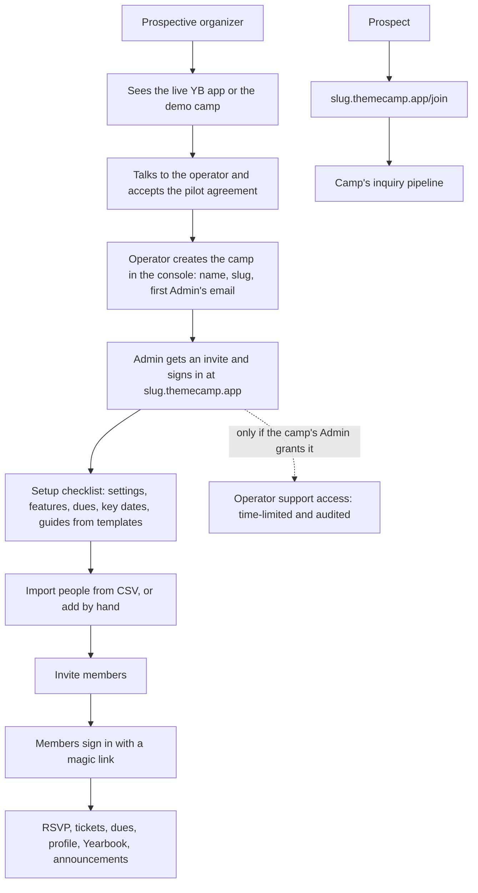

# Theme Camp App — V1 Requirements

## Problem Frame

The Yellow Balloon camp app (`../yellowballooncampapp`, live at `app.yellowballooncamp.com`) replaced the camp's planning spreadsheet for roster, Stewards Sale tickets, newcomer intake, dues, SAPs, volunteer roles and the Yearbook. Organizers of other Burning Man theme camps want the same thing, but they aren't technical enough to run their own copy, even if it were open source.

V1 is a **hosted, multi-camp version** of the app called **Theme Camp App**, at **`themecamp.app`**. **Kline Technology LLC** owns and operates it, and it's funded by donations.

**Yellow Balloon is the first camp on the platform.** The standalone Yellow Balloon app is retired rather than maintained as a separate fork. Its data moves to the platform in a one-off migration (R66), and `app.yellowballooncamp.com` redirects to Yellow Balloon's platform address (R3a). Only a small group of Yellow Balloon campers has been invited so far, for feedback. Nobody else is invited until Yellow Balloon runs on the platform. So the platform, not a fork running alongside it, gets proven by a real camp with real data through the 2027 Stewards Sale.

The pilot goal is **Yellow Balloon plus at least 2, and ideally 3–5, other camps of 20–100 people each**, collecting their 2027 Stewards Sale ticket requests in the app. Camps that miss that window start with the spring cycle and still count as pilots. During the pilot the operator creates each camp and onboards its organizer by hand. Self-serve camp signup and a larger public launch come no earlier than spring 2027, and may wait until 2028. The other pilot camps haven't been chosen yet. Recruiting starts now, in parallel with the build (R59, R69–R71).

## User Flow

## Requirements

**Camp isolation (the top security requirement)**

- R1. Every camp's data is visible only to that camp's members, according to their roles. No page, file, email, export, log view or error message may reveal another camp's data. This includes the fact that someone belongs to another camp.
- R2. Every camp-owned record carries its camp. The database enforces isolation itself, not only the app code. A record in one camp can never reference a record in another camp, and database-level row security acts as a backstop to the app's own checks.
- R3. Each camp has its own address, `<slug>.themecamp.app`. Sign-in sessions work only on the address where they were created, so being signed in at one camp gives no access at another. All camp subdomains count as the same site to the browser, so every state-changing request is checked against its exact origin, not only same-site cookie rules. A request for a host that isn't a known camp, the demo camp or the platform's own site is refused, and is never given a default camp.
- R3a. **Yellow Balloon's old address redirects.** `app.yellowballooncamp.com` redirects to `yellowballoon.themecamp.app`, keeping the path. The redirect is a Cloudflare redirect rule on the `yellowballooncamp.com` zone. The platform serves no custom domains in V1.
- R4. Uploaded files (Yearbook photos, SAP PDFs, camp logos) are stored per camp. Photos and PDFs are served only to active members of that camp, with the same rules as today: private, not cached by shared caches, and stored under keys that can't be guessed.
- R5. Every camp-scoped page and action is covered by automated cross-camp tests: a Lead or Admin of camp A gets "not found" for camp B's records on every route. These tests must pass in CI before any deploy. A route without a registered cross-camp test fails CI. This is a new check, modelled on the route-listing test in the Yellow Balloon app's `tests/authz/routes.test.ts`, which only checks how routes are structured and doesn't send them requests.
- R6. Rate limits and send limits apply per camp as well as per IP and per email, so one camp's traffic can't lock out another.

**Accounts and sign-in**

- R7. Sign-in stays passwordless and invite-only per camp. A camp sends a sign-in link only to an email that has a pending invite to that camp, or that belongs to an active member of it who has signed in before. The response looks the same, and takes the same time, whatever the case. That includes emails that belong to other camps. The "check your email" screen names the camp address the person is on, and says that if no email arrives they should check they're at their camp's address or ask their organizer.
- R8. One email address is one login across the platform. Each camp keeps its own **person record** for that login: name, playa name, phone, photo, directory choice and history. Nothing on a profile is shared between camps. A member of two camps sets up each profile separately.
- R9. A public "find my camp" page takes an email and sends that address a list of links to the camps where it's an active member or has a pending invite. The page responds the same way whether or not the email is known.
- R10. A member can leave a camp themselves, after a confirmation that says their photo will be deleted and they'll leave the directory. That deactivates them and deletes their photo in that camp. If they're the last active Lead, Treasurer or Admin (R11), leaving is blocked, and they're told to hand the role on first, with a link to where that's done. A Lead can invite someone who left back. A person can ask to delete their login, which removes them from every camp (R45).
- R11. Roles are unchanged and per camp: Member, Lead, Treasurer and Admin. The guards against removing the last active Lead, Treasurer or Admin stay.

**Creating camps and abuse controls**

- R12. **During the pilot, the operator creates camps.** In the console, the operator enters the camp name, the slug, and the first Admin's name and email. The app creates the camp and sends that person an invite. They become the camp's Admin, Lead and Treasurer when they accept it. Creating a camp is audited. There is no public signup page during the pilot.
- R12a. **Self-serve signup (larger launch).** From the larger launch, anyone can create a camp from the public site. Signing up requires:
  - the camp name, a slug, and the creator's name and email;
  - confirming the email with a link;
  - Turnstile;
  - confirming that it's a Burning Man theme camp;
  - accepting the Terms of Service and the Privacy Policy.

  The creator becomes the camp's Admin, Lead and Treasurer. Signups are rate-limited per IP and per email, and one email can create only a small number of camps (R15). Open signup is a platform setting the operator turns on, without a code change.
- R13. Slugs are unique and lowercase. System and look-alike names (`www`, `app`, `admin`, `support`, `mail`, `demo`, `burningman` and similar) are reserved. *(Larger launch:)* the operator can rename a slug, and links to the old slug redirect for a set period.
- R14. **New camps start with low sending limits (larger launch).** A new camp gets a small daily cap on invites, nudges and announcement emails, and a cap on total people. Limits rise automatically once a camp has been active for a while with low bounce and complaint rates, or when the operator raises them. Every limit sits comfortably above what a 100-person camp needs in a normal week. During the pilot, the operator sets each camp's limits by hand.
- R15. Signup rate limits, as described in R12a (larger launch).
- R16. The operator can suspend a camp. A suspended camp's members can still sign in (sign-in email is the one email still sent). They see a notice with a contact address, the camp is read-only, and Admins can still use the CSV exports. No other email is sent, and nothing is deleted. The operator can also restore a camp. Suspending or restoring a camp is audited, and the camp's Admins are told why.
- R17. Each camp page carries a short, plain statement: the camp runs it, Theme Camp App hosts it, and it isn't affiliated with Burning Man Project. *(Larger launch:)* the public site has a way to report a camp for abuse or impersonation.
- R18. Camps that go unused are cleaned up. After 12 months with no sign-ins, the camp's Admins are emailed. If nobody signs in within the following notice period, the camp is deleted as in R46.

**Camp settings, features and branding**

- R19. A camp's Admin manages:
  - the camp name;
  - an optional logo, from an allowed set of image types, re-encoded like profile photos;
  - an accent color, picked from a range that keeps text readable;
  - a contact email, used as the reply-to on camp emails;
  - the join page's intro text, as plain text;
  - who is notified about new inquiries.
- R20. Each feature can be switched on or off per camp. Switching one off hides its pages, emails and key dates but keeps its data.
  - Stewards Sale ticket requests and announcements are always available.
  - The Admin can switch these on or off:
    - dues;
    - the join page and inquiries;
    - the Yearbook and directory;
    - Setup Access Passes (SAPs);
    - volunteer roles;
    - elected positions.
  - A new camp starts with dues, the join page and the Yearbook/directory switched **on**, and SAPs, volunteer roles and elected positions switched **off**.
- R21. Each camp runs its own seasons. The camp's current season and its rollover work as today, but for that camp only.
- R22. Some Burning Man details are camp settings instead of fixed values: the maximum Stewards Sale tickets a camper can request (default 2), the dues payment methods (a list the camp edits), and the SAP days.
- R23. The operator enters each year's Burning Man event dates once, for the whole platform. They set sensible defaults for arrival and departure dates and for SAP days.
- R24. A new camp gets a **setup checklist**: settings, features, dues amount, key dates, guides, import people, and invite a first member. Each item links to where it's done.
  - Admins and Leads see it on the home page. Members never see it.
  - Each item ticks itself off when its condition is met: contact email set; features reviewed (the page has been saved once); dues amount set, or dues switched off; at least one key date; at least one guide published; at least one person imported or added; at least one invite sent.
  - It can be dismissed, and reopened from the Admin page. It disappears once every item is done.

**Camp features (carried over from Yellow Balloon)**

- R25. These work as they do in the Yellow Balloon app today, scoped to one camp and shown only when switched on:
  - people and invites (single and bulk), and the Lead queue;
  - RSVP and logistics;
  - the roster views and RSVP nudges;
  - Stewards Sale requests: campers request tickets and vehicle passes, Leads see the request board, lock requests, and export the list to send to Burning Man. There is no buyer/partner pairing and no purchase tracking;
  - SAP requests, decisions, passes and PDFs;
  - dues (seen only by the Treasurer);
  - the join page and inquiry pipeline;
  - profile, and self-service email change;
  - the Yearbook, past Yearbooks and the directory with its opt-out;
  - volunteer roles;
  - elected positions;
  - export to CSV;
  - the sign-in log, per-person history and the Activity page.
- R26. All text that names Yellow Balloon, a sober camp, or Yellow Balloon's own practices is removed from the code. Where it's needed, the camp's name and settings are used instead. Wording that only suited Yellow Balloon moves into Yellow Balloon's own guides and email wording on the platform (R66).
- R27. The app doesn't collect recovery, health or sobriety history for any camp. The join form keeps asking people not to share it, and the guidance for camps says the same.

**Announcements and key dates (new for the pilot)**

- R61. **Announcements.** Any Lead can post an announcement to the camp's home page. It has a title, a plain-text body, and an expiry date (required, up to a maximum). When the expiry date passes, the announcement comes off the home page automatically. Any Lead can edit or remove any current announcement. Active members see current announcements, newest first. Posting, editing and removing announcements is audited.
- R62. **Optional announcement email.** When posting, a Lead can tick "also email all active members of this season". The email is sent once, is plain text, and counts against the camp's send limits. Links and web addresses are stripped from the body. The only link is a system link to read the announcement on the camp site, following the same rule as R35. On the home page, the announcement can show `https` links, and each one is displayed with its full address. Before sending, the Lead sees a preview of the email exactly as it will go out, a warning if any links will be stripped, and the number of recipients. They then confirm. The announcement shows that it was emailed, and when. Editing an announcement after it's been emailed doesn't send it again.
- R63. **Key dates.** Leads can add key dates for the season. Each has a label and a date, and can be linked to an action: ticket requests close, dues due, or RSVP by. Upcoming key dates show on the home page. A date linked to an action can send an optional reminder, a few days before the deadline, to active members who haven't done that action yet. Reminders use the RSVP nudge's rules and send limits. A date linked to a feature that's switched off is hidden.
- R64. When a key date linked to ticket requests passes, the app doesn't lock requests automatically. It reminds Leads to lock them. *(Keeps the lock a deliberate Lead action, as today.)*

**Home page and new screens**

- R72. The camp home page shows, in this order:
  1. system notices: suspended, demo, and the first-sign-in privacy notice (R51);
  2. the member's own open actions: RSVP, ticket request, dues owed;
  3. current announcements (R61);
  4. upcoming key dates (R63);
  5. for Admins and Leads only, the setup checklist (R24) until it's done or dismissed.

  A block with nothing to show is left out, except the member's own actions, which say "You're all set" when there's nothing to do.

  *Amended 2026-09-30 (Lead workspace plan, Unit 7):* Leads and Admins see the home page as two views. **Overview** is where they land: the camp's open items, each linking to its list, then the setup checklist, announcements and key dates. **My participation** shows their own actions and cards, plus announcements and key dates, with a count on its tab when they have something to do. System notices stay above both. Members' home page is as above.
- R73. New screens follow the Yellow Balloon app's phone-first layout and accessibility baseline. CSV import and the operator console may be designed for desktop first, but must still work on a phone. The accent color picker (R19) enforces WCAG AA contrast.

**Guides**

- R28. Guides are stored per camp and edited in the app by that camp's Admins and Leads. They are written in Markdown and have a preview, the same three visibility levels (public, members, Leads), an order, and a draft/published status. Every edit is audited.
- R29. Guide content is sanitized on the server. Raw HTML isn't rendered, and links may only be relative paths or `https` URLs. Public guides are the only camp content anyone can see without signing in.
- R30. The platform has a small **starter guide library** that a camp can copy and then edit: Welcome, Tickets & the Stewards Sale, Arrival/build/strike, Dues, SAPs, Volunteering, and a Lead handbook. The starters are general versions of the Yellow Balloon guides, rewritten without Yellow Balloon specifics. An organizer picks which starters to copy, and the copies start as drafts.

**Import and onboarding**

- R31. A Lead can import people from a CSV file. The columns are name, playa name, email, phone, home location, and past years attended. The import shows a preview before anything is saved: rows it will create, likely duplicates of existing people, shared emails, and bad or missing values. It also has a downloadable template.
  - For each likely duplicate, the Lead chooses: skip the row, or update the existing person.
  - A row with no name is skipped. A bad value (for example a malformed phone number) is imported blank and flagged.
  - Values can't be edited in the preview. To fix them, the Lead edits the spreadsheet and uploads it again.
  - After the import, a summary shows how many people were created, updated, skipped and not yet invitable, with a link to the people who need fixing (R33).
- R32. Nothing is written until the Lead confirms. Each import is one audited batch. Re-importing the same file doesn't create duplicates. A camp Admin can undo a batch within a limited period, as long as its people haven't been invited yet.
- R33. People without an email, or who share one, are imported but aren't invitable until a Lead fixes them. This is the same rule as today.

**Email**

- R34. All email is sent from the platform's domain, with the camp's name as the display name ("Camp Name via Theme Camp App"). The reply-to is the camp's contact email. Each email says which camp sent it, and why the person is receiving it.
- R35. Camp Admins can edit the wording of the editable emails, as today. Edited wording **can't contain links or web addresses**; the only link is the system's `{link}` placeholder. The sign-in email can't be edited.
- R36. Hard bounces and spam complaints automatically stop further email to that address, across the platform. A camp whose bounce or complaint rate passes a threshold has its sending paused, and the operator is alerted.
- R37. Visitor-typed text is still never included in an email or a notification.

**Operator and support access**

- R38. The operator (and anyone the operator adds later) has a platform console. It lists camps with their slug, name, created date, member and invite counts, emails sent, bounces and complaints, last activity, sending limits and status. It shows **no member names, contact details, notes or other camp content**. The operator creates camps (R12), sets their limits, and reads feedback (R65) from the console.
- R39. The operator sees a camp's contents only when that camp's Admin grants **support access** from the camp's Admin page. A grant has a short expiry, chosen by the Admin up to a maximum, and is read-only unless the Admin also allows changes. The Admin can revoke it at any time. *(2026-09-29: the pilot ships read-only grants; "allow changes" is deferred until a pilot needs it.)*
  - The grant form offers preset durations (for example 1 hour, 1 day or 3 days) up to the maximum. It's read-only by default, and "allow changes" is a separate, explained option.
  - While a grant is active, the camp's Admins see a banner with its end time and a Revoke button.
- R40. Every page the operator views and every change the operator makes under a grant is recorded in the camp's own Activity log, which the camp's Admins can see. Operator entries are clearly labelled, and the log can be filtered to show only them. The camp's Admins are emailed when a grant starts and when it ends.
- R41. Operator accounts are separate logins, with their own email, and are never a camp member's login. They work only on the operator console's host, and they need a stronger sign-in than a magic link alone. The operator signs in through Cloudflare Access, using an identity provider that requires MFA. Operator actions in the console are audited.
- R42. Direct database access by the operator happens only in an emergency, is logged in an operator log, and is described honestly in the Privacy Policy. Day-to-day operations never need it. The one-off Yellow Balloon migration (R66) is done with Yellow Balloon's consent as its own camp, and is logged the same way.
- R42a. The operator's own membership of a camp (they're a member of Yellow Balloon) is an ordinary camp membership, on their normal login and separate from their operator login (R41). It gives them no extra access to other camps. Their operator access to that camp follows the same grant rules as any other camp. As one of its Admins they can grant it to themselves, and that grant shows in the camp's Activity log like any other.
- R74. *(Added 2026-09-29.)* The operator console also shows **how each camp uses the app**, over time and for all camps together: successful and failed sign-ins (by reason), how many members were active in the last 7 and 30 days, which features are used and how often (RSVPs, ticket requests, dues, invites, photos, SAPs, volunteering, guides, announcements, the join form, and so on), page views by area, and problems (server errors, errors in the browser, and email that failed or was held back). Like the rest of the console (R38), these are **numbers only**: never a member's name, email, an id from a page address, an error message's text, or anything a camp wrote. The Privacy Policy says that aggregate usage is collected, and why.

**Feedback and the demo camp (new for the pilot)**

- R65. **In-app feedback.** Every signed-in page has a "Send feedback" link. The member types a message, and the app attaches the camp slug, the page's path (without record IDs), the member's role and the time. It sends nothing else from the camp. Feedback appears in the operator console as plain text, never rendered as HTML or Markdown, and the operator gets an email that contains only a link to it (R37). The form tells the member that the operator will read it and asks them not to include other people's personal details. The member gets a confirmation email. *(First to slip:)* until stored feedback ships, the link opens an email to the contact address, pre-filled with the camp slug and the page.
- R67. **Public demo camp.** `demo.themecamp.app` is a camp filled with fictional people, seasons, requests, dues, guides and announcements. Anyone can open it without an invite and choose to view it as a Member, Lead or Admin.
  - It's read-only. Forms are shown, but saving is disabled, and a banner explains this is a demo. The server enforces read-only, not only the page: every write, email and upload for the demo camp is refused on the server.
  - It never sends email and never accepts file uploads.
  - A demo session is a separate kind of session. It is valid only on the demo camp and is never tied to a real login. The cross-camp tests (R5) include demo sessions against real camps.
  - The demo's data can be regenerated from a script at any time.
  - The public landing page links to it.
  - *(First to slip:)* choosing a role. Without it, the demo opens as a Lead.

**Data rights, export, deletion and retention**

- R43. *(Larger launch:)* A camp Admin can export all of the camp's data at any time, as CSV plus the photos and PDFs, in one download. The export is audited. **During the pilot:** Admins use the per-feature CSV exports (R25). The operator produces a full export when a camp's Admin asks for one, under a support grant from that Admin. The export is delivered inside the app, never by email.
- R44. *(Larger launch:)* A camp Admin can delete the camp. They must type the camp's name to confirm, and there is a 30-day grace period during which the operator can restore it on request. After that, all of the camp's records and files are permanently deleted. Encrypted backups age out on their normal schedule, which the Privacy Policy states. **During the pilot:** the operator deletes a camp when its Admin asks, with the same 30-day grace period and the same permanent deletion.
- R45. A person can ask for their login to be deleted. The operator can do this without a support grant, because it concerns only that person's login and their person records. A camp's audit entries about the person stay, with their name replaced by "a deleted member".
- R45a. During the pilot, any request to the operator for an export (R43), a camp deletion (R44) or a login deletion (R45) is acted on only after the requester confirms it. They confirm from their signed-in account, or through a confirmation link sent to that account's email. An email or conversation alone isn't enough.
- R46. Deleting an unused camp (R18) follows R44.
- R47. Retention runs automatically in every camp:
  - declined inquiries are anonymized after 12 months (today this is a manual SQL step);
  - sign-in log entries are kept for 90 days;
  - photos are deleted when a member is deactivated;
  - feedback (R65) is kept for 12 months.

**Donations**

- R48. The public site and each camp's Admin area have a "Support Theme Camp App" link to an outside donation page. The platform processes no payments. No feature, limit or level of support depends on donating. Camp dues are still only recorded, never processed. Because the operator is an LLC and not a nonprofit, the donation page doesn't call donations tax-deductible.

**Legal and policy**

- R49. The platform is owned and operated by **Kline Technology LLC**, which is named as the operator in the Terms of Service and Privacy Policy. It publishes Terms of Service, a Privacy Policy, an abuse and contact address, and a short description of how data is handled. **For the pilot**, these are plainly written drafts. A legal review happens before the larger launch.
- R50. The documents make the roles clear:
  - each camp decides what it collects and who it invites;
  - the platform stores and processes that data for the camp;
  - the operator doesn't read camp data without a support grant.
- R51. On their first sign-in to a camp, a member sees a short privacy notice. It says who can see what: camp members, Leads, the Treasurer, and the operator only with a grant.
- R52. The product is called **Theme Camp App**. The name and branding don't use Burning Man Project trademarks.
- R68. **Pilot agreement.** Each pilot camp's first Admin accepts a short pilot agreement before the camp is created. It says:
  - the service is a free pilot with best-effort support;
  - data is handled as the Privacy Policy describes;
  - features may change;
  - the camp can get a full export (R43) and deletion (R44) at any time.

  Acceptance is recorded with the camp.

**Operational safety**

- R53. The platform has a **staging environment** with only fictional data, and every change runs there before production. This reverses the Yellow Balloon app's production-only decision, because the platform holds other organizations' data. Staging and production have separate secrets, databases and file buckets, and staging can't reach production data. Secrets are never stored in the repository.
- R54. Production uses a least-privileged database role, an append-only audit log, a snapshot before every migration, daily encrypted off-provider backups, and a regular restore drill. These are the same as today, applied to the whole platform.
- R55. Errors, sign-in failures, sending rates and bounce rates are monitored, and the operator is alerted. *(Before the larger launch:)* each year's peaks are expected and load-tested for: the Stewards Sale (January–February) and pre-burn logistics (July–August), when every camp is busy at once.
- R56. There is one production deployment and one database for all camps. Deploys go through CI with the full test suite, including the cross-camp tests (R5).

**Yellow Balloon migration**

- R66. Yellow Balloon's live data moves into the platform as its own camp in a **one-off, assisted migration**, not a product feature. The data covers people, seasons and 2024–2025 history, participation, inquiries, ticket requests, dues, SAPs, roles, positions, the Yearbook and photos, guides, email wording, and the audit history.
  - The migration is rehearsed on a copy that is kept away from staging, since staging holds only fictional data (R53). The copy is encrypted, kept only on storage the operator controls, never connected to staging or CI, and destroyed after the cutover, and its destruction is logged. Record and file counts are checked against the source.
  - It runs after a production snapshot.
  - Yellow Balloon's guides and email wording keep their Yellow Balloon-specific text as that camp's own content.
  - The few campers already invited sign in again on the platform. Their old address redirects there (R3a).
  - After the cutover is verified, the standalone app is taken down and its provider keys and tokens are revoked. Its database is kept as an encrypted backup for a set period, then deleted.

**Pilot program**

- R69. Each non-YB pilot camp commits to:
  - collecting its 2027 Stewards Sale ticket requests in the app, instead of a form or spreadsheet;
  - naming one organizer, who joins short check-in calls at onboarding, after the Stewards Sale, and before the burn;
  - accepting the pilot agreement (R68).

  Before a camp is chosen, it confirms that it collects Stewards Sale requests from its own members, the way the app does.
- R70. The first other pilot camp is onboarded on its own. Once it has invited its members without needing fixes that block it, the rest can be onboarded in parallel.
- R71. During the pilot, the public site at `themecamp.app` has:
  - a landing page that explains the pilot and that camp creation is by arrangement;
  - a contact address;
  - a link to the demo camp (R67);
  - the legal pages.

  It has no signup page.

**Release priority**

- R57. **Release gates.**
  - **Gate A: must ship before Yellow Balloon cuts over.**
    - camp isolation: R1–R6;
    - accounts and sign-in: R7, R8, R10, R11;
    - suspension: R16, and R17's statement that the camp runs its page and isn't affiliated with Burning Man Project;
    - settings: R19–R22;
    - the carried-over features: R25–R27;
    - the home page, and announcements and key dates without their emails: R61, R63 (display only), R64, R72, R73;
    - guides: R28, R29;
    - email: R34–R37;
    - the console and operator sign-in: R38, R41, R42, R42a;
    - privacy and legal: R49–R52;
    - operational safety: R53, R54, R56, and R55's monitoring and alerts;
    - the Yellow Balloon migration and redirect: R66, R3a.
  - **Gate B: must ship before the first other pilot camp is onboarded.**
    - support access: R39, R40. YB's only Admin is the operator, so grants add nothing for YB;
    - pilot-period export and deletion: R43–R45a in their pilot form;
    - operator-created camps: R12, R13 (reserved names only);
    - the setup checklist: R24;
    - starter guides: R30;
    - CSV import: R31, R33, and R32 without undo;
    - the pilot agreement: R68;
    - the demo camp, without role choice: R67;
    - the pilot public site: R71.
  - **First to slip.** These are planned before the first other pilot, but they're the first to move to R58 if Gate A or Gate B is at risk:
    - the announcement email: R62;
    - key-date reminders: part of R63;
    - stored feedback in the console: R65, with the email fallback in the meantime;
    - choosing a role in the demo: part of R67.
- R58. **Can follow shortly after the first pilots:**
  - "find my camp": R9;
  - unused-camp cleanup: R18, R46;
  - event dates set by the operator: R23;
  - import undo: part of R32;
  - automatic retention: R47;
  - the donation link: R48.
- R59. **Pilot, before January 2027.** Timeline:
  - recruiting starts now (late September 2026), showing the live Yellow Balloon app, with a goal of at least 2 verbal commitments by the end of October;
  - the demo camp (R67) is up by early November, for camps that want to click around;
  - Gate A runs on staging by mid-November;
  - Yellow Balloon cuts over by late November and invites its campers;
  - the first other pilot camp is onboarded in early December, after Gate B ships, and the rest follow in parallel (R70), in time for their 2027 Stewards Sale requests.

  **Yellow Balloon's fallback date is December 1.** If Yellow Balloon hasn't cut over by then, it invites all its campers on the standalone app for the Stewards Sale, and the migration moves to after the sale. Pilot camps that miss the Stewards Sale window start with the spring RSVP, dues and SAP cycle.
- R60. **Larger launch: no earlier than spring 2027, and possibly not until 2028.** Before promoting `themecamp.app` more widely:
  - the pilots have run through at least the 2027 Stewards Sale, and ideally a full season;
  - their feedback is addressed;
  - the legal review is done;
  - the R58 items are all shipped;
  - these are shipped:
    - self-serve signup and its rate limits: R12a, R15;
    - slug rename: R13;
    - automatic send limits: R14;
    - R17's way to report a camp;
    - self-serve full export and deletion: R43, R44;
    - peak load testing: R55;
    - operator-configured custom domains, if any camp needs one;
  - then open signup is switched on.

## Success Criteria

- Yellow Balloon runs its 2027 Stewards Sale on the platform, with no loss of data from the standalone app.
- At least 2 other pilot camps (goal: 3–5) collect their 2027 Stewards Sale ticket requests in the app. Over the season, they run their roster and dues in the app instead of a spreadsheet.
- A pilot organizer, with a short onboarding call and no other technical help, sets up their camp, imports their people and invites a first member in under an hour. *(Unassisted, under an hour, is the bar for the larger launch.)*
- No member of any camp ever sees another camp's data. The cross-camp tests cover every route, an automated check confirms that queries with no camp or the wrong camp set return nothing, and no such exposure is ever reported.
- The operator never views a camp's member data without a grant, and every grant shows in that camp's Activity log.
- Email from the platform keeps a healthy sender reputation, with no camp's sending blocking another camp's sign-in emails.
- Each pilot organizer, at the post-Stewards Sale check-in, says they'd use it again next season.
- Running the platform takes a few hours a week outside the peak seasons.

## Scope Boundaries

- **Burning Man (Black Rock City) only.** Regional burns, with their own ticket programs, come later.
- **One codebase.** The platform is a new repository forked from the Yellow Balloon app. The standalone app stops being developed and is retired after Yellow Balloon's migration (R66).
- No buyer/partner ticket pairing or ticket purchase tracking. Tickets are a request list (R25).
- No payment processing: not for dues, and not in-app donations.
- No custom domains. Every camp, Yellow Balloon included, uses `<slug>.themecamp.app`. Yellow Balloon's old address redirects there (R3a).
- No discovery between camps. There is no public list of camps and no shared directory, and a member can't see which other camps someone belongs to.
- Out of scope, as in the Yellow Balloon V1:
  - passwords or social sign-in;
  - a native mobile app and offline mode;
  - events and WWW listings;
  - inventory and maps;
  - newsletters, or bulk email beyond invites, nudges, key-date reminders and announcements (R62).
- English only.
- No sample data in production, other than the clearly marked demo camp (R67). Staging uses only fictional data.

## Key Decisions

- **Yellow Balloon becomes camp #1, not a parallel fork.** This avoids making every fix twice through the same Stewards Sale, and makes Yellow Balloon's real data the hardest test the platform gets. YB campers aren't invited any further until the cutover, so they only ever learn one app.
- **YB's old address redirects; no custom domains in V1.** Only a few YB campers have been invited, and they sign in again anyway. Serving a custom hostname would have added critical-path work (a second session origin and host setup) for little gain.
- **Three release tiers.** Gate A is the minimum for Yellow Balloon's cutover. Gate B is what other camps need. A named first-to-slip list protects both dates.
- **A fallback date for Yellow Balloon (December 1).** Yellow Balloon's own Stewards Sale doesn't depend on the platform being on time.
- **A separate operator login, through Cloudflare Access.** The operator never uses a camp member's login, so a plain magic link to a camp email never carries operator access. Access with an MFA identity provider meets R41 without building a second sign-in system.
- **Support access and data rights ship in Gate B.** They matter once a camp other than the operator's own has data on the platform, and moving them shortens the path to YB's cutover.
- **The first pilot onboards alone, then the rest in parallel.** Success is measured by ticket requests collected in the app, not by camps onboarded.
- **Recruiting starts now, not after the demo.** Demand gets tested while there's still time to change scope.
- **Operator-created camps for the pilot.** A self-serve signup page, Turnstile, email confirmation and invite codes all wait until the larger launch. With the operator onboarding each camp by hand, they would add build time without serving the pilot.
- **Tickets are a simple request list.** Yellow Balloon has already dropped buyer/partner pairing, and a request list matches more camps.
- **Announcements are one feature with an optional email.** Posts expire automatically. The email version strips links, following the same anti-phishing rule as edited email wording (R35).
- **The pilot trims self-serve export, deletion and load testing.** The operator handles export and deletion on a confirmed request (R45a), under the same guarantees. At pilot scale, monitoring replaces load testing.
- **The name is Theme Camp App, and it matches the domain.**
- **Plain legal drafts and a pilot agreement are enough for the pilot.** A legal review comes before the larger launch.
- **A public demo camp** lets organizers see the app before they commit. It's read-only, so it needs no moderation or clean-up.
- **One shared database, with isolation enforced by the database.** This is cheaper and simpler to run for tens of small camps than a database or deployment per camp. Database-level row security backs up the app's checks. Because Hyperdrive reuses database connections, the camp has to be set per transaction, never per connection.
- **A subdomain per camp, with sessions that stay on it.** Each camp is its own browser origin, which limits the damage from a flaw in camp-written content, and makes "signed in at camp A" mean nothing at camp B. Subdomains are still the same site, so state-changing requests check the exact origin (R3).
- **One login, a separate person record per camp.** People really do belong to more than one camp, and camps shouldn't learn about each other's members. A separate login per camp was considered and rejected. It would avoid a shared user table, but it would split one person's login across camps, and merging logins later means matching them by email.
- **Donations, not fees.** No billing system, and nothing gated on donating.
- **Operator access only with the camp's permission.** Support access is granted, time-limited, and visible to the camp. The console shows only counts, never member data.
- **Guides move into the database.** Organizers can't edit files in GitHub. A starter library gives them a head start.
- **Staging is required.** The Yellow Balloon app's production-only choice doesn't hold once the data belongs to other organizations.

## Dependencies / Assumptions

- **Kline Technology LLC** owns the platform, its accounts and its data-processing obligations (R49). Provider accounts, the donation page and the legal documents are in the LLC's name.
- **`themecamp.app` and `yellowballooncamp.com` are both in the operator's Cloudflare account**, which has Workers Paid. DNS, the Workers, R2, Images, Turnstile and Hyperdrive for the platform all live in that account, and the camp subdomains (`*.themecamp.app`) are served through it. Separate accounts aren't needed: isolation between camps comes from the database and host routing. `app.yellowballooncamp.com` redirects to the platform through a rule on its own zone (R3a). The platform's CI token is limited to the themecamp zones for routes. Its account-wide Workers Scripts permission could also touch the standalone YB Worker until that is retired, which is accepted. `.app` domains are HTTPS-only in browsers, which the platform needs anyway.
- **Staging runs on `themecamp.dev`** (registered, in the same account). Staging camps are `<slug>.themecamp.dev`. It uses only fictional data (R53).
- The same providers as the Yellow Balloon app, in new accounts or projects owned by the LLC: Cloudflare Workers, R2, Images and Turnstile; Neon Postgres through Hyperdrive; Resend; and GitHub Actions. The platform needs paid tiers once pilots run (roughly tens of dollars a month at pilot scale), paid for from donations or by the operator.
- A Resend sending domain on `themecamp.app` can send for every camp. This needs checking against current Resend limits.
- The standalone Yellow Balloon app stays live, and no more campers are invited to it, until the cutover. If YB hasn't cut over by December 1, the standalone app is the fallback for YB's 2027 Stewards Sale (R59).
- Pilot camps are Burning Man theme camps of 20–100 people, and each has one organizer willing to give feedback.
- The 2027 Stewards Sale is assumed to fall around January–February 2027, as in 2026. This hasn't been confirmed against Burning Man's 2027 ticketing announcements.

## Outstanding Questions

### Resolve Before Planning

(none)

### Resolve Before the First Non-YB Pilot

- [Affects R69][User decision] Which camps to approach. Start now, with at least 2 verbal commitments by the end of October (R59).
- [Affects R59, R69][Needs research] Confirm the 2027 Stewards Sale dates, and each candidate camp's deadline for requests from its own members, against Burning Man's 2027 ticketing announcements.
- [Affects R48][User decision] Donation provider for an LLC (for example Stripe Payment Links, Ko-fi, or GitHub Sponsors). Not blocking: the donation link is in R58.

### Resolve Before the Larger Launch

- [Affects R49–R51][Needs advice] Legal review of the Terms of Service and Privacy Policy, and whether campers in the EU or UK change the obligations.

### Deferred to Planning

- [Affects R2][Technical] How row-level security and a per-transaction camp setting work with Hyperdrive and Drizzle. How to wrap each request's queries in a transaction, and what that costs in speed. How the camp setting applies to work done after the response through `ctx.waitUntil` (emails, the send log, sign-in events), and to Better Auth's own queries on the shared user, session and verification tables. Whether queries with no camp set are denied by default.
- [Affects R18, R44, R47, R63][Technical] Scheduled jobs: key-date reminders, the 30-day deletion, retention and unused-camp cleanup all need them, and the Yellow Balloon Worker has none today. Which database role these jobs use across camps without weakening row-level security.
- [Affects R21, R23, R66][Technical] How the single-camp season model (`burn.year` unique, `current_year()`, the `app_setting` keys, global unique constraints) splits into platform event years and per-camp seasons.
- [Affects R3, R7–R9][Technical] Better Auth with per-camp hosts: its base URL and trusted origins per request, cookies bound to one host, and one user table shared by many camps. Where the operator console and "find my camp" live (`themecamp.app`, `www.themecamp.app`, or a separate domain for the console), and making sure no cookie is set for the whole domain.
- [Affects R14, R36][Technical] The pilot's per-camp limits, the bounce and complaint thresholds, and how the sending pause works. How bounce and complaint events arrive from Resend (a signed webhook outside the camp hosts), how each is mapped back to its camp, and what happens when a webhook is missed.
- [Affects R3, R53][Technical] The staging hostname scheme for per-camp subdomains, and the certificate it needs. A second-level wildcard isn't covered by Universal SSL.
- [Affects R39–R41][Technical] How support access works inside a camp for the separate operator login (R41), and which sign-in method the operator uses. Which actions a grant that allows changes can take (for example, whether it can change roles or the camp's reply-to address).
- [Affects R34, R36][Technical] Whether sign-in email goes out on a separate sending subdomain or stream from invites, announcements and reminders, so that one camp's complaints can't hurt sign-in delivery.
- [Affects R61–R63][Design] The maximum announcement lifetime, how many announcements show at once, and when key-date reminders are sent (how many days before, and whether there's one reminder or more).
- [Affects R66][Technical] The migration's mapping from the YB schema to the platform schema, how R2 photos are copied, and how YB's audit history keeps its actors.
- [Affects R67][Technical] How demo sessions are issued without an invite, while keeping R3 and R7 intact for real camps. How server-side read-only is enforced for the demo camp without breaking its own session writes. How the demo's fictional data is generated.
- [Affects R20][Design] What each page shows when a feature is off.
- [Affects R31][Design] The CSV column aliases, and how past years attended map to past seasons.
- [Affects R28–R30][Technical] The Markdown editor, preview, and sanitization library.
- [Affects R44, R46][Technical] How deletion is scheduled, and how files in R2 are deleted.
- [Affects R55][Technical] Which monitoring and alerting tools to use, and whether to have a status page.
- [Affects R71][Design] The landing page and legal pages, written for non-technical organizers.
- Later: regional burns, custom camp domains, and optional passkeys for camp Admins.

## Next Steps

→ `/ce:plan` for structured implementation planning. Recruiting starts in parallel now. Build order:

1. Camp isolation and staging.
2. Settings, removing Yellow Balloon wording, guides in the database, and the home page.
3. The console, support access with the separate operator login, pilot-period export and deletion, and monitoring. Gate A on staging by mid-November.
4. The Yellow Balloon migration and redirect. Cutover by late November, or fall back on December 1.
5. Gate B: operator-created camps, import, the checklist, starter guides, the pilot agreement, the landing page and the demo camp. Then onboard the first pilot camp in early December.
6. The first-to-slip items, as time allows.
