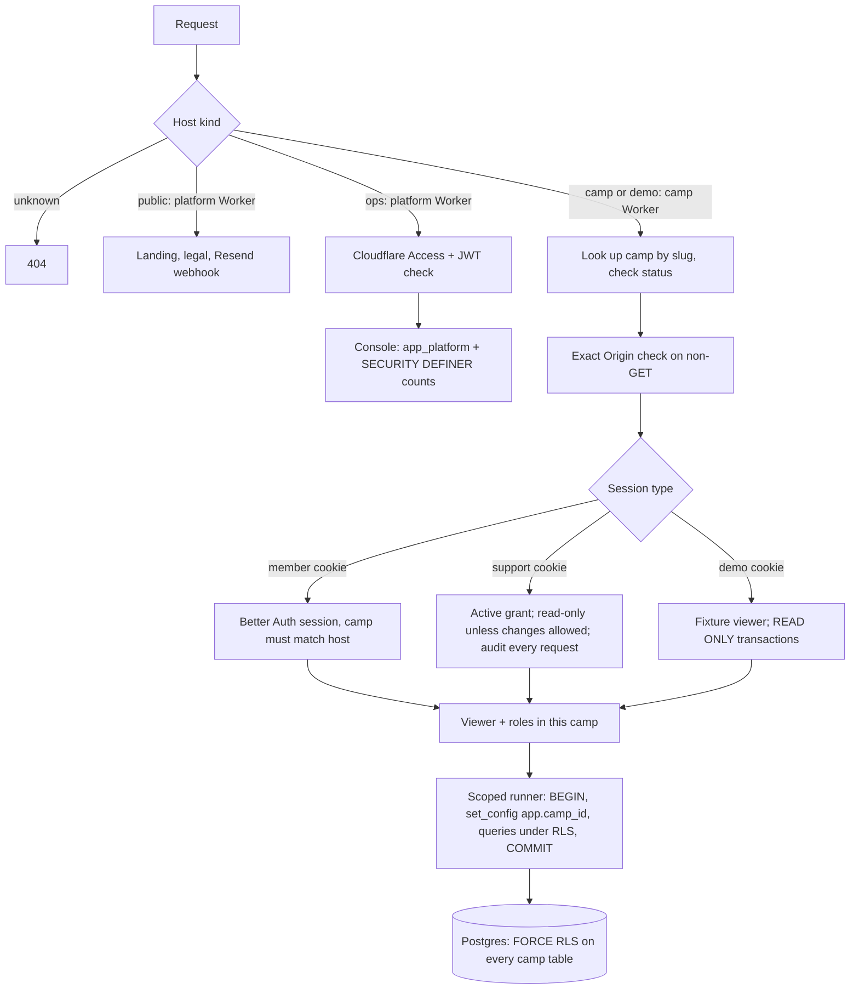
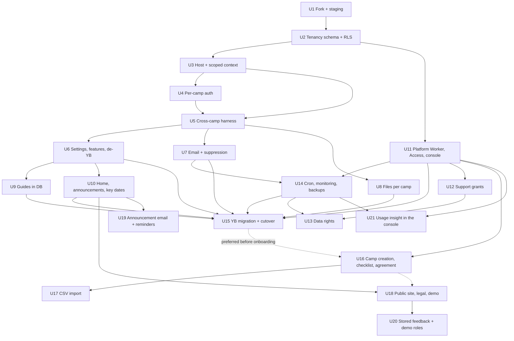

# feat: Theme Camp App multi-camp platform (pilot)

**Target repo:** `themecampapp` (this repo). It starts as a copy of the Yellow Balloon app (sibling repo `yellowballooncampapp`). All paths below are relative to this repo after the fork. `YB:` marks a path in the Yellow Balloon repo.

## Overview

Turn the single-camp Yellow Balloon app into a hosted platform where each Burning Man theme camp gets `<slug>.themecamp.app`. There are two Workers and one Neon database, and the database itself enforces isolation between camps:
- the **camp Worker** serves every camp and the demo;
- the **platform Worker** serves the public site, the operator console (behind Cloudflare Access), the Resend webhook and scheduled jobs. Yellow Balloon moves in as the first camp. Then 3–5 pilot camps are onboarded by hand before their 2027 Stewards Sale.

The work ships in three tiers (origin R57):
- **Gate A (U1–U11, U14, U15):** everything the Yellow Balloon cutover needs. On staging by mid-November; cutover by late November; YB falls back to the standalone app on December 1.
- **Gate B (U12, U13, U16–U18):** what the first other pilot camp needs, in early December. That includes support grants and pilot data rights: YB's only Admin is the operator, so these matter once another camp's data arrives.
- **First to slip:** items that can move later if either gate is at risk.
- **Pilot insight (U21, added 2026-09-29):** usage data for the operator, without names. Not needed by either gate; it can start any time after U11 and U14, and is most useful once pilot camps are active.

## Problem Frame

Organizers of other camps want the Yellow Balloon app, but can't run their own copy. The platform must let a non-technical organizer run a season without help, while guaranteeing that one camp never sees another camp's data. That guarantee covers the operator too, who sees a camp's data only with that camp's time-limited permission. (See origin: docs/brainstorms/2026-09-28-multi-camp-platform-requirements.md.)

## Requirements Trace

All requirement IDs refer to the origin document.

| Area | Requirements | Units |
|---|---|---|
| Isolation | R1–R6 | U2, U3, U5, U8 |
| Sign-in | R7, R8, R10, R11 (R9 is in R58) | U4 |
| Camp lifecycle and abuse controls | R12, R13, R16, R17 (R12a, R14 automatic limits and R15 are larger-launch) | U6, U7, U16 |
| Settings | R19–R22, R24 (R23 is in R58) | U6, U16 |
| Carried-over features | R25–R27 | U6, U7 |
| Announcements and key dates | R61, R63 display, R64 → U10 · R62, R63 reminders → U19 (first to slip) | U10, U19 |
| Home page and new screens | R72, R73 | U10 |
| Guides | R28–R30 | U9 |
| Import | R31–R33 | U17 |
| Email | R34–R37 | U7 |
| Operator and support access | R38–R42a | U11, U12 |
| Feedback and demo | R65, R67 | U18, U20 |
| Data rights (pilot form) | R43–R45a (R46, R47 are in R58) | U13 |
| Legal | R49–R52, R68 | U16, U18 |
| Operational safety | R53–R56 | U1, U14 |
| YB migration and redirect | R66, R3a | U15 |
| Pilot program | R59, R69–R71 | U16, U18; recruiting is outside the code |
| Usage insight for the operator | R74 (added 2026-09-29) | U21 |

**Success criteria** (origin):
- Yellow Balloon's Stewards Sale runs on the platform.
- At least 2 other camps collect their ticket requests in the app.
- Setup takes under an hour, with an onboarding call.
- There is no cross-camp exposure, and an active check proves it.
- The operator views camp data only under a grant.
- Sign-in email stays healthy.
- Running the platform takes a few hours a week.

## Scope Boundaries

Carried from the origin:
- Black Rock City only.
- No payments.
- No custom domains; YB's old address redirects.
- No discovery between camps.
- No passwords or social sign-in, no native app or offline mode, no events or WWW, no inventory or maps, no newsletters.
- English only.
- No buyer/partner ticket pairing.
- Self-serve signup, self-serve export and deletion, automatic send limits, slug rename, abuse reports and load testing are larger-launch items. This plan leaves room for them but doesn't build them.
- R58 items are named under Phased Delivery but aren't planned in detail: find my camp (R9), unused-camp cleanup (R18/R46), operator event dates (R23), import undo, automatic retention (R47) and the donation link (R48).

## Context & Research

### Relevant Code and Patterns (Yellow Balloon repo, carried over by the fork)

- **Stack:**
  - React Router 8.4 (SSR) on Workers via `@cloudflare/vite-plugin`, React 19, Tailwind 4, TypeScript 5.9, Biome.
  - drizzle-orm 0.45, postgres-js 3.4.9 through Hyperdrive with caching off.
  - Better Auth 1.7.6 with magic links; Resend through `fetch`; R2 and Images.
  - Vitest 4 with Miniflare/workerd request tests against a throwaway Postgres (`tests/helpers/db.ts`, `tests/helpers/worker.ts`). There are 293 tests.
- **Request plumbing:**
  - `workers/app.ts` builds the `CloudflareContext` (`deferred[]`, `cleanup[]`) and applies `withSecurityHeaders`.
  - `app/lib/context.server.ts` provides `defer()`.
  - `app/lib/db.server.ts` creates one postgres-js client per request (`max: 5`, `prepare: true`).
  - `app/lib/access.server.ts` provides `resolveViewer`, `requireMember`, `requireLead`, `requireAdmin` and `assertSameOrigin`.
  - The layout middleware lives in `app/routes/_app.tsx`, `_app.lead.tsx` and `_app.admin.tsx`.
- **Single-camp assumptions to remove:**
  - `burn.year` is unique, and the `current_year()` SQL function reads the single `app_setting` row.
  - `app_setting.key` is the primary key. `camp_position.title` and `import_record.source_key` are unique platform-wide, and `person_auth_user_ux` enforces one person per login.
  - The `APP_URL`, `MAIL_FROM` and `LEAD_NOTIFY_EMAILS` environment variables.
  - R2 keys are platform-wide.
  - `lead_queue_item.auth_user_id`.
  - The header counts in `_app.tsx` aren't scoped.
  - The `burn` and `current_year` seed rows in migrations `0001`, `0003` and `0006`.
  - "Yellow Balloon" appears 73 times in 46 files; `app/lib/email-templates.ts` alone has 16.
- **Raw SQL** in `activity`, `history`, `export`, `nudge`, `allowlist` and `photos` wouldn't pick up an app-level filter. Row-level security has to cover it.
- **Import pattern to reuse** (`scripts/import-2026/`, `scripts/import-history/`): hash the source, write a report, record decisions, validate everything, apply in one transaction, and use `import_record` for idempotency. A pre-import Neon snapshot is taken first.
- **Deploy safety to extend:**
  - `scripts/db-grants.ts` is the audit-log revoke plus a role check, and it fails the deploy.
  - `scripts/neon-snapshot.sh` takes a snapshot before migrations.
  - `.github/workflows/backup.yml` runs encrypted `age` dumps; `scripts/restore-drill.sh` rehearses restores.
- **Guides** are loaded from `content/guides/*.md` with `import.meta.glob` and rendered with `markdown-it` (`html: false`, `linkify: true`).

### Institutional Learnings

- There is no `docs/solutions/`. The YB runbook (`YB:docs/runbook.md`) has the lessons that matter:
  - Create roles with SQL, never in the Neon console, because console roles join `neon_superuser`.
  - Keep Hyperdrive caching off.
  - The Worker never runs migrations.
  - Keep the audit log append-only through grants.

### External References

- **Hyperdrive** pools in transaction mode, so the tenant must be set in every transaction with `set_config(..., true)`. postgres-js must be at least 3.4.5. https://developers.cloudflare.com/hyperdrive/configuration/how-hyperdrive-works/
- **Drizzle RLS:** `pgPolicy` and `.withRLS()`. Don't use Neon's `crudPolicy` helpers, which are built around JWT roles. https://orm.drizzle.team/docs/rls
- **Neon:** roles made in the console, CLI or API get BYPASSRLS through `neon_superuser`. The runtime role must be created in SQL with `NOBYPASSRLS`. https://neon.com/docs/manage/roles
- **Better Auth 1.5+ dynamic base URL** (`baseURL.allowedHosts`) and function-form `trustedOrigins`. `__Host-` cookie prefixes are not supported in 1.7 (draft PR #11315), so use host-only `__Secure-` cookies. https://better-auth.com/docs/guides/dynamic-base-url
- **Workers routing:** custom domains don't accept wildcards, so use a route `*.themecamp.app/*` with a proxied wildcard DNS record. Universal SSL covers only first-level subdomains, so `*.staging.themecamp.app` would need Advanced Certificate Manager.
- **Cron triggers:** a `scheduled` handler in `workers/app.ts`. The paid plan allows 30 s of CPU for intervals under an hour.
- **Resend:**
  - Svix-signed webhooks, verified against the raw body.
  - Resend suppresses hard bounces and complaints itself.
  - 10 requests per second per team.
  - Bounces must stay under 4% and complaints under 0.08%.
- **React Router 8.3.1+** checks an action's Origin against the host in the request URL (`allowedActionOrigins`). Never add `*.themecamp.app` to that list.
- **Public Suffix List:** not suitable for now; small projects are likely declined, and removal is slow.
- **markdown-it** with `html: false` plus a strict link allowlist is enough. DOMPurify can't run on Workers because it needs a DOM.

## Key Technical Decisions

- **Fork by copying, not with git history.** Copy the YB working tree at a pinned commit into this repo and record the source SHA in `docs/fork.md`. YB stops being developed, so there's nothing to merge upstream. YB's schema is **frozen** at that SHA. Any YB change after it, especially a hotfix under the December 1 fallback, must update the U15 transform and its fixture in the same week. The transform refuses to run if the source's latest migration isn't the expected one.
- **Isolation has three layers:**
  1. Host resolution picks the camp.
  2. Every camp-owned table has `camp_id` with **composite foreign keys `(camp_id, id)`**, so a row can't reference another camp's row.
  3. **Postgres row-level security with `FORCE`.** The policy is `camp_id = (select nullif(current_setting('app.camp_id', true), ''))::uuid`. When the setting is missing or empty it compares against NULL, so access is denied by default. The `nullif` matters because once the setting has been used on a pooled connection it reads as `''`, not NULL. Session-level `SET app.*` or `set_config(..., false)` is banned; a lint and a test enforce it.

  The app's own checks stay as the first line. RLS is the backstop required by R2.
- **Two Workers, and no runtime role that skips row-level security.**

  | Role | Login | RLS | Used by |
  |---|---|---|---|
  | `app_owner` | CI only | owner | Migrations. Owns tables. Never bound to a Worker. |
  | `app_runtime` | camp Worker (`HYPERDRIVE`) | `NOBYPASSRLS` | Every camp and demo request. DML on camp tables; SELECT on `camp`. |
  | `app_platform` | platform Worker (`HYPERDRIVE_PLATFORM`), offline scripts | `NOBYPASSRLS` | Console, webhook and cron. DML on platform tables and `camp`. When it acts for one camp (creating a camp, per-camp jobs, grant emails), it sets that camp in the transaction just like the camp Worker. |
  | `app_definer` | `NOLOGIN` | `BYPASSRLS` | Owns only a short list of `SECURITY DEFINER` functions with fixed signatures and a pinned `search_path`. |

  The `SECURITY DEFINER` functions:
  - `camp_counts()`: numbers only, for the console;
  - `camp_for_resend_message(id)`;
  - `camp_send_rates(camp)`;
  - `camps_for_user(user)`: camp ids only, for email change;
  - `email_in_use(email)`: a yes or no;
  - `finalize_camp_deletion(camp)`: refuses unless the camp is `pending_deletion` and past `delete_after`.

  Every cross-camp read goes through one of these, so no Worker can read another camp's rows directly.
  - Roles are created in SQL (`scripts/db-roles.sql`). `scripts/db-grants.ts` checks them on every deploy. It asserts that:
    - no login role has BYPASSRLS or belongs to `neon_superuser`;
    - `app_definer` can't log in;
    - neither runtime role owns a table or function;
    - each role has exactly the grants in the table above.
  - The camp Worker's config has no platform binding, and a config test asserts it.
- **Camp context is set per transaction, through one helper.** Each loader or action opens one transaction per block (`withCamp(context, tx => …)`) and calls `set_config('app.camp_id', <camp>, true)` before any query. Data functions are typed against the Drizzle transaction/database union, so their bodies don't change, and existing `db.transaction` calls become savepoints. Route code can't call `getDb()` directly; a static test enforces this. Parallel loaders each open their own transaction. A spike at the start of U3 confirms the p95 cost through real Hyperdrive before any data module is converted. Deferred work (`defer`) captures the camp id when it's scheduled and runs in its own scoped transaction. External calls (Resend, R2) never run inside a transaction; they run between blocks.
- **Read-only is decided by the camp, not the host.** The runner reads `camp.kind` and `camp.status` whenever it opens a transaction, and the same rule applies to deferred work and cron.
  - A demo camp is always `READ ONLY`.
  - A suspended camp is `READ ONLY` for route handlers, except for a short writable transaction limited to: sign-in events, linking a first sign-in, privacy-notice acknowledgement, and audit rows (including `support_view`).
- **`camp` holds only platform-owned identity and status. Anything the camp edits lives in `camp_settings`.**
  - `camp` holds slug, name for routing, kind, status, `delete_after`, sending caps and `sending_paused`. It has no RLS, `app_runtime` can SELECT it for host lookup, and only platform code can write it.
  - `camp_settings` holds everything the camp edits: display name, logo, accent, contact email, join intro, inquiry notify list, feature switches, `current_year`, maximum tickets, payment methods, SAP days, checklist dismissal, and pilot agreement acceptance. Its primary key is `camp_id`, it has FORCE RLS like every camp-owned table, and a composite foreign key ties it to `camp`.
  - This way a camp Admin can never touch another camp's row, or change its own status, caps or pause.
- **Other platform-wide tables have no RLS but tight grants:**
  - Better Auth's tables (`user`, `session`, `account`, `verification`, `rate_limit`).
  - `event_year` and `email_suppression`.
  - `feedback` is platform-wide but camps can only insert into it: RLS allows INSERT `WITH CHECK` on the current camp and gives no SELECT.
  - `support_grant`, `data_request` and `import_batch` carry `camp_id` and are **camp-owned** with FORCE RLS. Pending `import_batch` payloads are deleted on confirm or after 24 hours.
- **The season model:**
  - Keep `burn` as the **per-camp season** table, now `unique(camp_id, year)`.
  - Add a platform `event_year` table for Burning Man's dates.
  - Move `current_year` onto `camp_settings.current_year`, and redefine the SQL function `current_year()` to read it for the current camp setting. This keeps the many existing call sites unchanged. It returns NULL when no camp is set, so any platform code that needs a season must set a camp first.
  - `app_setting` becomes keyed by `(camp_id, key)`.
- **Host routing.** Each request is classified by host:

  | Host | Worker | Serves |
  |---|---|---|
  | `<slug>.themecamp.app` | camp | camp routes |
  | `demo.themecamp.app` | camp | camp routes, read-only |
  | `themecamp.app`, `www.themecamp.app` | platform | landing and legal at `/`, the Resend webhook |
  | `ops.themecamp.app` | platform, behind Cloudflare Access | the console under `/ops/*` (`/` redirects there) |
  | anything else | — | refused with 404 |

  Cloudflare picks the most specific route, so the platform Worker's routes for the apex, `www` and `ops` win over the camp Worker's `*.themecamp.app/*`. Each Worker also refuses hosts it doesn't serve. In the platform Worker, `/ops/*` answers only on the ops host, and public pages only on the public hosts. Route tests enforce both. `ops`, `www` and `demo` are reserved slugs.
  Before matching, the host is lowercased and its port and trailing dot are removed. A camp host has exactly one label before the suffix, and that label must match the slug pattern. `x.a.themecamp.app` is a 404.
- **Origin checks:** every unsafe method needs an `Origin` header that exactly matches the request origin. A missing or `null` Origin is refused. No GET has side effects. Emailed confirmation links open a page, and a POST from that page confirms.
- **Better Auth for camps:**
  - Built per request with `baseURL` equal to the resolved camp origin and `trustedOrigins` equal to that one origin.
  - Host-only `__Secure-` cookies (`crossSubDomainCookies` off).
  - Session rows get a `camp_id` field. `resolveViewer` refuses a session whose camp doesn't match the host, which backs up the host-only cookie.
  - The magic-link allowlist becomes camp-scoped: an invite to **this** camp, or an active, previously signed-in person in **this** camp.
  - Each magic-link verification row records the camp that issued it. Verifying on a different camp host is refused, and the allowlist is checked again at verification.
  - Endpoints that span the whole login, such as `list-sessions`, are added to `disabledPaths`. Only sign-in, verify, get-session and sign-out stay reachable.
  - Better Auth's database hooks (`user.create.before` for the allowlist) run through the scoped runner, not the adapter's raw handle.
- **One login, one person per camp.** `person_auth_user_ux` becomes `unique(camp_id, auth_user_id)`.
  - A self-service email change is handled in `app/lib/email-change.server.ts` on the camp Worker. It gets the user's camp ids from a `SECURITY DEFINER` function that returns only ids for the signed-in user. It then updates the person row in **each** of those camps in its own scoped `app_runtime` transaction, and writes an audit row in each camp.
  - The platform-wide conflict check is a `SECURITY DEFINER` function that returns a single yes or no.
  - The confirmation says the sign-in email changes for every camp, without naming any camp.
- **The operator signs in through Cloudflare Access** (R41):
  - An Access application covers `ops.themecamp.app/*`, plus the staging equivalent.
  - It uses an identity provider that requires MFA (Google or GitHub with 2FA enforced). One-time email PINs are disabled.
  - The platform Worker also verifies the `Cf-Access-Jwt-Assertion` header on every ops request: signature against the team's JWKS, the audience tag, and expiry. It maps the email in the token to an active row in `operator`, and refuses anything else. This keeps a mistake in the Access configuration from opening the console.
  - There's no operator Better Auth instance, password, TOTP or operator session table. Operator identities never exist as camp logins.
  - Why: Better Auth 1.7.6's twoFactor plugin doesn't intercept magic-link sign-in, and Access costs no code.
- **Support access is a separate session type.**
  - A grant is a `support_grant` row: camp, expiry, allow changes, created by, revoked at.
  - From the console, the platform Worker writes a single-use token (stored hashed) into that camp's `support_grant`, with that camp set in the transaction. `/support/enter` on the camp host exchanges it for a `__Secure-support` cookie. That cookie resolves to a synthetic Admin viewer with `actorType = operator`.
  - The support cookie is an opaque random id, stored hashed and tied to one grant. It's host-only, `HttpOnly` and `SameSite=Strict`, and every request checks that the grant's camp is the host's camp. `/support/enter` takes its token by POST, and the page sets `Referrer-Policy: no-referrer`.
  - Middleware refuses every non-GET request unless the grant allows changes. A grant that allows changes uses an **allowlist** of actions: people, RSVP, tickets, dues, SAP, guides and settings edits. It never covers invites, person email changes, roles, contact or reply-to changes, support grants, or export and deletion requests.
  - Every request writes an audit row, and expiry is checked on every request.
  - Audit rows gain `actor_type` (`person` | `operator` | `system`) and `actor_operator_id`.
- **The demo camp is a real camp with `kind = 'demo'`.**
  - `/demo/enter` issues a `__Secure-demo` cookie mapped to a fixture person for the chosen role.
  - For demo-host requests, the camp-scoped runner opens its transactions `READ ONLY`, so the database itself rejects writes. Middleware also refuses non-GET requests with a friendly page, and mail and R2 writes check `kind`.
- **Email:**
  - **Provider changed to Plunk during U7 (2026-09-29).** Resend's Pro plan caps an account at 10 domains (shared with other apps), and its API keys are either all-domains or one domain. Plunk allows many domains per project and costs $0.001 per email. The design below is unchanged except for the webhook: Plunk has no signed account webhooks, so bounces and complaints come from Plunk workflows with a bearer secret, and the webhook acts only on events that match a message the app sent to that address. References to Resend and Svix elsewhere in this plan describe the original design; U7's "As built" and `docs/runbook.md` describe what's in place.
  - Sender: `"<Camp> via Theme Camp App" <notify@mail.themecamp.app>`, with reply-to set to the camp's contact email.
  - **Sign-in email goes out from a separate sending subdomain** (`auth.themecamp.app`), so reputation from camp traffic can't hurt sign-in. This resolves the origin's deferred question.
  - Before every send: check `email_suppression`, then the camp's `sending_paused` flag, then the camp's daily cap (counted from `send_log`, which is now scoped by camp). During the pilot the operator sets the cap.
  - A Resend webhook on the platform Worker's public host (verified with Svix against the raw body) writes suppressions. Resend suppresses these addresses too. The local table exists so skipped sends show up in `send_log` and history, and so a future change of provider doesn't lose the list. It pauses a camp whose 7-day bounce or complaint rate passes a threshold and emails the operator an alert.
- **Files:** R2 keys become `camps/<camp_id>/p/<uuid>.webp`, `.../sap/<uuid>.pdf` and `.../logo/<uuid>.webp`. Every read looks up the key within the scoped runner. Deleting a camp removes its whole prefix.
- **Scheduled work:** one hourly cron in the **platform Worker** (`platform/workers/app.ts`) runs a small job list:
  - key-date reminders (R63): *as built, these run on the camp Worker's own daily cron instead (see U19);*
  - grant-ended emails (R40);
  - finalizing camp deletions after 30 days (R44), through `finalize_camp_deletion`;
  - platform health checks for alerts (R55).

  Jobs that do camp work loop over camps as `app_platform`, one scoped transaction per camp, under RLS. Read-only mode follows the camp.
- **Staging uses its own domain, `themecamp.dev`** (registered, in the same Cloudflare account). Staging camps are `<slug>.themecamp.dev`, the platform host is `themecamp.dev`, and the console is `ops.themecamp.dev`. Camp subdomains stay first-level, so Universal SSL covers them at no extra cost. It's a different site from production, so staging cookies, routes, DNS and Access settings can't overlap with production's. Like `.app`, `.dev` is HTTPS-only in browsers. Staging has its own `wrangler` environment, Neon project, Hyperdrive configs, R2 buckets, Resend domain (`mail.themecamp.dev`, which also sends staging sign-in email) and secrets. Staging mail only reaches an allowlist of operator addresses; everything else is dropped and logged.
- **CI:** on `main`, run check, deploy to staging (migrations, grants, smoke tests), then deploy to production. Production requires the GitHub `production` environment's approval and the same snapshot, migrate, grants and deploy sequence as today (R53, R56).
- **Guides:**
  - A `guide` table stores Markdown.
  - Rendering uses markdown-it with `html: false`, `linkify` on, and a `validateLink` override that allows only relative links, `https:` and `mailto:`. Links get `rel="nofollow noopener ugc"`.
  - Starter guides are bundled from `content/starter-guides/*.md` and copied into a camp as drafts.
- **CSV import** reuses the pipeline from the import scripts (`normalize.ts`, `import_record` idempotency), in two steps inside the app:
  1. Upload: the file is parsed and saved as a pending `import_batch` (payload and hash) with a preview.
  2. Confirm: one transaction applies it.
- **Pilot export and deletion are operator tools:**
  - **Export:** `scripts/ops/export-camp.ts` refuses to run without an active grant and a confirmed R45a request. It runs as **`app_platform` with that camp set** in every transaction, so RLS and `current_year()` behave exactly as in the app. It writes a zip to `camps/<id>/exports/` in R2, where an R2 lifecycle rule deletes it after 7 days. The camp's Admin page lists it for download until then. It never goes out by email.
  - **Deletion** is a console action: it marks the camp pending deletion, and the cron finishes it 30 days later through `finalize_camp_deletion`, then deletes the R2 prefix.
- **Keep, don't rename, YB-only columns.** `person.note_2026` becomes a generic `import_note`, and `participation.pre_burn_intent` stays nullable and is shown only when set. This keeps the YB migration lossless without a special case for YB.

## Open Questions

### Resolved During Planning

- **Operator console and "find my camp" hosts:** the console lives at `ops.themecamp.app`. Find my camp (R58) goes on the public host.
- **Staging hostnames and certificates:** `themecamp.dev`, a separate domain, so Universal SSL covers `*.themecamp.dev` and no Advanced Certificate Manager is needed.
- **Sign-in email sending:** a separate subdomain, `auth.themecamp.app`.
- **How support access works:** a separate session type with a synthetic Admin viewer, never a camp login. The token is issued by the platform Worker through that camp's `support_grant`.
- **Scheduled jobs and roles:** one hourly cron in the platform Worker. Camp loops use `app_platform` under RLS; cross-camp reads go through the `SECURITY DEFINER` functions.
- **Worker split:** a camp Worker and a platform Worker, with no runtime role that bypasses RLS.
- **Operator sign-in:** Cloudflare Access with an MFA identity provider, verified with the Access JWT in the Worker.
- **Season model:** keep `burn` as the per-camp season, add `event_year`, and redefine `current_year()`.
- **Demo read-only enforcement:** `READ ONLY` transactions plus middleware.
- **Markdown sanitizing:** markdown-it with a link allowlist, and no HTML sanitizer.
- **Email change with a shared login:** it updates the login and every linked person row.
- **Default feature switches:** from the origin's R20.

### Deferred to Implementation

- Whether React Router's built-in action Origin check covers resource routes and the Better Auth mount. An explicit exact-Origin check in root middleware covers them either way, and a test proves it.
- Exact lifetime limits: the longest support grant (proposed 7 days), the longest announcement lifetime (proposed 30 days), the bounce and complaint pause thresholds (proposed 4% and 0.1% over 7 days, at least 20 sends), and the pilot's default daily send cap (proposed 300).
- Latency cost of a transaction per data call on nested routes. Measure it on staging, and batch loader calls if the p95 is poor.
- The per-table column mapping from YB to the platform, and the photo re-keying details for the migration. Fixed during the rehearsal.
- Whether Better Auth needs a custom adapter wrapper to write `session.camp_id` or whether `additionalFields` plus a hook is enough.
- Where the landing page and legal copy finally land. Plain drafts are written in U18.

## High-Level Technical Design

> *This illustrates the intended approach and is directional guidance for review, not implementation specification. The implementing agent should treat it as context, not code to reproduce.*

## Implementation Units

### Phase 1: Foundation (Gate A)

- [x] **Unit 1: Fork, rename, and the staging pipeline**

**Goal:** Get a working copy of the YB app in this repo, deployable to a staging environment and to production, in the operator's Cloudflare account. That account already holds `themecamp.app`, `yellowballooncamp.com` and the standalone YB Worker, and has Workers Paid.

**Requirements:** R53, R54, R56

**Dependencies:** None. Needs: R2 and Images enabled on the Cloudflare account, the staging zone `themecamp.dev` (already registered there), the `themecampapp` Neon projects, and the Resend domains. The CI API token gets account Workers Scripts Edit plus Workers Routes Edit limited to the `themecamp.app` and `themecamp.dev` zones. It uses new names only (`tca-camps`, `tca-platform`, `tca-*` buckets and Hyperdrive configs), so nothing collides with YB's resources in the same account.

**Files:**
- Create: `docs/fork.md` (source SHA, what was dropped), `docs/runbook.md` (the platform runbook, adapted from YB)
- Create: `platform/` (a small second React Router app: `platform/wrangler.jsonc`, `platform/vite.config.ts`, `platform/workers/app.ts`, `platform/app/root.tsx`, `platform/app/routes.ts`). It shares server code with the camp app by importing from `app/lib` and `app/db`.
- Modify: `package.json` (name, and scripts to build, test and deploy both Workers), `wrangler.jsonc` (the camp Worker `tca-camps`: route `*.themecamp.app/*`, `HYPERDRIVE` bound to `app_runtime`, R2, Images; `env.staging`; no `workers_dev`), `platform/wrangler.jsonc` (the platform Worker `tca-platform`: routes `themecamp.app/*`, `www.themecamp.app/*` and `ops.themecamp.app/*`; `HYPERDRIVE_PLATFORM` bound to `app_platform`; the same R2 bucket; `env.staging`), `.github/workflows/ci.yml` (check → deploy-staging → deploy-production with environment approval), `.github/workflows/backup.yml` (artifact prefix `tca-`), `scripts/neon-snapshot.sh`
- Delete: `content/guides/*` (moves to YB migration input), YB workbook files, `import-output/`, `camp-pics/`
- Test: `tests/smoke/*` (existing, extended to hit a staging host name in workerd)

**Approach:**
- Copy the YB tree without `.git`, `node_modules`, workbooks or `import-output`. Keep `scripts/import-*` only as references for U15 and U17, then delete them once U15 is done.
- Set up proxied wildcard DNS records for `*.themecamp.app` and `*.themecamp.dev`, and the Cloudflare Access applications for `ops.themecamp.app` and `ops.themecamp.dev`.
- Staging mail goes through an allowlist check in the mail layer, controlled by `MAIL_ALLOWLIST`.
- Keep migrations `0000`–`0012` for reference but **squash** them into a fresh baseline in U2. The platform starts with an empty database, so YB's migration history doesn't apply.

**Patterns to follow:** `YB:.github/workflows/ci.yml`, `YB:scripts/neon-snapshot.sh`, `YB:docs/runbook.md`

**Test scenarios:**
- Happy path: CI deploys both Workers to staging on a push to `main`, and production waits for approval.
- Integration: a config test fails if the camp Worker's `wrangler.jsonc`, in any environment, has a binding other than `HYPERDRIVE`, R2, Images and rate limits.
- Integration: the smoke test builds the bundle, loads it in workerd with `APP_HOST_SUFFIX=themecamp.test`, and gets 200 from the public host.

**Verification:** A deploy to staging serves a placeholder page at `https://themecamp.dev`. Production deploys only after approval.

- [x] **Unit 2: Tenancy schema, roles and row-level security**

**Goal:** Every camp-owned record carries its camp, cross-camp references are impossible, and the database refuses to return or accept another camp's rows.

**Requirements:** R1, R2, R21, R22 (storage), R54

**Dependencies:** U1

**Files:**
- Modify: `app/db/schema.ts`
- Create: a new baseline migration in `drizzle/` (from `drizzle-kit generate`) plus a hand-written custom migration (`drizzle-kit generate --custom`). The custom one holds what drizzle-kit can't generate: FORCE RLS on every camp table, the `current_year()` function, `SECURITY DEFINER` functions, and the composite `ON DELETE SET NULL (x_id)` foreign keys. Also `app/db/rls.ts` (the shared policy helper) and `scripts/db-roles.sql` (runbook SQL for `app_owner`, `app_runtime`, `app_platform` and the `NOLOGIN` role `app_definer`, plus the `SECURITY DEFINER` functions)
- Modify: `scripts/db-grants.ts` (it now checks every table with `camp_id` has RLS enabled and forced, `app_runtime` is not bypassrls or superuser and doesn't belong to `neon_superuser`, the audit log is append-only for both roles, and `app_runtime` has only SELECT on `camp`)
- Test: `tests/db/schema.test.ts`, `tests/db/grants.test.ts`, new `tests/tenancy/rls.test.ts`

**Approach:**
- New `camp` table with:
  - identity: id, slug (unique, reserved-name check), name, kind (`camp` | `demo`);
  - status (`active` | `suspended` | `pending_deletion`), `delete_after`;
  - sending caps and `sending_paused`.
- A new camp-owned `camp_settings` table (see Key Technical Decisions) holding `current_year`, the settings U6 fills in, checklist dismissal, and `pilot_agreement_accepted_at` and `pilot_agreement_accepted_by`.
- Add `camp_id uuid not null references camp on delete cascade` to all 22 camp-owned tables, plus `camp_settings`, `support_grant`, `data_request` and `import_batch`. Foreign keys that are `SET NULL` today (for example `auth_event.person_id`) become `ON DELETE SET NULL (person_id)`, which needs Postgres 15 or later, so the NOT NULL `camp_id` is never nulled. Give each a `unique(camp_id, id)`. Rewrite every foreign key between camp tables as composite `(camp_id, x_id) → (camp_id, id)`.
- Make these uniques composite: `burn(camp_id, year)`, `camp_position(camp_id, title)`, `import_record(camp_id, source_key)`, `person(camp_id, auth_user_id)`, `app_setting` primary key `(camp_id, key)`, and `sap_pass(camp_id, burn_id, serial)`.
- New platform tables: `event_year`, `email_suppression`, `feedback`, `support_grant`, `operator_*` (U11), `data_request` (U13) and `import_batch` (U17).
- Change `audit_log`:
  - add `actor_type` and `actor_operator_id`;
  - make `actor_person_id` nullable, with a check constraint that exactly one actor is set for each type.
- Redefine the `current_year()` function to read `camp_settings.current_year` for the current camp setting.
- Policies: `USING` and `WITH CHECK` on `camp_id = (select current_setting('app.camp_id', true))::uuid`, for all commands, with `FORCE` on every camp-owned table. Index every `camp_id` as the leading column of existing indexes.

**Execution note:** Test-first. Write the RLS test before the migration.

**As built (2026-09-28):**
- `camp_id` defaults to `current_camp_id()`, so inserts never pass it and app code barely changed. Policies call the same function (`enable_camp_rls()` adds FORCE and the `camp_isolation` policy; later camp tables call it).
- **Temporary bridge:** `current_camp_id()` falls back to the only camp when none is set, so the single-camp app and its 333 tests keep working until U3 sets the camp per transaction. With two camps it returns NULL (tested). U3 removes the fallback in a migration.
- Uniques on UUID columns stayed as they were; only natural keys became per camp (`burn.year`, `camp_position.title`, `import_record.source_key`, `person.auth_user_id`, `app_setting` key).
- Grants are applied (not just checked) by `scripts/db-grants.ts` on every deploy, and in every test database.
- **Moved to the units that use them:** the `SECURITY DEFINER` functions (U4, U7, U11, U13), `event_year` (R58), `email_suppression` (U7), `support_grant` (U12), `data_request` (U13), `import_batch` (U17), `feedback` (U20), and the audit log's operator actor (U11). `camp_settings` holds only `current_year` until U6.
- YB's seed data (seasons, SAP days, positions, volunteer roles) left the migrations. Tests seed it for their one camp (`tests/helpers/seed.ts`); YB's real rows come across in U15.

**Patterns to follow:** `YB:app/db/schema.ts` conventions, `YB:scripts/db-grants.ts`

**Test scenarios:**
- Happy path: as `app_runtime` with camp A set, select from each camp-owned table and get only A's rows.
- Edge case: no `app.camp_id` set, so every camp-owned table returns 0 rows, and inserts fail the policy.
- Error path: with camp A set, inserting a row with `camp_id = B` is rejected by `WITH CHECK`.
- Error path: inserting a `participation` whose `(camp_id, person_id)` points to camp B's person fails the composite foreign key, even for the owner role.
- Edge case: two camps can each have `burn.year = 2027`, `camp_position.title = 'Lead'` and `app_setting` key `current_year`.
- Integration: a catalog query lists every table with a `camp_id` column and asserts `relrowsecurity` and `relforcerowsecurity`. A new camp table without RLS fails this test.
- Integration: `current_year()` returns each camp's own year under its setting, and NULL when none is set.
- Error path: `db:grants` fails when any login role is given BYPASSRLS or membership in `neon_superuser`, when a runtime role owns a table, or when `app_definer` can log in.
- Happy path: `camp_counts()` returns only numbers. `finalize_camp_deletion` refuses an active camp and a camp still inside its 30 days.
- Edge case: in one transaction on a pooled connection, set camp A. A later transaction on the same connection with no camp set sees 0 rows, even though the setting now reads `''`.
- Integration: deleting a person nulls `auth_event.person_id` and keeps `camp_id`. Finalizing a camp's deletion cascades without errors.
- Integration: the schema test asserts `current_year()` and the `SECURITY DEFINER` functions exist.

**Verification:** RLS tests pass. `db:grants` passes on staging and fails when a role is misconfigured deliberately.

- [x] **Unit 3: Host resolution and the camp-scoped request context**

**Goal:** Every request is bound to exactly one camp, or to a platform host, before any data access. All camp queries run through the scoped runner.

**Requirements:** R1, R3, R6 (rate-limit keys), R16 (the suspended camp is read-only)

**Dependencies:** U2

**Files:**
- Create: `app/lib/hosts.server.ts` (classifies the host, reads `APP_HOST_SUFFIX`), `app/lib/tenancy.server.ts` (the camp lookup and the scoped runner with its read-only option, shared by both Workers)
- Modify: `workers/app.ts`, `app/lib/context.server.ts` (camp on the context; `defer` captures the camp), `app/lib/db.server.ts`, `app/lib/access.server.ts` (`assertSameOrigin` uses the request origin; add exact Origin checks for all unsafe methods, including resource routes), `app/lib/rate-limit.server.ts` (keys prefixed with the camp), `app/routes.ts` (group routes by host kind), every `app/lib/data/*.server.ts` and `app/lib/*.server.ts` that queries (go through the runner), `app/routes/_app.tsx` (scope the header counts)
- Modify: `tests/helpers/db.ts`, `tests/helpers/worker.ts`, `tests/setup/*`. Roles are created once in global setup. Migrations run as the owner. Miniflare's `HYPERDRIVE` connects as **`app_runtime`**, so every request test runs under RLS.
- Test: `tests/tenancy/hosts.test.ts`, `tests/tenancy/context.test.ts`, `tests/authz/routes.test.ts` (extended to check host kinds), `tests/tenancy/role-guard.test.ts` (fails if the Worker's `current_user` is a superuser, a table owner, or has BYPASSRLS)

**Approach:**
- The host kind is decided in the Worker's fetch handler. A camp host with an unknown or deleted slug gets a plain 404 that looks the same as any other unknown host.
- The runner is the only way to query camp data. Data functions take a runner (or the context), not a raw `db`.
- For raw `sql` calls, correctness comes from RLS. Leave app-level filters in place where they already exist.
- Suspended camps: the runner opens read-only transactions for everyone but sign-in. A notice banner comes from the camp status.

**Execution note:** Characterization first. Run the existing test suite through the runner with a single seeded camp before adding a second camp.

**As built (2026-09-28):**
- **The "runner" is a camp-bound database client** (`campScopedClient` in `app/lib/tenancy.server.ts`), not a per-loader wrapper. drizzle reaches Postgres only through `unsafe` (every statement) and `begin` (every transaction), so the client sets the camp on both: every standalone statement is its own short transaction, and every `db.transaction` sets it on entry. No call site can forget it, raw SQL included, and route and data code didn't change.
- **Latency spike, on staging through real Hyperdrive:**
  - A camp-scoped statement first cost 3–4 round trips of about 65ms each; POST `/sign-in` took about 1.5s.
  - Hyperdrive doesn't benefit from pipelining (messages still cost one round trip each).
  - **Fix 1:** targeted placement (`"placement": { "mode": "targeted", "region": "aws:us-west-2" }`) runs both Workers next to Neon, which cut each round trip to about 16ms.
  - **Fix 2:** BEGIN plus `set_config` go as one simple-protocol message, on a per-request single-connection client (`pinned`, `max: 1`), so a statement is 3 messages.
  - **Result:** POST `/sign-in` is about 465ms end to end, and a camp-scoped statement about 50ms.
- postgres.js `reserve()` was ruled out: in 3.4.9 it hangs on a pool that hasn't opened a connection yet, and never opens a new connection when the open ones are busy.
- The single-camp bridge is gone (migration `0003`). Tests and `makeContext` run as `app_runtime`. Fixtures run as the test superuser with the default camp set per connection, which only tests do.
- The Worker entry resolves the camp before any route runs. Unknown hosts, `pending_deletion` camps, the apex, `ops` and deeper names all get the same plain 404. Unsafe methods need an exact `Origin` match. A suspended camp can sign in and out; every other write gets a 403 notice, and its transactions are `READ ONLY` apart from sign-in's. `APP_URL` is set per request to the camp's origin.
- The rate-limit keys include `current_camp_id()`. `bootstrap-lead.ts` now takes `--camp`, and it filters by camp explicitly, because the owner role skips row-level security.
- The support-view and cron test scenarios move to U12 and U14, where those features are built.

**Patterns to follow:** `YB:app/lib/context.server.ts` for defer and cleanup; `YB:tests/authz/routes.test.ts`

**Test scenarios:**
- Happy path: `a.themecamp.test/rsvp` resolves to camp A, and its data loads.
- Error path: `nosuch.themecamp.test/`, `evil.example/` and `x.a.themecamp.test/` all return a 404 with the same body. `A.themecamp.test.` and `a.themecamp.test:443` resolve to camp A.
- Error path: a POST with no `Origin` header is refused.
- Integration: a deferred write and a cron job against the demo camp are both rejected by the read-only transaction.
- Integration: a support GET on a suspended camp still writes its `support_view` row.
- Error path: a POST to `a.` with `Origin: https://b.themecamp.test` is refused with 403 on a page action, on a resource route and on `/api/auth/*`.
- Edge case: a `defer`red send-log write after the response lands with camp A's `camp_id`.
- Integration: a suspended camp can sign in and read, but an RSVP POST returns the suspended notice, and the database rejects any write that slips through (read-only transaction).
- Error path: `themecamp.test/` and `ops.themecamp.test/` are refused by the camp Worker.

**Verification:** The whole carried-over suite passes on a single camp through the runner. Host and Origin tests pass.

- [x] **Unit 4: Per-camp sign-in, person records and leaving a camp**

**Goal:** Passwordless sign-in works per camp host with one login per email, a separate person record per camp, and no leak of membership in other camps.

**Requirements:** R3, R7, R8, R10, R11

**Dependencies:** U3

**Files:**
- Modify: `app/lib/auth.server.ts` (baseURL and trustedOrigins set per request; `session.camp_id` additional field; `__Secure-` host-only cookies), `app/lib/allowlist.server.ts` (scoped to the camp), `app/lib/access.server.ts` (`resolveViewer` checks the session's camp against the host, and `linkFirstSignIn` stays in the camp), `app/lib/email-change.server.ts` (updates the login and every linked person row, with global conflict checks; the notice text), `app/routes/sign-in*.tsx` (the "check your email" copy names the camp address, per R7), `app/lib/auth-log.server.ts` (camp-scoped `auth_event`), `app/routes/_app.profile.tsx` (leave camp)
- Create: `app/lib/leave-camp.server.ts`
- Test: `tests/auth/magic-link.test.ts`, `tests/auth/change-email.test.ts`, new `tests/tenancy/auth-isolation.test.ts`, `tests/people/leave-camp.test.ts`

**Approach:**
- The allowlist hook, `sendMagicLink` and `logAuthEvent` stay deferred, so timing is the same whatever the case. The deferred work runs with the captured camp.
- Leaving a camp deactivates the person, deletes their photo from R2 after the transaction commits, and writes an audit row. The last-role guards (R11) run first and return a message pointing to where the role can be handed on.

**Execution note:** Test-first for the isolation cases.

**As built (2026-09-28):**
- Much of U4 came free with U3: the allowlist, first-sign-in linking and the sign-in log already run under the camp, and Better Auth's `baseURL`/`trustedOrigins` are the camp's origin.
- **Sessions are camp rows.** `session.camp_id` (set by a `session.create` hook, defaulting to `current_camp_id()`) has forced row-level security like every camp table, so another camp's session row is simply invisible. `resolveViewer` also compares the session's camp with the request's, and cookies stay host-only.
- **Magic-link tokens are `<camp id>.<random>`** (`generateToken`), and the confirm page refuses a token from another camp.
- Over HTTP, `/api/auth` answers only `get-session` and `sign-out` (an allowlist in the route); sign-in, verify and sign-out otherwise run server-side from the app's own pages. Login-wide endpoints are also in `disabledPaths`.
- **Email change across camps:** two `SECURITY DEFINER` functions owned by `app_definer` (`login_camps` returns camp ids only; `email_in_use` returns a yes or no). After the change commits, the person row in each of the login's other camps is updated in that camp's own transaction, with that camp's own audit row. The emails don't name the other camps. `db:grants` lets only `app_runtime` execute these functions, and fails if a definer function is owned by a login role or doesn't pin its `search_path`.
- Deactivating, unlinking or leaving ends sessions **at this camp only** (they used to delete every session of the login).
- **Leave camp** is on the profile page, with a confirmation box. It's blocked for the last Lead, Treasurer or Admin with a pointer to hand the role on. Otherwise it deactivates the person, releases their SAP, ends their sessions at this camp, deletes their photo after commit, and logs `person_left`.
- The "check your email" page names the camp's address.

**Patterns to follow:** `YB:app/lib/auth.server.ts`, `YB:tests/auth/magic-link.test.ts`, `YB:tests/helpers/worker.ts` `signIn()`

**Test scenarios:**
- Happy path: a person invited to A signs in at `a.` and lands on A's home page.
- Error path: the same email, invited only to B, asks for a link at `a.`. The response and its timing are identical, and no email is sent.
- Error path: a cookie obtained at `a.` and replayed to `b.` is not accepted. A forged session row with `camp_id = A`, used at `b.`, is refused.
- Error path: a magic-link token issued at `a.`, submitted at `b.`, is refused and creates no session.
- Error path: `/api/auth/list-sessions` is disabled on camp hosts.
- Happy path: one email that belongs to A and B has two person rows with different names. The directory in A never shows B's name.
- Integration: an email change at A updates the login and B's person email. B's audit log records it, and signing in at B with the new email works. The notice doesn't name B.
- Edge case: the sole Admin tries to leave, which is blocked with a link to roles. A regular member leaves: they're deactivated, their photo object is gone, and a Lead can invite them back.
- Integration: an auth event written by deferred work carries the correct camp.

**Verification:** All carried-over auth tests pass per host. The new isolation tests pass.

- [x] **Unit 5: Cross-camp test harness and route registry**

**Goal:** CI proves every camp route refuses another camp's records, and fails when a new route has no cross-camp probe.

**Requirements:** R5, the success criterion "an active check proves isolation"

**Dependencies:** U3, U4

**Files:**
- Modify: `tests/helpers/worker.ts` (multi-host requests, `signIn(host, email)`), `tests/helpers/db.ts` (seed two camps)
- Create: `tests/helpers/two-camps.ts` (a full fixture per camp: people, seasons, requests, SAPs, dues, inquiries, guides, photos, announcements), `tests/authz/cross-camp.registry.ts` (a probe for every route), `tests/authz/cross-camp.test.ts`, `tests/tenancy/active-probe.test.ts`

**Approach:**
- The registry maps each route file in `app/routes.ts` to one or more probes: method, a path template filled with camp B's IDs, the viewer role, and the expected status (404 for a record, 403 for a role).
- A meta-test compares the registry with `app/routes.ts` and fails on any missing or extra entry.
- Each probe also checks that the response body contains none of camp B's marker strings.
- Every later unit that adds a route adds its probe.

**Test scenarios:**
- Happy path: camp A's Admin requests `/people/<B person id>`, `/lead/inquiries/<B id>`, `/saps/pass/<B id>/pdf` and `/photos/<B key>`, and each returns 404 with no B markers in the body.
- Error path: camp A's Lead POSTs an RSVP edit for B's person id, gets 404, and B's row is unchanged.
- Edge case: exports, the Activity log and the sign-in log at A contain no B rows or emails.
- Integration: the meta-test fails when a dummy route is added without a probe.
- Integration (active probe): for every camp-owned table, as `app_runtime` with the wrong camp or no camp, the count is 0. This runs in CI and as a daily staging job (U14).

**Verification:** CI fails if a route lacks a probe. All probes pass.

**As built (2026-09-29):**
- `tests/helpers/two-camps.ts` seeds camp B ("zulu") with a row of every kind of camp data, every string carrying the marker `Zzb`; its ids are markers too. `fingerprint()` captures all of camp B's rows across every camp table.
- `tests/authz/cross-camp.registry.ts` maps all 41 route files to 86 probes run as camp A's Admin (Lead and Treasurer too). Every probe must return no marker in its body or `Location` and no 5xx, and a 404 where the URL names a camp B record. Every write must leave camp B's fingerprint unchanged. The meta-test fails on a route missing from the registry, and a test proves it would.
- The harness found two real problems: `/people/<other camp's id>` actions no-opped with a success notice, and a note on another camp's inquiry gave a 500 (the composite foreign key refused it). Both actions now answer 404 before doing anything.
- `scripts/isolation-probe.ts` (`npm run probe:isolation`) runs as `app_runtime` and checks every camp table with no camp set, with a nonexistent camp, and with a real camp. It refuses to vouch when run as a role that bypasses row-level security. Its test breaks a policy on purpose and checks the probe catches it. U14 schedules it against production.

### Phase 2: Camp features (Gate A)

- [x] **Unit 6: Camp settings, features, branding, suspension and removing Yellow Balloon wording**

**Goal:** Each camp configures itself. Features switch on and off per camp, and no Yellow Balloon wording remains in platform code.

**Requirements:** R16, R17 (statement), R19, R20, R21, R22, R25, R26, R27

**Dependencies:** U5

**Files:**
- Create: `app/routes/_app.admin.settings.tsx`, `app/routes/_app.admin.features.tsx`, `app/lib/data/camp-settings.server.ts`, `app/lib/features.ts` (the feature list and defaults), `app/lib/contrast.ts`
- Modify: `app/routes/_app.tsx` (navigation hides features that are off; camp name, logo, accent CSS variable; the footer statement R17; the suspended banner), every feature route (a `requireFeature` guard in middleware returns 404), `app/components/CampName.tsx` (camp name and logo, with the joke SVG removed), `app/components/AuthCard.tsx`, `app/components/RsvpForm.tsx`, route `meta()` titles, `app/routes/join.tsx` (the camp's intro text; inquiry notifications go to the camp's list instead of `LEAD_NOTIFY_EMAILS`), `app/routes/_app.tickets.request.tsx` (maximum from the camp), `app/lib/dues.ts` (the camp's payment methods), `app/lib/data/sap.server.ts` (the camp's SAP days), `app/lib/data/season.server.ts` (rollover locks the camp row)
- Test: `tests/admin/settings.test.ts`, `tests/admin/features.test.ts`, `tests/admin/season.test.ts`, `tests/tenancy/no-yb-strings.test.ts`

**Approach:**
- The feature switches are boolean columns on `camp_settings`, defaulted as in R20. Switching a feature off hides its pages, emails and key dates but leaves its data.
- Logo uploads reuse the photo pipeline (U8).
- The accent colour is accepted only if it passes WCAG AA contrast against white and near-black text (R73).
- The string test greps `app/`, `workers/`, `content/` and `public/` for "Yellow Balloon", "yellowballoon" and "sober", and fails on any match. The YB migration is the one exception.

**Test scenarios:**
- Happy path: an Admin saves the camp name and accent colour, and every page header reflects them.
- Error path: a low-contrast accent is rejected with a message. A logo in a disallowed type is rejected.
- Happy path: with SAPs off, `/saps/*` returns 404, the navigation hides SAPs, and the SAP data is still there after switching back on.
- Edge case: a new camp starts with SAPs, volunteer roles and positions off, and the rest on.
- Happy path: the maximum tickets is set to 4, so the request form allows 4 and rejects 5.
- Integration: rollover at camp A leaves camp B's `current_year` unchanged.
- Integration: a suspended camp shows the banner and refuses writes. Sign-in email still sends; other email doesn't.
- Edge case: the string test fails when "Yellow Balloon" is added to a route.

**Verification:** The carried-over feature tests pass with camp settings. The string test is clean.

**As built (2026-09-29):**
- `camp_settings` gained the camp's display name, accent, contact email, join intro, inquiry notification list, ticket limit (1–10, default 2), payment methods and six feature switches (migration 0006). Camps that already existed keep every feature on; new camps get the R20 defaults. `dues.method` is now free text, and the ticket check allows up to 10.
- The root loader supplies the camp's name and accent to every page (`useCamp()`, `pageTitle()`); the accent replaces `--color-gold`. All route titles, the header, the auth card and the footer statement (R17) use the camp's name. Email templates have a `{camp}` placeholder and generic defaults.
- The `_app` middleware 404s any path a switched-off feature owns (`featureForPath` in `app/lib/features.ts`); navigation, the Admin tabs, the RSVP SAP question (kept as hidden fields) and the email template list follow the switches.
- Because the root route now has a loader, errors thrown by `_app`'s middleware render at the root boundary; the not-a-member and not-allowed pages moved to `app/components/AccessError.tsx`, which both boundaries use.
- `tests/tenancy/no-camp-strings.test.ts` checks `app/`, `workers/` and `public/`. `content/` is left out until the guides are rewritten (U9).
- The logo moved to U8 (it needs the upload pipeline). "Sign-in email still sends while suspended; other email doesn't" is U7's pre-send check; U6 adds the banner. Rollover isolation is covered by the cross-camp harness's `/admin` probes.
- A camp name that looks like a web address is refused: it goes into every email subject, sign-in links included, and mail apps link anything address-shaped. Switched-off features' email templates are hidden and their editor 404s.
- `tests/db/migration-0006.test.ts` migrates to 0005, adds a camp, applies 0006, and checks the existing camp kept every feature while a new one gets the defaults.
- Tests: `tests/admin/camp-settings.test.ts` (settings, contrast, Admin-only, email preview, feature defaults, SAPs and join off, ticket limit 4, payment methods, rollover keeps settings, suspended banner), plus settings and features probes in the cross-camp registry.

- [x] **Unit 7: Per-camp email, send caps, suppression and pausing**

**Goal:** Email names the camp, protects the shared sending reputation, and can't carry links that camps typed themselves.

**Requirements:** R6, R14 (manual limits during the pilot), R34, R35, R36, R37

**Dependencies:** U5

**Files:**
- Modify: `app/lib/mail.server.ts` (from name, reply-to, auth vs notify sender, pre-send checks, camp-scoped `send_log`, staging allowlist), `app/lib/email-templates.ts` (generic defaults; placeholders `{camp}`, `{link}`, `{year}`, `{day}`), `app/lib/data/email-templates.server.ts` (camp-scoped; the link rejection is unchanged), `app/lib/data/nudge.server.ts` (camp-scoped cooldown), every email-link builder (camp origin in place of `APP_URL`)
- Create: `platform/app/routes/webhooks.resend.ts` (platform Worker, public host only), `platform/app/lib/suppression.server.ts`, `platform/app/lib/sending-health.server.ts`
- Test: `tests/email/sending.test.ts`, `tests/email/webhook.test.ts`, `tests/admin/email-templates.test.ts`

**Approach:**
- Before each send, in order: a suppressed recipient is dropped and logged; a paused camp is dropped and logged (sign-in email is exempt only while the camp is suspended); a camp over its daily cap is dropped and logged, and Leads see a "daily limit reached" message on the relevant screen.
- Webhook: verify Svix against `await request.text()`. Record `email.bounced` (hard) and `email.complained` into `email_suppression`, which is platform-wide.
- Map each event to a camp through the Resend message id stored in `send_log`. This lookup and the rate calculation go through platform `SECURITY DEFINER` functions, because the webhook has no camp context. Then recompute that camp's 7-day rate, pause it past the threshold, and alert the operator.
- The webhook route is idempotent on `svix-id`.

**Test scenarios:**
- Happy path: an invite from camp A has from `"Camp A via Theme Camp App"`, reply-to set to A's contact, a link on `a.`, and a footer naming camp A and the reason.
- Happy path: the sign-in email goes from the auth sender.
- Error path: saving an edited template containing `example.com` or `https://` is rejected.
- Integration: a bounce webhook with a valid signature adds a suppression. A later invite to that address, from **any** camp, is not sent and is logged as `suppressed`.
- Error path: a webhook with a bad signature gets 401 and no change. A replayed `svix-id` changes nothing.
- Edge case: at a camp over its cap, the 301st invite that day is refused with the limit message, and camp B is unaffected.
- Integration: a camp crosses the complaint threshold, gets `sending_paused`, and the operator alert email is captured. The camp that's paused is the one that sent the message.
- Edge case: on staging, mail to a non-allowlisted address is dropped and logged.

**Verification:** Every outgoing email in the test suite goes through the checks. Webhook tests pass.

**As built (2026-09-29):**
- `sendMail` / `sendMailBatch` read the camp (name, contact, kind, status, pause, cap) in one query, then hold each recipient for, in order: the staging allowlist, `suppressed_emails()` (a camp-callable SECURITY DEFINER function that answers only for the addresses asked about), a paused camp, and the daily cap. Every hold is logged with its own status. They return the status (`sent`, `failed`, `skipped`, `suppressed`, `paused`, `capped`); callers turn holds into Lead-facing messages (`notSentError`, `heldNotice`).
- Account mail (`magic_link`, `email_change_verify`, `email_changed_notice`) goes from `AUTH_MAIL_FROM` and still goes while a camp is paused or suspended. The plan's "sign-in email is exempt only while suspended" was read as "account mail is the only mail a suspended camp sends"; pausing never blocks sign-in either, since that would lock a whole camp out over its members' bounces. A demo camp sends nothing.
- The cap covers invites and RSVP nudges (R14; announcements join in U18), counted from `send_log` over a rolling 24 hours. Transactional mail isn't capped.
- Every email ends with a fixed footer naming the camp and why the person got it (R34). Links were already on the camp's origin (U3).
- Link rejection for edited templates didn't exist yet; `app/lib/links.ts` now refuses schemes, `www.`, domain-like words and email addresses in edited wording and in the camp name.
- The webhook is handled in `platform/workers/app.ts` before the router (`platform/app/webhooks/resend.server.ts`), on the public host only. One transaction records the Svix id, suppresses, finds the camp with `send_log_camp()` (platform-only SECURITY DEFINER), then sets that camp and does the rest under row-level security. `email_suppression` and `resend_webhook_event` are platform tables the camp Worker can't read. Thresholds: 4% bounces, 0.1% complaints, at least 20 sends in 7 days. The operator alert carries only the camp's address and counts.
- **Moved from Resend to Plunk before merging** (see Key Technical Decisions → Email). Sending is `POST /v1/send`, one request per recipient (a few at a time for bulk mail), with the plain-text email escaped into minimal HTML (`app/lib/email-html.ts`) where only the app's own link is clickable; `subscribed: false` and no contact data. The webhook is `/webhooks/plunk/{bounce,complaint}` (`platform/app/webhooks/plunk.server.ts`), authenticated by a static bearer secret compared in constant time, idempotent on Plunk's workflow execution id (`email_webhook_event`). Because that secret is weaker than a signature, `send_log_camp(message_id, address)` returns a camp only when both the message id and the recipient match a real send, and unmatched events change nothing (not even the suppression list).
- Review fixes: the link check also runs with the placeholders filled in, so `{camp}.org` can't become a domain. A suppressed address is reported to Leads (and in person history) as a plain failure, because the list is every camp's and naming it would tell one camp about another's mail. Holds are tracked per message, so two people sharing an address each count once against the limit.
- Tests: `tests/email/sending.test.ts`, `tests/email/webhook.test.ts` (including the built platform Worker in workerd), link rejection in `tests/admin/email-templates.test.ts`, function and table grants in `tests/db/grants.test.ts`.

- [x] **Unit 8: Files stored per camp**

**Goal:** Photos, SAP PDFs and logos are stored under each camp and served only to that camp's active members.

**Requirements:** R4, R10 (photo deletion)

**Dependencies:** U5

**Files:**
- Modify: `app/lib/photos.server.ts`, `app/routes/_app.photos.$key.ts`, `app/routes/_app.saps.pass.$id.pdf.ts`, `app/lib/data/sap.server.ts`
- Test: `tests/yearbook/*.test.ts`, `tests/saps/*.test.ts`, the cross-camp probes (U5)

**Approach:** Keys are `camps/<camp_id>/<kind>/<uuid>`. A request's key must start with the current camp's prefix **and** exist in a camp-scoped row lookup. The cache headers stay as they are today.

**Test scenarios:**
- Happy path: a member of A views an A photo and gets 200 with `Cache-Control: private, no-store`.
- Error path: a member of A requests B's photo key and gets 404, even though the object exists.
- Edge case: a key with `..` or another camp's prefix gets 404.
- Integration: deactivating a person deletes their photo object.

**Verification:** The file probes in the U5 registry pass.

**As built (2026-09-29):**
- `app/lib/files.server.ts` builds keys (`camps/<camp id>/<p|sap|logo>/<uuid>.<webp|pdf>`) and checks them: `keyFor` turns a URL's file name into this camp's key (anything but a plain `<uuid>.<ext>` is refused), and `inCamp` checks a stored key is well formed and under the requesting camp. The photo route builds the key from the camp's own prefix, then requires a row of this camp's to point at it; the SAP PDF route checks the pass row's key is under the camp. So a row that somehow pointed into another camp still gets a 404.
- **Logo (moved here from U6):** `camp_settings.logo_key` (migration 0009). Admins upload it on Admin → Settings; like photos it's sniffed by its bytes (never SVG), re-encoded by the Images binding to a WebP that fits 400×120 with transparency kept, and replacing or removing it deletes the old object. It's shown in the header and on the sign-in card, and served at `/logo/<name>` to anyone (it's on the sign-in page), only while it's the camp's current logo, with `public, max-age=86400`.
- Cache headers are unchanged from before (photos `private, max-age=86400`; PDFs `private, no-store`), as the Approach says; the test scenario's `no-store` for photos was not applied.
- "Deactivating a person deletes their photo" was read against R10: leaving the camp deletes it (already so since U4). A Lead's deactivation keeps it, since reactivation should bring it back and inactive people aren't in any Yearbook.
- There's no data to move: nothing has stored files in the new platform yet, and the YB import (U15) writes new-format keys.
- Tests: `tests/yearbook/camp-files.test.ts` (prefixes; another camp's photo 404s though it exists; a row pointing into another camp 404s, for photos and PDFs; `..` and prefixed names; the logo's upload, resize, header, sign-in card, public serving, replacement, SVG and non-Admin refusal, and removal), plus a logo probe in the cross-camp registry.

- [x] **Unit 9: Guides stored per camp**

**Goal:** Admins and Leads write and publish their camp's guides in the app, safely rendered.

**Requirements:** R28, R29. R30, the starter library, moves to U16 in Gate B.

**Dependencies:** U6

**Files:**
- Create: `app/routes/_app.lead.guides._index.tsx`, `app/routes/_app.lead.guides.$id.tsx` (edit, preview, publish), `app/lib/data/guides.server.ts`, `app/lib/markdown.server.ts`
- Modify: `app/routes/guides._index.tsx`, `app/routes/guides.$slug.tsx`, and delete `app/lib/guides.server.ts`
- Test: `tests/guides/guides.test.ts`, `tests/guides/markdown.test.ts`

**Approach:**
- The preview renders on the server with the same renderer. Every edit, publish and reorder is audited.
- Guide links that point to a switched-off feature still render; the target page returns 404.

**Test scenarios:**
- Happy path: a Lead drafts, previews and publishes a members-only guide. A member sees it, and an anonymous visitor gets redirected to sign in.
- Happy path: a public guide at A is visible anonymously at `a.` and doesn't exist at `b.`.
- Error path: the body `` renders as escaped text. `[x](javascript:alert(1))` renders with no link. `[x](http://…)` renders without a link. `[x](https://…)` and `[x](/rsvp)` render as links with `rel="nofollow noopener ugc"`.
- Edge case: a draft is invisible to members, and visibility "leads" hides it from members.
- Integration: an edit writes an audit row that shows in Activity.

**Verification:** Guide tests pass. The Markdown test corpus covers the known XSS vectors.

**As built (2026-09-29):**
- `guide` table (migration 0010, forced RLS): slug (from the title at creation, unique per camp, never changes), title, summary, Markdown body, visibility, sort, published. Data layer `app/lib/data/guides.server.ts`; the old file-based `app/lib/guides.server.ts` and `content/guides` are gone (Yellow Balloon's files moved to `scripts/yb-guides` for U15 and U16).
- The editor is `/guide-editor` and `/guide-editor/:id` in the Lead layout (Leads and Admins): create a draft from a title, edit title, summary, visibility and body, preview (the unsaved text through the same renderer), save, publish or unpublish, reorder, and delete drafts (a published guide must be unpublished first). Audited: `guide_created`, `guide_saved` (whether the body or summary changed, not the text), `guide_published`, `guide_unpublished`, `guides_reordered`, `guide_deleted`; all labeled for Activity.
- `app/lib/markdown.server.ts`: markdown-it with HTML off and images off; `validateLink` allows `#…`, `/…` (not `//`, `/\`, or their percent-encodings) and `https://…`; bare-domain and email auto-linking is off; every link gets `rel="nofollow noopener ugc"`.
- Public pages show published guides only; a draft is never shown outside the editor, even to Leads. Unknown, unpublished and unreadable guides behave the same (sign-in when signed out, 404 when signed in), so nothing reveals which guides exist.
- Guides are now each camp's own, so links from other pages to a specific guide (`/guides/dues` and so on) appear only when that camp has published a readable guide at that slug (`GuideLink` / `useHasGuide`, fed by the `_app` loader). The join form now lands on `/join/thanks`, which forwards to a public `welcome` guide when there is one and otherwise thanks people itself.
- Tests: `tests/guides/guides.test.ts` (visibility, drafts, camp separation by host, the editor flow with preview and publish, Activity, reordering, unique slugs, deleting drafts, Lead-only access, guide links, the join thank-you), `tests/guides/markdown.test.ts` (the XSS and link-policy corpus), and editor probes in the cross-camp registry.

- [x] **Unit 10: Home page, announcements and key dates**

**Goal:** A clear home page per role, with announcements and upcoming dates, which the pilot uses as its communication surface.

**Requirements:** R61, R63 (display), R64, R72, R73

**Dependencies:** U6

**Files:**
- Create: `app/routes/_app.lead.announcements.tsx`, `app/routes/_app.lead.dates.tsx`, `app/lib/data/announcements.server.ts`, `app/lib/data/key-dates.server.ts`
- Modify: `app/routes/_app._index.tsx` (the R72 order; empty blocks left out; "You're all set")
- Test: `tests/home/home.test.ts`, `tests/announcements/announcements.test.ts`, `tests/key-dates/key-dates.test.ts`

**Approach:**
- Expiry is applied when the page is read (`expires_at > now()`), so no job is needed.
- Key dates carry an optional action (`tickets_close` | `dues_due` | `rsvp_by`) and are hidden when that action's feature is off.
- The lock reminder (R64) is a banner shown to Leads when a `tickets_close` date has passed and requests aren't locked. It needs no email.

**Test scenarios:**
- Happy path: a Lead posts an announcement expiring tomorrow, and members see it at the top of the announcements block.
- Edge case: after the expiry time it's gone from the home page. An expiry beyond the maximum is rejected.
- Happy path: a second Lead edits and then removes it, with both actions audited.
- Happy path: a member with no RSVP sees "RSVP" in their actions. After RSVP, their actions say "You're all set" (with dues and tickets done too).
- Edge case: a key date linked to dues is hidden when dues are off.
- Happy path: after a `tickets_close` date has passed and requests are unlocked, Leads see the lock banner and members don't.
- Edge case: the setup checklist block shows only to Admins and Leads (content comes from U16; a placeholder here).

**Verification:** The home page renders the R72 order for Member, Lead and Admin in tests.

**As built (2026-09-29):**
- Tables `announcement` (title, plain-text body, `show_until` date) and `key_date` (per season: label, date, optional `tickets_close` | `dues_due` | `rsvp_by`), migration 0011, forced RLS. Expiry is a date, "shown through this day", compared with `current_date` when read; the maximum is 30 days ahead, checked with the database's date so every check agrees. Removing an announcement deletes it (the audit log keeps its title and dates).
- Lead pages `/announcements` and `/dates` (Lead menu). Any Lead edits or removes any announcement or date; every change is audited and labeled for Activity. Errors show at the top of the page (echoing a submitted id back would put another camp's id in the response).
- Home page (`app/routes/_app._index.tsx`) in R72 order. "Your to-dos" lists an RSVP, a ticket request (while requests are open and the member is coming) and dues owed (when dues are on and set), or says "You're all set". Announcement and date blocks are left out when empty, except for Leads, who get a link to add one. The setup block is a placeholder of links for Leads and Admins; U16 makes it the real checklist with dismissal. The detail cards now follow the feature switches (dues, SAPs, volunteer roles, Yearbook).
- `LinkedText` shows an announcement's `https://` addresses as links with the full address shown (R62's display rule); everything else is escaped text.
- R64: `lockReminder` finds a passed `tickets_close` date while the season's requests are unlocked; Leads get a notice on the home page linking to the Stewards Sale page.
- A key date tied to dues is hidden while dues are off (ticket requests and RSVPs are always on).
- Tests: `tests/home/home.test.ts` (posting, newest first, links, expiry, the 30-day limit, edit and remove by another Lead with audit, Lead-only, to-dos through to "You're all set", dues off, upcoming dates, hidden dues dates, the lock reminder, the R72 order for Lead and Admin, empty blocks left out), plus probes for both pages in the cross-camp registry.

### Phase 3: Operator (Gate A)

- [x] **Unit 11: The platform Worker, operator access through Cloudflare Access, and the console**

**Goal:** The operator reaches a counts-only console through Cloudflare Access with MFA. Suspension works from here, and later camp creation too (U16).

**Requirements:** R16, R38, R41, R42 (the operator log)

**Dependencies:** U2, U1 (the platform Worker scaffold)

**Files:**
- Create:
  - `platform/app/lib/access-jwt.server.ts`: verifies `Cf-Access-Jwt-Assertion` against the team's JWKS (cached), the audience tag and expiry.
  - `platform/app/lib/operator.server.ts`: maps the email in the token to `operator`.
  - `platform/app/routes/ops._index.tsx`: the camp list.
  - `platform/app/routes/ops.camps.$id.tsx`: counts, limits, suspend or restore.
  - `platform/app/routes/ops.log.tsx`.
  - `platform/app/lib/console.server.ts`: `camp_counts()` and `camp` reads as `app_platform`.
  - `scripts/add-operator.ts`.
  - `docs/runbook.md`: the Access setup section.
- Test: `tests/platform/access-jwt.test.ts`, `tests/platform/console.test.ts`

**Approach:**
- Every `/ops/*` request needs a valid Access JWT for an active operator; otherwise it gets 403. In local development and tests, a test JWKS and signing key stand in for Access.
- The console shows counts and statuses only. A test asserts the rendered HTML contains no fixture member names or emails.
- Suspending or restoring a camp requires a reason. It writes the operator log, and also the camp's audit log with that camp set in the transaction. It emails the camp's Admins.
- An `operator_log` table records emergency database access, entered by hand through the console (R42).

**Test scenarios:**
- Happy path: a request with a valid Access JWT for an active operator sees the camp list with counts.
- Error path: no JWT, a JWT with the wrong audience, an expired JWT, a bad signature, or a valid JWT for an email not in `operator` all get 403.
- Error path: `/ops/*` on the public host returns 404. The camp Worker returns 404 for `ops.` paths it doesn't serve.
- Integration: the console HTML contains no fixture names, emails or notes.
- Happy path: suspending camp A with a reason creates an A audit row, an operator log row and an email to A's Admins. A's members see the notice.

**Verification:** On staging, the console is reachable only through Access with MFA. The ops tests pass.

**As built (2026-09-29):**
- Migration 0012: `operator` (email, name, active) and `operator_log` (operator, `console_action` | `database_access`, `subject_camp_id`, action, detail), both platform tables the camp Worker can't read; `audit_log` gains `actor_type` (`person` | `operator` | `system`) and `actor_operator_id`, with a check that operator rows have no person actor; `camp_counts()` (SECURITY DEFINER, platform only) returns per camp: active members, pending invites, and 7-day sends, bounces and complaints, plus last activity.
- `platform/workers/app.ts`: on `ops.<domain>`, `/` redirects to `/ops`; anything outside `/ops` is 404; `/ops*` needs a verified Access token (`access-jwt.server.ts`: RS256 against the team's JWKS, cached 10 minutes and refetched once for an unknown key id; audience; issuer = team domain; expiry) for an active operator, else a bare 403. With `ACCESS_TEAM_DOMAIN` or `ACCESS_AUD` empty, everyone is refused. `/ops` on the public host is 404.
- Routes live under `/ops` (layout `ops.tsx`, `ops._index.tsx`, `ops.camps.$id.tsx`, `ops.log.tsx`), `private, no-store` and `noindex`. Actions: limits (daily cap 0–10,000, pause), suspend or restore with a required reason, and recording database access. Suspend and restore write the operator log, and the camp's audit log with that camp set in the transaction (Activity shows it "by Theme Camp App"), then email the camp's active Admins after commit (Plunk; staging allowlist; suppressed addresses skipped).
- There's no camp creation yet (U16) and no feedback list (U20).
- `scripts/add-operator.ts` (`npm run ops:add`) adds, renames or deactivates an operator with the owner connection.
- Tests: `tests/platform/access-jwt.test.ts` (valid; caching; wrong audience or issuer; expired; missing expiry or email; another key; unknown key id; `alg: none`; HS256; unconfigured; edited payload), `tests/platform/console.test.ts` (camp list with counts; root redirect; 403 for no token, wrong audience, expired, bad signature, non-operator, deactivated operator; 404 on the public host and via the camp Worker; no names, emails or content in the console's HTML; reason required; suspend with both logs, the Admin email and the member notice; Activity shows it; restore; limits; recording database access).

- [x] **Unit 12: Support-access grants** *(read-only; "allow changes" deferred, see As built)*

**Goal:** Camp Admins grant time-limited, audited operator access. The operator sees nothing without a grant.

**Requirements:** R39, R40, R42a

**Dependencies:** U11

**Files:**
- Create: `app/routes/_app.admin.support.tsx` (the grant form with presets, the allow-changes option, revoke), `app/routes/support.enter.ts`, `platform/app/routes/ops.camps.$id.open.ts` (issues a single-use token through the camp's `support_grant`), `app/lib/support.server.ts`
- Modify: `app/lib/access.server.ts` (the support session gives a synthetic Admin viewer), `app/routes/_app.tsx` (a banner for Admins while a grant is active), `app/lib/activity.server.ts` and `app/lib/history-labels.ts` (operator actor label and filter)
- Test: `tests/ops/support-access.test.ts`

**Approach:**
- The token is single-use, lasts 60 seconds, and is bound to the grant and the camp host.
- The support cookie is checked against the grant on every request. An expired or revoked grant clears the cookie and returns 403.
- Middleware writes a `support_view` audit row for every GET and the normal audit rows for any allowed write.
- Grant start and end emails go to all active Admins. The end email fires on revoke, or on the first request or hourly cron after expiry.
- A write grant still can't change roles, the contact email or the reply-to, or create support grants.

**Test scenarios:**
- Happy path: an Admin grants 1 day, read-only. The operator opens the camp, views people, and each view appears in Activity labelled "Theme Camp App support".
- Error path: under a read-only grant, a POST returns 403 and nothing changes.
- Error path: after revocation, the next request is refused and the cookie cleared. A replayed token is refused.
- Error path: a token for camp A used at `b.` is refused. A support cookie from `a.`, replayed to `b.`, is refused.
- Error path: under a grant that allows changes, sending an invite or changing a person's email is refused.
- Edge case: after the grant expires, access is refused and the "ended" email is sent once.
- Edge case: under a write grant, an attempted role change is refused.
- Integration: grant start and end emails go to every Admin. A self-grant by the YB Admin shows in YB's Activity like any other.

**Verification:** No path gives the operator camp data without an active grant.

**As built (2026-09-29):**
- **Decision (2026-09-29, the operator's call): read-only first.** Grants let the operator see a camp, never change it. "Allow changes" (with its allowlist) is deferred until a pilot actually needs it: most writes record the member who made them (foreign keys to `person`), so operator writes would need a stand-in support person per camp or changes across the data layer. Until then the operator guides Admins through fixes.
- `support_grant` (migration 0013, forced RLS): created by, expires, revoked, "ended" email sent, and the single-use token and the session, each stored only as a SHA-256 hash, plus the operator who opened it.
- Admin → Support access (`/admin/support`, Admins only): grant for 1 hour, 1 day, 3 days or 7 days (one grant at a time; a new one replaces a running one), revoke, recent grants. Every active Admin is emailed when access starts and when it ends. Admins see a banner while it runs.
- Console (`ops.camps.$id`): shows the running grant and "Open the camp (read-only)". That writes a 60-second single-use token (hashed) on the grant, as that camp, logs `support_opened` to the operator log, and the page posts the token to the camp's `/support/enter` (a plain cross-origin form, so it never sits in a URL). The camp Worker accepts that one path from `https://ops.<domain>` only.
- `/support/enter` exchanges the token for a `__Secure-support` cookie (HttpOnly, Secure, SameSite=Strict, host-only, lasting until the grant ends); `/support/leave` clears it and returns to the console. Both work for a suspended camp.
- `resolveViewer` checks the support cookie first (R42a: the operator may also be a member): a running grant of this camp (the lookup is under the camp's RLS) gives a synthetic Admin viewer whose `personId` matches no one; anything else is "support ended": a 403 page that clears the cookie. The cookie is cleared by the Worker (`setCookies` on the request context), because React Router drops headers on errors thrown in middleware.
- **Read-only is enforced by the Worker**: any non-GET request carrying the support cookie is refused ("Support access is read-only.") unless it's `/support/enter` or `/support/leave`, whatever the route would allow.
- Every page support opens under `_app` writes a `support_view` audit row with the path, after the response (`defer`); photos aren't counted as pages. Audit rows now carry `actor_type = 'operator'` with the operator's id for support actions (`audit()` takes `actorOperatorId`). Activity labels them "Theme Camp App support viewed …", and the Who filter has "Theme Camp App (support)".
- "Ended" emails go out on revoke, or when an Admin next loads Admin → Support access after expiry (`settleExpired`, once per grant). U14's hourly job should call `settleExpired` for every camp so it doesn't wait for an Admin.
- Review fixes:
  - **The console's security policy** now allows its forms to post to `https://*.<domain>`; `form-action 'self'` would have stopped the browser from handing the token to the camp. Every other response keeps `form-action 'self'`.
  - **Replacing a running grant** emails "ended" for the old one, and granting locks the camp's settings row, so two grants at once can't both stay active.
  - **Guide pages** support opens are logged too.
  - **Profile and export:** support gets a 404 for its (nonexistent) profile and a 403 for the people CSV export, since support looks and doesn't take a copy. Individual SAP pass PDFs stay viewable, as for any Admin.
  - **Every page opens:** a test opens every member, Lead and Admin page as support and requires no server error.
  - **Leftover wording:** the export's file name was still `yellow-balloon-people-…`, a missed Yellow Balloon string (the string test didn't match hyphens); it's now `<camp slug>-people-…`, and the test catches hyphens and underscores.
- Tests: `tests/ops/support-access.test.ts` (grant and emails to every Admin, the Admin banner, Admin-only, the console refusing without a grant, opening through both Workers, what support sees, every view in Activity and the filter, read-only for RSVP, revoke and sign-out, replayed tokens, a token at another camp, the console's origin only, a cookie replayed to another camp, revoke ending access and clearing the cookie with emails, expiry ending access and emailing once), plus registry probes for the three new routes.

- [x] **Unit 13: Pilot data rights and scheduled jobs**

**Goal:** Export, camp deletion and login deletion work on confirmed requests, and the cron infrastructure exists.

**Requirements:** R43, R44, R45, R45a (pilot forms), R51

**Dependencies:** U12, U14 (cron)

**Files:**
- Create: `app/routes/confirm.request.$token.tsx` (on the camp host), `platform/app/routes/ops.requests.tsx`, `platform/app/jobs/deletion.server.ts`, `scripts/ops/export-camp.ts`, `app/routes/_app.admin.exports.tsx`, `app/routes/_app.privacy-notice.tsx`
- Modify: `app/lib/access.server.ts` (first-sign-in privacy notice, R51)
- Test: `tests/ops/data-requests.test.ts`, `tests/ops/deletion.test.ts`, `tests/jobs/scheduled.test.ts`, `tests/auth/privacy-notice.test.ts`

**Approach:**
- The operator records a request in the console: export, delete camp, or delete login. The app emails a confirmation link to the requester's account email. The console action unlocks only once the request is confirmed.
- **Camp deletion:** status becomes `pending_deletion` with `delete_after = now + 30 days`. The camp is inaccessible, the operator can restore it, and the cron finalizes it through `finalize_camp_deletion`, which cascades, then deletes the R2 prefix. An operator log entry is written.
- **Login deletion:** delete the `user`, anonymize the linked person rows (name becomes "a deleted member", contact fields cleared, photos deleted), and keep the audit rows.
- **Export:** the script needs an active grant and a confirmed request, and runs as `app_platform` with the camp set. It writes a zip of CSVs plus files to R2 and records it. The Admin exports page lists downloads for 7 days.

**Test scenarios:**
- Happy path: a delete request is confirmed through the emailed link, and the console action becomes available.
- Error path: without confirmation, the console action is refused. An expired confirmation link is refused. Opening the link with GET (as a link scanner would) confirms nothing; only the page's POST does.
- Integration: exporting camp A with camp B seeded gives a zip with no B markers, and the season-dependent CSVs aren't empty.
- Integration: finalizing a pending deletion after 30 days leaves zero rows for that camp in every camp-owned table and zero R2 objects under its prefix. Other camps are untouched.
- Edge case: a restore within 30 days gives back full access and data.
- Integration: after login deletion, A's Activity shows "a deleted member", and the email is gone from every camp.
- Happy path: a new member's first sign-in shows the privacy notice. Acknowledging it records the time, and it isn't shown again.

**Verification:** Data-rights tests pass. The cron runs on staging.

**As built (2026-09-29):**
- Migration 0014:
  - `data_request` and `camp_export` are camp-owned tables with forced RLS; `person.privacy_notice_seen_at` is new.
  - `operator_log.operator_id` is nullable, for `system_job` entries only (checked).
  - A `camp_delete_guard` trigger refuses any `delete from camp` unless the camp is `pending_deletion` and past `delete_after`. It guards the owner too, so this replaces the planned `finalize_camp_deletion` function: the platform role, which already had DML on `camp`, does the delete, and the cascade (which skips RLS) removes every camp row.
  - `data_requests()` (SECURITY DEFINER, platform only) lists requests without the requester's email.
  - Grants: the platform may call `login_camps`, and may select or delete `user` and `verification` rows (login deletion). The grants script now groups each function's callers, so a function granted to both Workers isn't revoked from one by the other's pass.
- **Requests** (console → Data requests): record an export, camp deletion or login deletion.
  - An export or a camp deletion must name an active Admin of that camp; a login deletion, someone who signs in there.
  - The requester is emailed a link to `https://<camp>.<domain>/confirm/request/<token>`: 7 days, hash stored, looked up under that camp's RLS.
  - Viewing the link confirms nothing; the page's button does. It works for suspended camps too.
  - Only a confirmed, not-yet-done request can be carried out.
- **Camp deletion:** `pending_deletion` with `delete_after = now + 30 days`. The camp answers 404 at once, and the operator can restore it from its console page (with a reason). The hourly job deletes the R2 prefix and then the camp row.
- **Login deletion:**
  - In every camp where the login has a person (`login_camps`): the person becomes "a deleted member", with contact fields, notes and photo cleared, inactive and unlinked. Their invites and email changes are deleted; linked inquiries are anonymized; their email is removed from `auth_event` and `send_log`.
  - Pending magic links go, then the `user` row (sessions cascade). Audit rows stay, so Activity shows "a deleted member".
- **Export:**
  - It's a console action, not a script (it needs the bucket and the camp-scoped database, which the platform Worker already has). It needs a running support grant as well as the confirmed request.
  - It writes every camp-owned table as a CSV, except `session`, `support_grant`, `data_request`, `email_change`, `camp_export` and `rate_limit` (secrets and token hashes), with formula-safe cells, plus every file under the camp's prefix.
  - The zip goes to `camps/<id>/exports/<uuid>.zip` via `fflate`, listed at Admin → Exports (Admins only, not support) for 7 days. The hourly job removes it after that, so no R2 lifecycle rule is needed.
- **Scheduled jobs:** `platform/app/jobs/registry.server.ts` runs, hourly at :07, `finalize_camp_deletions` and `expire_exports`, each isolated from the other's failure. (U14 added `settle_support_grants` and the health check.)
- **Privacy notice (R51):** the `_app` layout shows "Who can see what here" until the member presses Got it (`/privacy-notice` records the time); never to support. Existing members see it once too.
- Tests: `tests/ops/data-requests.test.ts` (who may ask; the link on the camp's own site; viewing doesn't confirm; not at another camp; expiry; unconfirmed refused; the export needing a grant, then a zip with no other camp's data, no secrets and non-empty season tables; deletion, restore, and the hourly job leaving no rows or files for that camp; login deletion across two camps, with Activity keeping "a deleted member"; the privacy notice once), the guard in `tests/tenancy/rls.test.ts`, grants, and registry probes for the new routes.

- [x] **Unit 14: Monitoring, alerts, backups and restore** *(restore drill still to run before cutover, see As built)*

**Goal:** The platform Worker runs scheduled jobs, and the operator learns about problems before camps report them.

**Requirements:** R54, R55 (monitoring), the "active check" success criterion

**Dependencies:** U7, U11

**Files:**
- Create: `platform/app/jobs/registry.server.ts`, `platform/app/jobs/health.server.ts`, `docs/runbook.md` sections (alerts, restore, incident)
- Modify: `platform/workers/app.ts` (the scheduled handler), `platform/wrangler.jsonc` (hourly `triggers.crons`), `.github/workflows/backup.yml`, `scripts/restore-drill.sh`
- Test: `tests/jobs/scheduled.test.ts`, `tests/jobs/health.test.ts`

**Approach:**
- Use Cloudflare Workers observability and notifications for error rate.
- An hourly health job emails the operator when any of these happens:
  - sign-in failures spike;
  - a camp is paused;
  - the send failure rate passes a threshold;
  - the active isolation probe (U5) finds rows.
- The daily probe is a separate small GitHub Actions job with a read-only `app_runtime` credential. It runs against production with no camp set and with a sentinel camp.
- Rehearse a restore to a Neon branch once before cutover.

**Test scenarios:**
- Happy path: with no incidents, no alert is sent.
- Error path: a simulated paused camp sends one alert, and the same state doesn't resend within 24 hours.
- Integration: the active probe with a deliberately broken policy (in a test database) triggers an alert.
- Integration: the scheduled handler runs a per-camp job for every camp with the correct camp set, and skips writes for the demo and suspended camps.

**Verification:** A restore drill is logged in the runbook. Alerts arrive on staging.

**As built (2026-09-29):**
- **Hourly health check** (`platform/app/jobs/health.server.ts`) runs after the other jobs in the platform Worker's scheduled handler, as its own isolated job. It emails `OPERATOR_EMAIL` about:
  - a paused camp;
  - over 20% of a camp's last-hour sends failing (10 attempts at least);
  - 10 or more failed sign-ins in a camp in an hour (`sign_in_failed`, `link_send_failed`);
  - any scheduled job that failed this run;
  - the isolation probe finding rows, run as `app_platform` with a real camp.
- **Deduplication:** `platform_alert` (migration 0015) records what was emailed. A problem that lasts is emailed again after 24 hours; one that clears is forgotten. Several new problems go in one email. A failed alert email isn't recorded, so it retries next hour. The webhook's immediate pause alert goes through the same record (`lib/alerts.server.ts`), so the hourly check doesn't repeat it.
- **Support grants:** `settle_support_grants` settles expired grants hourly in active, non-demo camps. It audits `support_expired` and emails the camp's Admins from the platform sender, so the camp's own `support_ended` wording isn't used.
- **Daily probe:** `.github/workflows/isolation-probe.yml` runs against staging and production as a new read-only role, `app_probe`, instead of `app_runtime`. `app_runtime`'s password lives only in Hyperdrive and the role can write. `app_probe` is optional (`APP_PROBE_PASSWORD` in `db:roles`). `db:grants` gives it read on camp tables and fails the deploy if it can write anything. The isolation checks moved to `platform/app/lib/isolation.server.ts`, shared by the Worker and the script.
- **Worker 5xx rates are not alerted on.** Workers Logs are on for both Workers and are checked by hand (runbook, Alerts). Cloudflare notifications for Worker errors weren't set up; revisit with U21's usage numbers.
- **Backups** (`backup.yml`) and the **restore drill** (`scripts/restore-drill.sh`) came with the fork. The drill and a Neon point-in-time rehearsal need production data, so they're a pre-cutover step logged in the runbook's Restore section.
- **Tests:** `tests/jobs/health.test.ts` covers the checks, deduplication, retry, the broken-policy alert and grant settling (including suspended and demo camps). `tests/ops/data-requests.test.ts` runs the real scheduled handler twice and sees one alert.

### Phase 4: Yellow Balloon cutover (Gate A)

- [x] **Unit 15: Yellow Balloon migration and redirect** *(done 2026-10-01; see `docs/cutover-yb.md`)*

**Goal:** Move YB's live data into the platform as camp `yellowballoon`, without loss, and redirect the old address.

**Requirements:** R66, R3a, R42 (logged), R26 (YB wording becomes camp content)

**Dependencies:** U6–U11, U14

**Files:**
- Create: `scripts/migrate-yb/{extract,transform,report,apply,verify}.ts`, `docs/cutover-yb.md` (checklist, rollback, fallback on December 1)
- Test: `tests/migrate-yb/transform.test.ts`, `tests/migrate-yb/apply.test.ts` (on a fixture shaped like YB)

**Approach:**
1. Extract from an **encrypted local dump** of YB production. Restore it into a throwaway local Postgres, never staging.
2. Transform:
   - Create the camp.
   - Map every table and add `camp_id`.
   - Map `auth user` to a platform `user` by email.
   - Re-key photos to `camps/<id>/p/...`.
   - Turn YB's guides (`content/guides/*.md`) into YB guide rows.
   - Turn YB's email wording and the default YB templates into `app_setting` overrides for YB.
   - Move `note_2026` to `import_note`.
   - Keep audit rows with remapped ids.
3. Write a report with counts per table and file.
4. Apply in one transaction as `app_platform` with YB's camp set, after a production snapshot. The camp row itself is created in the same transaction before the camp is set.
5. Copy R2 objects.
6. Verify counts and hashes.
7. Rehearse end to end on a local Postgres, then on a throwaway Neon branch of platform production.
8. Cutover:
   - Freeze the standalone app. A small YB change adds a `READ_ONLY` environment flag that middleware checks to refuse non-GET requests. Deploy it to YB ahead of time and switch it on at cutover.
   - Take a final dump, then migrate and verify.
   - Remove the standalone Worker's custom domain from `app.yellowballooncamp.com`. The Worker stays deployed for the fallback and can be reached again by re-adding the domain. Add a redirect rule on the `yellowballooncamp.com` zone (`app.yellowballooncamp.com/*` → `https://yellowballoon.themecamp.app/$1`, 301). Both zones are in the same account, and YB's R2 photos copy between buckets using one set of credentials.
   - The Admin sends invites.
   - Keep the standalone app deployable and frozen, **with its keys intact, until the 2027 Stewards Sale closes**, then revoke them. Before invites go out on the platform, rollback means switching the redirect off and unfreezing YB. After invites go out, rollback means fixing forward on the platform. `docs/cutover-yb.md` records the date that line is crossed and the go/no-go checklist: counts match, the YB Admin smoke test passes, the isolation probe is clean, and the last start date is November 28.
   - Destroy the rehearsal copies and log it.

**Execution note:** Test-first on the transform against a fixture that reproduces every YB table.

**Patterns to follow:** `YB:scripts/import-2026/*` (report, decisions, validate, single transaction, `import_record`), `YB:scripts/import-env.ts` (snapshot guard)

**Test scenarios:**
- Happy path: the fixture migrates, and the counts for every table match the source.
- Edge case: a person with a photo gets a re-keyed object that the YB member can view on the platform.
- Edge case: a person with no auth user stays unlinked, and an invite still works.
- Integration: after the migration, the YB Admin signs in at `yellowballoon.`, and the 2024–2026 Yearbook, ticket requests, dues and Activity history are all present.
- Error path: re-running the apply changes nothing (idempotent through `import_record`). A source hash mismatch is refused.
- Integration: YB guides show YB wording, and platform defaults contain none (U6's string test still passes).

**Verification:** The rehearsal checklist in `docs/cutover-yb.md` is signed off. The production migration's counts match. The redirect works.

**As built (2026-10-01):** detailed in `docs/plans/2026-10-01-001-feat-yb-cutover-plan.md` and logged in `docs/cutover-yb.md`. Differences from the above:
- **Ids:** row ids are kept, not remapped.
- **Script:** one script, `scripts/migrate-yb.ts`. It reads a local restore of an encrypted dump in one repeatable-read snapshot, writes with the target tables' own row types, and refuses a non-YB source or an existing camp.
- **`note_2026`** stays a person column (the platform kept it).
- **Freeze and redirect:** a Worker (`yb-redirect`) takes YB's custom domain. This freezes YB and redirects it in one step, so no zone rules and no change to the frozen YB code were needed.
- **Shared logins:** a YB member who already had a platform login is linked to it.
- **Timing:** done the same day, at the operator's request (slow season).

### Phase 5: Gate B, the first other pilot camp

U12 (support grants) and U13 (data rights) are Gate B too. They're written above, in Phase 3, because they build on the console, but they ship after the YB cutover and before the first other camp is onboarded.

- [x] **Unit 16: Operator camp creation, the setup checklist and the pilot agreement**

**Goal:** The operator creates a pilot camp in minutes, and its organizer is guided through setup.

**Requirements:** R12, R13 (reserved names), R24, R30, R68, R20 (defaults)

**Dependencies:** U11, U6, U9. U15 isn't a build dependency. YB's cutover being verified is the preferred point to **onboard** the first other camp, not to build this unit.

**Files:**
- Create: `content/starter-guides/{welcome,tickets,arrival-build-strike,dues,saps,volunteering,lead-handbook}.md`, the starter picker in `app/routes/_app.lead.guides._index.tsx`, `tests/guides/starters.test.ts`, `platform/app/routes/ops.camps.new.tsx`, `platform/app/lib/camps.server.ts`, `app/lib/reserved-slugs.ts`, `app/lib/data/checklist.server.ts`, `app/routes/_app.admin.agreement.tsx`, `content/legal/pilot-agreement.md`
- Modify: `app/routes/_app._index.tsx` (the checklist block), `app/routes/_app.admin._index.tsx` (reopen the checklist)
- Test: `tests/ops/create-camp.test.ts`, `tests/admin/checklist.test.ts`

**Approach:**
- Creating a camp is one transaction:
  - the camp row, with features defaulted and `current_year` set from `event_year`;
  - the first season;
  - the first person, with pending Admin, Lead and Treasurer roles;
  - an invite;
  - an operator audit row.
- The first Admin must accept the pilot agreement before the rest of the app unlocks. Acceptance (who and when) is recorded in `camp_settings`.
- Checklist items are computed from data on every render (the conditions in R24). Dismissing it is stored in `camp_settings`.

**Test scenarios:**
- Happy path: the operator creates "Dusty Owls" (`dustyowls`), an invite is sent, and the Admin signs in, accepts the agreement and sees the checklist.
- Error path: the slugs `ops`, `www`, `burningman` and `Dusty Owls` are rejected (reserved or not lowercase). A duplicate slug is rejected.
- Edge case: until the agreement is accepted, every Admin route redirects to it.
- Happy path: each checklist item ticks when its condition is met, and the checklist disappears when all are done.
- Edge case: after dismissing, it's hidden, and it can be reopened from the Admin page. Members never see it.
- Happy path: copying the "Tickets" starter creates a draft in this camp only.

**Verification:** A fresh camp gets from creation to its first invite in a scripted test.

**As built (2026-09-30):** built before U15, since U15 isn't a build dependency; the preference to onboard another camp only after YB's cutover stands.
- **Console:** Camps → New camp (`platform/app/routes/ops.camps.new.tsx`, `platform/app/lib/camps.server.ts`). One transaction as `app_platform` makes:
  - the camp, with `created_in_console` set;
  - its season and settings (R20's defaults come from the column defaults);
  - the first person, with Admin, Lead and Treasurer;
  - a pending invite;
  - an operator audit row and an operator log entry.

  The invite goes from the platform's sender (`sendPlatformMail`, which now returns how many were accepted), and the console says if it didn't send. The season defaults to next year from September on.
- **Reserved slugs:** `app/lib/reserved-slugs.ts`, shared with the platform Worker. 2 to 40 characters, no double hyphens. System, mail, Burning Man and Theme Camp App names are reserved, plus anything containing `burningman`.
- **Only console-created camps** (`camp.created_in_console`) get the pilot agreement and the checklist, so Yellow Balloon (U15 must leave the flag false) and staging's sandbox are unaffected.
- **Pilot agreement:** R68 says "before the camp is created"; as built, it's accepted by an Admin on first sign-in, before anything else opens. The `_app` middleware redirects Admins to `/admin/agreement`, `.data` included. Accepting stores the version, who and when in `camp_settings`, and audits `pilot_agreement_accepted`. The acceptor has no foreign key: `truncate person cascade` would otherwise wipe `camp_settings`, and the audit row has it anyway. The text is `content/legal/pilot-agreement.md`, a **draft for the operator to review**.
- **Setup checklist:** worked out on every render (`app/lib/data/checklist.server.ts`). It replaces the placeholder "Setting up your camp" block. Saving Admin → Features sets `features_reviewed_at`. Hiding it (Leads and Admins) and bringing it back (Admins, from Admin → Season) are audited through `/setup-checklist`.
- **Starter guides:** seven files in `content/starter-guides/`, loaded with `import.meta.glob` (`app/lib/data/starters.server.ts`). The picker is on the guide editor (`/guide-editor`, not a new route). A copy keeps the starter's slug so GuideLinks work once it's published, and a second copy to a taken slug is refused.
- **Tests:** `tests/ops/create-camp.test.ts` covers the console (reserved, malformed and taken slugs; a created camp's rows, logs and invite), the agreement gate, every checklist item, hide and reopen, members never seeing it, and the starters. `tests/helpers/platform.ts` starts the platform Worker for tests.

- [x] **Unit 17: CSV import**

**Goal:** A Lead imports people from a spreadsheet safely, with a clear preview.

**Requirements:** R31, R32 (without undo), R33

**Dependencies:** U16

**Files:**
- Create: `app/routes/_app.lead.people.import.tsx`, `app/routes/_app.lead.people.import.template.ts`, `app/lib/data/csv-import.server.ts`, `app/lib/csv.ts`
- Modify: reuse the normalizers from the YB import scripts, moved into `app/lib/import/normalize.ts`
- Test: `tests/import/csv-import.test.ts`, `tests/import/normalize.test.ts`

**Approach:**
- Step one: parse on upload, with a size limit (for example 1 MB or 2,000 rows). Store an `import_batch` (payload, hash, status `pending`) and render the preview: rows to create, likely duplicates with a skip or update choice, shared emails, and flagged values.
- Step two: confirm with the chosen options, apply in one transaction, and write `import_record` for idempotency.
- Past years create participation rows in existing past seasons, and create past seasons as needed.
- The summary screen links to the people who aren't yet invitable.

**Test scenarios:**
- Happy path: 20 clean rows give 20 people, with past years mapped to seasons.
- Edge case: a row whose email matches an existing person shows as a likely duplicate. Choosing "update" changes the existing person; choosing "skip" leaves them alone.
- Edge case: two rows share an email. Both are imported, and neither is invitable (R33).
- Edge case: a bad phone number is imported blank and flagged. A row with no name is skipped.
- Error path: a non-CSV file, or one over the size limit, is rejected before the preview.
- Error path: importing the same file again creates no duplicates.
- Integration: the batch is one audit entry, and camp B is unaffected.

**Verification:** A realistic 100-row file imports in one pass on staging.

**As built (2026-09-30):**
- `/people/import` (`app/routes/_app.lead.people.import.tsx`): upload, preview, confirm or cancel, then the summary. The template is `/people/import/template`, and People has an "Import CSV" button. The setup checklist's people item now links here.
- `app/lib/data/csv-import.server.ts`:
  - `startImport` checks size, type, binary content and the Name column, then stores a pending `import_batch` (migration 0017, under RLS).
  - `getImport` plans the preview against the camp's people now.
  - `applyImport` plans again inside the transaction.
- **Duplicates:** same email, or same name (by `nameKey`) when either side has no email. Update never changes an existing email.
- **Idempotency:** `import_record.source_key = "csv:" + sha256(normalized row)`, so the same file, or the same row in another file, is skipped as "already imported".
- **Shared code:** the parser is `app/lib/csv.ts` (RFC 4180, BOM, comma, semicolon or tab). The normalizers moved to `app/lib/import/normalize.ts` (`scripts/import-2026/normalize.ts` re-exports them) and gained `validPhone` and `parseYears`.
- **Performance:** each row is its own inserts, so a 2,000-row file is several thousand statements in one transaction. That should be fine at pilot sizes; the 100-row staging check measures it. Batch the inserts if bigger imports appear.
- **Tests:** `tests/import/csv-import.test.ts` (through the Worker, with multipart uploads) and `tests/import/normalize.test.ts`. The camp-wording guard now also covers `content/`.

- [x] **Unit 18: Public site, legal drafts and the demo camp**

**Goal:** The platform has a public face for the pilot and a read-only demo that organizers can click around.

**Requirements:** R49–R52, R67 (without the role chooser), R71, R17 (statement)

**Dependencies:** U6 and U10 for the demo and public site, so they can ship in early November. U16 only for linking the pilot agreement copy.

**Files:**
- Create: `platform/app/routes/_index.tsx`, `platform/app/routes/legal.$doc.tsx`, `content/legal/{terms,privacy,data-handling}.md`, `app/routes/demo.enter.ts`, `scripts/seed-demo.ts`, `scripts/seed-staging.ts`
- Modify: `app/lib/access.server.ts` (a demo session gives a fixture viewer), `app/lib/tenancy.server.ts` (read-only for demo), `app/routes/_app.tsx` (the demo banner)
- Test: `tests/site/site.test.ts`, `tests/demo/demo.test.ts`

**Approach:**
- The landing page explains the pilot, how to get in touch, the demo link and the legal pages. It has no signup.
- The demo opens as a Lead in this unit. The role chooser comes in U20.
- `seed-demo.ts` generates fictional data (names from a fixed fictional list), is idempotent, and resets the camp. Mail and R2 writes check `camp.kind`.

**Test scenarios:**
- Happy path: `themecamp.app/` renders the landing page, and `/legal/privacy` renders.
- Happy path: `demo.themecamp.app` opens as a Lead with a banner, and the people list shows fictional names.
- Error path: a POST to any demo action gets the friendly "saving is off in the demo" page, and the data is unchanged. A write forced through a bypassed middleware is rejected by the read-only transaction.
- Error path: a demo cookie sent to `a.` means nothing. The demo never sends email (the capture shows 0), and an upload is refused.
- Integration: the cross-camp probes run with a demo session against real camps and are all refused.

**Verification:** The demo is live on production by early November (R59). The legal pages are published.

**As built (2026-09-30):**
- **Public site** (`platform/app/routes/_index.tsx`, `legal.$doc.tsx`): the pilot, "by arrangement", the demo link, contact, the legal pages, the operator, and the R17 statement. The pages get the domain and `CONTACT_EMAIL` through a new `publicContext`. The legal texts are `content/legal/{terms,privacy,data-handling}.md` (plus U16's pilot agreement), rendered by the camp app's Markdown renderer (so `mailto:` links in them stay text; the page itself links the contact).
- **The privacy draft is accurate to what's built.** R47's automatic retention isn't, so sign-in logs are described as kept until the camp or login is deleted during the pilot, with 90 days at most before the larger launch.
- **Demo sessions:** `app/lib/demo.ts` and `resolveViewer`. On a camp of kind `demo`:
  - the only viewer is the seeded Lead (`DEMO_LEAD_ID`), from a host-only `__Secure-demo` cookie set by `GET /demo/enter`;
  - anonymous visits and `/sign-in` go to `/demo/enter`;
  - elsewhere, the cookie is never read.
- **Read-only, enforced four ways:**
  - the Worker refuses non-`.data` writes with an HTML page;
  - a new root middleware refuses `.data` writes with `demo_read_only`, rendered by `AccessError`;
  - database transactions are read-only (already so);
  - the demo's `PHOTOS` binding is a proxy whose writes throw.

  Mail was already skipped for demo camps.
- **Seed:** `scripts/seed-demo.ts` → `scripts/lib/demo-data.ts`. 30 fictional people with roles, past years, RSVPs, tickets, dues, SAP requests, inquiries, the seven starter guides published, announcements, key dates, volunteer roles and positions. It deletes and recreates the camp, with dates relative to now. Starter parsing moved to `app/lib/starter-guide.ts` so the script can read them without Vite.
- **Not built:** `scripts/seed-staging.ts`. Staging's sandbox holds the operator's own test data, and the demo seed covers fictional data. The role chooser stays in U20.
- **Tests:**
  - `tests/site/site.test.ts`: the landing and legal pages.
  - `tests/demo/demo.test.ts`: entering; every Lead page renders read-only; plain and in-page posts refused, with data unchanged; no sign-in, email or upload; the database refuses a forced write; the demo cookie is ignored at a real camp; reset, including refusing a real camp.
  - The cross-camp registry covers `/demo/enter` at a real camp (404).

### Phase 6: First to slip

- [x] **Unit 19: Announcement email and key-date reminders**

**Goal:** Leads can email an announcement safely, and deadlines can nudge the people who haven't acted.

**Requirements:** R62, R63 (reminders)

**Dependencies:** U10, U7, U13 (cron)

**Files:**
- Modify: `app/routes/_app.lead.announcements.tsx` (the email checkbox; the preview with links stripped; the warning; the recipient count; confirmation; "Emailed on …"), `app/lib/data/announcements.server.ts`, `app/lib/data/key-dates.server.ts`
- Create: `app/lib/strip-links.ts`, `platform/app/jobs/key-date-reminders.server.ts`
- Test: `tests/announcements/email.test.ts`, `tests/key-dates/reminders.test.ts`, `tests/email/strip-links.test.ts`

**Approach:**
- **Link stripping** is conservative. It removes any URL, any bare domain-like token (a label, a dot, a TLD from a list, including punycode `xn--`), and any `@`-less "dot com" style obfuscation it can match. The email carries only the title, the stripped body and the system link.
- **Reminders** send 3 days before the date, once, to active members of the current season who haven't acted. They're counted against the cap, and nudge-style cooldowns apply.

**Test scenarios:**
- Happy path: posting with email ticked shows the preview and the count. After confirmation, members receive the plain-text email with the "read on the camp site" link, and the announcement shows "Emailed on …".
- Error path: the body `sign up at tix-sale.com or https://evil.test` is stripped in the email (a warning was shown), but the home page shows the https link with its full address.
- Edge case: editing after the email was sent doesn't resend it.
- Edge case: the cap is reached partway through the send. The remainder is not sent, and the Lead sees how many went out.
- Happy path: an RSVP-by date 3 days away reminds only members without an RSVP, and running again the same day sends nothing new.
- Edge case: a reminder for a feature that's switched off is not sent.

**Verification:** Tests pass. A test announcement on staging reaches only allowlisted inboxes.

**As built (2026-10-01):**
- **Reminders run on the camp Worker, not the platform Worker.** The mail pipeline (`sendMailBatch`, holds, caps, templates) lives in the camp app, so the camp Worker got its own daily cron (`0 16 * * *`, both environments) and a `scheduled` handler (`workers/app.ts` → `app/lib/daily.server.ts`). It loops over active, non-demo camps and acts for each through `campDb`, exactly as a request would, under RLS as `app_runtime`. Links use `https://<slug>.<APP_HOST_SUFFIX>`. One camp's failure is logged and doesn't stop the others. No new binding.
- **Announcement email** (`announcements.server.ts`): posting with "Also email it" redirects to `/announcements?email=<id>`, a preview of exactly what goes out (subject `<Camp>: <title>`, the link-stripped body, "Read it on the camp site: <camp URL>"), how many links were taken out, the recipient count and a Send button. Any current, not-yet-emailed announcement can also be emailed later from the list. Sending claims the row first (`emailed_at` set where null), so it goes once however often it's pressed. Recipients: active people with a valid email who are on this year's list (an RSVP, a pending invite or a sign-in), except anyone not going; one email per address. Counted against the daily cap; the Lead is told how many went and how many were held back. Audited as `announcement_emailed`; editing never resends.
- **Link stripping** keeps a sentence's closing punctuation outside the removed link.
- **Key dates** get "Email a reminder 3 days before", saved only on a date tied to an action. The job sends dates up to 3 days ahead (so a date added late, or a missed run, still reminds), once each (`reminded_at`, claimed before sending). Moving a date to a new day clears `reminded_at`. Who gets it is the roster's own list: RSVP by → invited, no RSVP; ticket requests close → coming, no request (nothing while requests are locked); dues due → coming, unpaid (only with dues on and an amount set). A date whose feature is off is left unclaimed, so it still reminds if switched back on in time. The cooldown applies only between an RSVP nudge and an RSVP reminder; reminders for different dates don't hold each other back. Audited as `key_date_reminded` with no actor.
- Both new kinds (`announcement`, `date_reminder`) are capped, and their footers say why the person got them. Their content is written by the code (the Lead's words or the action's ask), not Admin-editable templates.

- [x] **Unit 20: Stored feedback and choosing a demo role**

**Goal:** Pilot feedback reaches the operator with context, and demo visitors can see each role.

**Requirements:** R65, R67 (role choice)

**Dependencies:** U18, U11, U13 (cron is not needed; the console is)

**Files:**
- Create: `app/routes/_app.feedback.tsx`, `platform/app/routes/ops.feedback.tsx`, `platform/app/lib/feedback.server.ts` (reads through a `SECURITY DEFINER` `feedback_list()` that returns camp slug, path, role, time and message)
- Modify: `app/routes/_app.tsx` (the feedback link), `app/routes/demo.enter.ts` (the role chooser page), the demo banner (a role switcher)
- Test: `tests/feedback/feedback.test.ts`, `tests/demo/roles.test.ts`

**Approach:**
- Before this unit ships, the feedback link is a `mailto:` pre-filled with the camp slug and path. That link ships in U10.
- Paths are stored with id-like segments replaced by `:id`. The console renders feedback as escaped plain text, with the camp slug and role but no member identity. That keeps R38's promise; the privacy notice says the operator reads feedback.

**Test scenarios:**
- Happy path: a member sends feedback from `/people/123`. The console shows the camp slug, `/people/:id`, the role, the time and the message. The operator gets a link-only email, and the member gets a confirmation.
- Error path: a message containing `` shows as literal text in the console.
- Edge case: a camp can't read the feedback table (RLS or grant), whatever query it runs.
- Happy path: the demo chooser offers Member, Lead and Admin. Switching roles changes the navigation, and every role remains read-only.

**Verification:** Tests pass, and the feedback round-trip works on staging.

**As built (2026-10-01):**
- **No mailto stage:** the link went straight to stored feedback. Every signed-in page's footer has "Send feedback about Theme Camp App" → `/feedback?from=<path>`. It's hidden in the demo and a support view.
- **Storage:** `feedback` is a **platform table** (`source_camp_id`, no `camp_id`), so camps get no table privileges at all. A query by `app_runtime` is refused, whatever it is. The camp adds to it only through `submit_feedback(path, role, message)` (SECURITY DEFINER, `app_definer`), which uses `current_camp_id()` (never a camp the caller names) and allows at most 30 an hour per camp. The console reads the table directly as `app_platform`; no `feedback_list()` function was needed.
- **Path cleaning:** the path is cleaned in `app/lib/feedback.ts`. Query, fragment and `.data` are removed, and any segment with a digit, an `@`, a UUID, over 24 characters or anything but letters and hyphens becomes `:id`. The page redirects to the cleaned `from`, so ids don't stay in the address bar either.
- **Role:** stored as `member` / `lead` / `treasurer` / `admin` (the highest the viewer has).
- **Operator email:** sent hourly by the platform job (`notify_feedback`): one link-only email covering all new feedback, marked sent only once Plunk accepts it. The plan had one email per message; this way a burst can't flood the inbox. `expire_feedback` removes feedback after 12 months (R65 retention). The Privacy Policy draft now says what feedback stores and how long it's kept.
- **Member confirmation:** a fixed `feedback_received` email that never repeats the message. Not capped, not Admin-editable.
- **Demo roles:** `/demo/enter` is now a chooser page (Member, Lead, Admin), and `?as=<role>` sets `__Secure-demo=<role>`. The seeded people have stable ids: Compass (Lead), Sprocket (Admin), and Lantern, a member who's coming with dues to pay. The banner names the role and switches between them. Every role is read-only, as before. An unknown cookie value counts as no demo visit.

- [x] **Unit 21: Usage insight in the console**

**Goal:** The operator can see how each camp uses the app, and what goes wrong for it, without ever seeing who did what.

**Requirements:** R74 (added 2026-09-29, at the operator's request after U11), R38 (the "no names or content" rule still holds)

**Dependencies:** U11 (the console), U14 (scheduled jobs; alerts can reuse these numbers)

**Files:**
- Create:
  - a camp-owned `usage_daily` table (camp, day, metric, count) with forced RLS, written by the camp Worker;
  - a `SECURITY DEFINER` `camp_usage(since date)` that returns only (camp id, day, metric, count), for `app_platform`;
  - `app/lib/usage.server.ts`: counts things as they happen;
  - `platform/app/lib/usage.server.ts`, `platform/app/routes/ops.usage.tsx` (all camps), and a usage section on `ops.camps.$id.tsx`.
- Modify: `workers/app.ts` (counts page views by area and responses by status), the auth hooks (sign-in outcomes), the data-layer functions behind each feature (use counts), `app/root.tsx` (a client error beacon).
- Test: `tests/usage/usage.test.ts`, `tests/platform/usage-console.test.ts`

**What's counted, per camp per day** (numbers only):
- **Sign-in:** links requested, links sent, sign-ins completed, sign-in failures by reason (expired link, used link, not on the camp list, and so on), sessions ended. Also distinct members active in the last 7 and 30 days, counted from sessions and never listed.
- **Features used:** RSVPs saved, ticket requests saved, dues recorded, invites sent, nudges sent, photos uploaded, SAP requests and decisions, volunteer sign-ups, guides viewed and edited, announcements posted, key dates added, join-form inquiries, and so on. Most come from the audit log's action names, which already exist; views come from the Worker's page counts.
- **Page views by area:** the route's id (for example `routes/_app.lead.people.$id`), never the URL, so no ids or names.
- **Problems:** 4xx and 5xx responses by route id and status; client-side errors reported by a small beacon (error type and route id only, never the message or stack, which can hold personal data); emails held (suppressed, paused, capped) and failed.

**Approach:**
- Counting is an upsert into `usage_daily` for the request's camp, after the response (`waitUntil`), so it never slows or breaks a page. If a count fails, it's dropped.
- The console shows, for all camps and for each camp, the last 7 and 30 days as totals and small daily charts. It has the same layout as the camp list: numbers and route ids, never a name, an email, an id from a URL or anything a camp wrote.
- Some counts could identify someone in a tiny camp (for example "1 dues payment recorded today"). The console shows them anyway, because the operator already can't tie a number to a person without a support grant. The Privacy Policy (U18) says aggregate usage is collected and why.
- Also worth deciding at the start of this unit: use Cloudflare Workers Analytics Engine for the high-volume counts (page views, statuses), and the database only for the product counts. That trades a second store for less write load; the database-only design above is enough at pilot scale.
- U14's alerts can reuse these numbers (for example, a spike in sign-in failures or 5xx responses for one camp).

**Test scenarios:**
- Happy path: signing in, saving an RSVP and uploading a photo at camp A each raise A's counts, and not B's.
- Edge case: a page view of `/people/<uuid>` is counted under the route id, and the stored metric contains no UUID.
- Error path: a loader that throws raises A's 5xx count for that route id. A client error report with a message and stack stores only its type and route id.
- Integration: the console's usage pages contain no fixture names, emails, UUIDs from URLs, or camp content.
- Edge case: when a count can't be written, the page still succeeds.
- Integration: `camp_usage()` is callable by `app_platform` only, and returns only the four columns.

**Verification:** The console shows sensible counts for sandbox after a few minutes of clicking around on staging, and the no-names test passes.

**As built (2026-10-01):**
- **Database only, no Analytics Engine:** this is enough at pilot scale; revisit if write load shows up.
- **Counted as it happens** (`usage_daily`):
  - only what nothing else records: `view:<route id>` (pages fetched with 200, including client-side `.data` navigations), `status:<code>:<route id>` (every 4xx/5xx; `unmatched` when no route matched), and `client_error:<type>:<route id>`;
  - the Worker matches each request to its route id from the server build (`app/lib/usage.server.ts`) and writes after the response, in `cf.deferred`, swallowing errors;
  - the demo isn't counted (it saves nothing);
  - a check constraint limits metrics to `prefix:[A-Za-z0-9_.$/:-]`.
- **Features, sign-in and email aren't instrumented separately:** `camp_usage()` derives them at read time.
  - Features come from audit-log action names: `action:<name>`.
  - Sign-in comes from the sign-in log: `auth:<event>`, with failures as `auth:sign_in_failed:<error code>`.
  - Email comes from `send_log` statuses and outcomes: `mail:<status|bounced|complained>`.
  - Join-form inquiries are `join:inquiry`.
  - So there are no new counters to keep in step with features.
- **Active members:** `person.last_seen_on` is set at most once a day in the same transaction as the counts. `camp_usage()` returns `active:7d` and `active:30d` for today only. It never lists anyone.
- **Browser errors:** a beacon (`app/components/ErrorBeacon.tsx`) covers window errors, unhandled rejections and render errors caught by the root boundary, at most 5 per page load. It posts `type` and `route` to `/__usage/client-error`, which the Worker handles before React Router. Only a known route id and a listed error name are kept (others become `Other`); the message and stack are never sent.
- **Console:**
  - **Usage** tab: every camp's last-7-day totals (30 for views), plus active members.
  - Each camp's page: 30-day bar charts (views, actions, errors) and 7/30-day tables for pages, features, sign-in, problems and email. All plain HTML, no chart library.
- **Retention and privacy:** usage counts are kept about 13 months (`expire_usage` in the hourly job). The Privacy Policy draft says what's counted and why.

## System-Wide Impact

- **How requests connect:** every loader, action, resource route, deferred task and cron job now goes through host classification and the scoped runner. Better Auth hooks and `defer` are the easiest places to miss this. U3's tests and U5's registry catch them.
- **How errors travel:** an unknown host, the wrong camp and a missing record all return the same 404 shape. RLS policy failures show up as 500s in tests and should never reach users. Treat any in the logs as incidents. Email is dropped silently to the recipient but always logged in `send_log`, with the reason.
- **State over time:** deferred writes need the camp captured when they're scheduled. A camp pending deletion must be unreachable while its rows still exist. Support grants expire mid-session. The demo is reset by a script and never by user action.
- **Surfaces that must behave the same:** page routes, resource routes (`photos`, `pdf`, `export`), `/api/auth/*` and the webhook all need the same Origin and host rules.
- **Integration coverage:** multi-host workerd tests (U5) are the backbone, and unit tests with mocks can't show isolation. The active probe also runs against production.
- **What doesn't change:** roles and their guards (R11), the passwordless flow, same-response sign-in timing, the append-only audit log, recorded-not-processed dues, private photo cache headers, the Worker never running migrations, and migrations happening only in CI after a snapshot.

## Risks & Dependencies

| Risk | Likelihood | Impact | Mitigation |
|---|---|---|---|
| The tenancy retrofit (U2–U5) takes much longer than the 4-day single-camp build suggests | High | High | Start it first. Hold a checkpoint around October 20. If U2–U5 aren't done, drop U9's editor to read-only guides for YB (guides migrated, editing in Gate B) and push the demo to after the cutover. A second checkpoint around November 10: if Gate A isn't complete, decide early whether to use the December 1 fallback. The December 1 YB fallback protects the Stewards Sale. |
| RLS silently bypassed by a role or ownership mistake | Medium | Critical | No login role has BYPASSRLS; cross-camp reads only through `SECURITY DEFINER` functions owned by a `NOLOGIN` role; `FORCE` on every table; tests run as `app_runtime`; `db:grants` fails the deploy; catalog test; daily active probe in production. |
| Cloudflare Access misconfigured, or the identity provider account compromised | Low | High | The Worker verifies the Access JWT itself and checks an operator allowlist. Enforce MFA at the identity provider. The console holds counts only, and camp data still needs a grant. |
| A transaction per call adds latency on nested routes | Medium | Medium | Measure on staging (p95). Batch the loader calls in hot routes. Hyperdrive keeps connections warm. |
| Better Auth doesn't behave with a base URL per host (magic-link URLs, `trustedOrigins`) | Medium | High | Prove it in a spike at the start of U4 with two hosts in workerd. The fallback is building the auth instance per request with a static `baseURL` for that host, which is how YB already builds it per request. |
| Cross-subdomain CSRF (same site) | Medium | High | An exact Origin check on every unsafe method in root middleware, plus React Router's own check. Tested across hosts. |
| The YB migration loses or mislinks data | Low | High | Rehearse on a fixture and on a Neon branch; verify counts; snapshot; standalone app frozen but kept until verified; December 1 fallback. |
| Shared email reputation harmed by one camp | Low (pilot) | High | Separate auth sending subdomain, platform-wide suppression, per-camp pause and caps, operator alerts. |
| One operator overloaded during December and January | Medium | Medium | Tools in the console, not SQL. Health alerts replace watching dashboards. Onboard the first camp alone, then others in parallel. |
| Provider accounts or domains not ready | Low | Medium | `themecamp.dev` is registered. Turn on R2 and Images, create the Neon projects and add the Resend domains in week 1 (U1 prerequisites). |

## Phased Delivery

| Phase | Units | Target |
|---|---|---|
| 1 Foundation | U1–U5 | Around October 20 (checkpoint) |
| 2 Camp features | U6–U10 | Early November; demo seed data needs U6 |
| 3 Operator | U11, U14 | Mid-November. **Gate A on staging** |
| 4 YB cutover | U15 | Late November, with the December 1 fallback |
| 5 Gate B | U12, U13, U16–U18 | Early December. U18's public site and demo move earlier in parallel if possible, to target early November per R59 |
| 6 First to slip | U19, U20 | December, or as time allows |
| R58 (not planned here) | R9, R18/R46, R23, import undo, R47, R48 | After the first pilots |

The demo target in R59 (early November) conflicts with U18 depending on U16. The demo needs only U6, U10 and the read-only runner, so **build U18's demo and public site right after Phase 2**, and leave its dependency on U16 for the legal and agreement copy only.

## Documentation / Operational Notes

- `docs/runbook.md`:
  - roles in SQL (`app_owner`, `app_runtime`, `app_platform`, `app_definer`) and the SECURITY DEFINER functions;
  - the Cloudflare Access application and identity provider MFA;
  - Hyperdrive bindings;
  - wildcard DNS;
  - the staging zone (`themecamp.dev`);
  - Resend domains (`auth.`, `mail.`) and the webhook secret;
  - the cron;
  - alerts;
  - restore;
  - the operator bootstrap;
  - camp creation;
  - handling data requests;
  - the emergency database access log.
- `docs/cutover-yb.md`: the migration rehearsal, cutover, redirect and December 1 fallback.
- **Secrets inventory** in the runbook: name, binding, environment, holder and rotation for each secret. The camp and operator auth use separate secrets. Resend has separate API keys for each sending domain, plus the webhook secret. Staging and production share nothing.
- **Backup retention:** dumps are kept 90 days, Neon history and snapshots on their stated windows, and all of this is written into the privacy and data-handling copy. After any restore, camps finalized for deletion since that backup are deleted again (the runbook has the procedure).
- `docs/fork.md`: the source SHA and what was removed.
- The YB standalone runbook gets a "frozen for cutover" note, and later a "retired" note.

## Sources & References

- **Origin document:** [docs/brainstorms/2026-09-28-multi-camp-platform-requirements.md](../brainstorms/2026-09-28-multi-camp-platform-requirements.md)
- Source app: `yellowballooncampapp` (sibling repo): `docs/runbook.md`, `docs/plans/2026-09-24-001-feat-camp-planning-app-v1-plan.md`, `app/db/schema.ts`, `app/lib/*`, `tests/helpers/*`, `scripts/import-*`
- Hyperdrive: https://developers.cloudflare.com/hyperdrive/configuration/how-hyperdrive-works/
- Drizzle RLS: https://orm.drizzle.team/docs/rls
- Neon roles: https://neon.com/docs/manage/roles
- Postgres RLS: https://www.postgresql.org/docs/current/ddl-rowsecurity.html
- Better Auth dynamic base URL: https://better-auth.com/docs/guides/dynamic-base-url · options: https://www.better-auth.com/docs/reference/options · `__Host-` PR: https://github.com/better-auth/better-auth/pull/11315
- Workers routing: https://developers.cloudflare.com/workers/configuration/routing/custom-domains/ · SSL limits: https://developers.cloudflare.com/ssl/edge-certificates/universal-ssl/limitations/
- Cron: https://developers.cloudflare.com/workers/runtime-apis/handlers/scheduled/
- Resend webhooks: https://resend.com/docs/dashboard/webhooks/verify-webhooks-requests · limits: https://resend.com/docs/knowledge-base/account-quotas-and-limits
- PSL guidelines: https://github.com/publicsuffix/list/wiki/Guidelines
