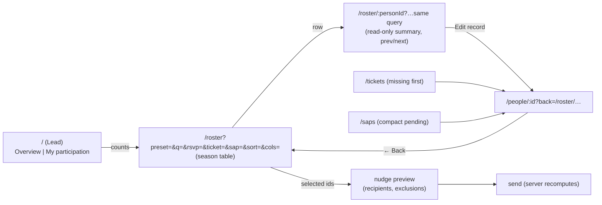

# feat: Lead workspace — season roster, quick person details, exception-first boards

## Overview

The September 30 review found the app calm and readable but tedious for Leads: one camper's season is spread across People, Roster, Tickets, SAPs, Volunteer and History, lists show just enough to open another page, and several dashboard numbers link to the wrong place. This plan turns the review's interface recommendations (sections "Why accessing the data feels tedious" and "Recommended interface changes" 1–6) into implementation units, in the review's suggested order: a small pass of fixes first, then the season roster workspace, quick person details and a Lead overview, then selected-recipient actions and a richer demo.

The security findings in the same document are handled separately (#39–#42); this plan covers only the interface.

## Problem Frame

Leads run the camp from their phones and laptops between meetups. Today, answering "what's this camper's situation this season?" or "who's arriving without a SAP decision?" takes several screens, and returning from a person page loses the list they came from. Counts that should be shortcuts (Going, Leaning yes, both ticket cards) open unfiltered pages. Actionable items (missing ticket requests, pending SAPs, understaffed volunteer roles) sit below completed work. (see origin: docs/plans/2026-09-30-security-and-ux.md, "Why accessing the data feels tedious")

## Requirements Trace

From the origin review's interface recommendations:

- R1. Every dashboard count opens exactly its matching rows (origin §6, first bullet; §"Why…" Roster and ticket cards).
- R2. Returning from a person keeps the list, filters and search the Lead came from (origin §3, §6).
- R3. Exception-first boards: Tickets (missing requests first), SAPs (compact pending rows, no empty pass selector), Volunteer (gaps first, a staffing view), Directory (reachable, searchable, the default when there are no photos) (origin §4).
- R4. A searchable **season roster** workspace: name/playa/email search, combined filters, sorting, preset views, URL state; a compact table on desktop and compact rows on phones; dues only for Treasurers, enforced on the server (origin §2).
- R5. **Quick person details** from any roster row without losing context: season summary first, previous/next within the filtered results, an addressable URL, full-screen on phones (origin §3).
- R6. A **Lead overview** on the home page as an Overview / My participation switch: actionable camp counts with exact links, with personal participation one tap away (origin §1; user choice 2026-09-30).
- R7. **Selected-recipient actions**: copy selected emails, RSVP nudges to a selection with a preview of recipients and cooldown exclusions, and export of the current view; server recomputes eligibility and permissions (origin §5).
- R8. Accessibility and consistency: readable danger/error text (WCAG AA 4.5:1), selected-filter semantics, one invitation vocabulary and one season label, clearly labelled year filters (origin §6).
- R9. A richer demo: approved SAPs with sample passes, representative history, and illustrated (not photographic) headshots (origin §6, last bullet). The demo role chooser stays in U20 of the pilot plan.

## Scope Boundaries

- No visual overhaul (the origin says it can wait until the access patterns work).
- No bulk permission changes or bulk SAP assignment (origin §5 says communication actions first).
- No new data captured from campers; everything here reads data the app already stores.
- Members' experience is unchanged except the Directory improvements, contrast fixes and the demo.
- The demo role chooser is pilot-plan U20, not this plan.
- Pagination is deferred (see Deferred to Implementation): pilot camps are 30–300 people.

## Context & Research

### Relevant Code and Patterns

- Roster: `app/routes/_app.lead.roster.tsx` (views as `?view=`, `Stat` cards, `CopyEmails`, nudge-all action) over `app/lib/data/roster.server.ts` (`listRoster`, `summarize`, `viewGroups`; dues already withheld from non-Treasurers in the loader).
- People directory and person page: `app/routes/_app.lead.people._index.tsx` (search `q`, `status` and `year` filters kept in the URL via an `href()` builder — the pattern to extend), `app/routes/_app.lead.people.$id.tsx` (a stack of edit forms; "← People" link; History via `app/lib/person-history.server.ts`, which takes the viewer's dues permission once #40 is merged).
- Tickets: `app/routes/_app.lead.tickets._index.tsx` over `requestBoard` in `app/lib/data/tickets.server.ts` (`buying`, `elsewhere`, `noRequest`).
- SAPs: `app/routes/_app.lead.saps.tsx` (pending/approved/plans-changed groups, a pass `select` per request).
- Volunteer: `app/routes/_app.volunteer.tsx` (roles with `n of slots filled`); Leads manage roles there.
- Yearbook/Directory: `app/routes/_app.yearbook.tsx` (`?view=directory`), `app/lib/data/directory.server.ts`.
- Home: `app/routes/_app._index.tsx` (R72 blocks, the setup checklist from U16, `lockReminder`).
- Nudges: `app/lib/data/nudge.server.ts` — `sendRsvpNudges(db, env, actor, ids)` already intersects the given ids with server-side candidates and the cooldown, so a selection can't widen who is emailed.
- Export: `app/lib/data/export.server.ts` (`toCsv` with formula defusing, dues columns only for Treasurers, audited).
- UI kit: `app/components/ui.tsx` (`btn`, `Notice`, `PageHeader`, label maps `STATUS_LABEL`, `INTENT_LABEL`); palette in `app/app.css`; contrast math in `app/lib/contrast.ts` (`contrastRatio`).
- Layout nav: `app/routes/_app.tsx` (Lead NavLinks; members' header links).
- Demo seed: `scripts/lib/demo-data.ts` (U18).
- Server-only modules: constants a component uses must live in non-`.server` files (recurring build failure in U9, U12, U17).

### Institutional Learnings

- `.data` requests and `?search` state: client navigations request `<path>.data`; any Worker-level path matching must strip `.data` (fixed for support/suspended in #26).
- Anything a component imports from a `.server` module breaks the client build ("Server-only module referenced by client").
- Restricted fields must be omitted in loaders, never hidden in components (origin S2; `listRoster` dues handling is the model).

### External References

- WAI-ARIA: `aria-current` for the current item in a set of links (filter pills), `aria-pressed` only for toggle buttons.
- WCAG 2.2 SC 1.4.3 contrast minimum 4.5:1 for normal text (origin cites it).

## Key Technical Decisions

- **Server-rendered filtering, URL as the state.** Search, filters, sort, preset and selected columns live in the query string and are applied in the loader. Bookmarks, back/forward and phones work without client state; `.data` navigations keep it fast. (Matches the People page's existing pattern.)
- **The season roster replaces the current Roster page's views.** Everyone / Arrivals / SAP requests / Generators / No RSVP / Dues unpaid become presets of one workspace at `/roster`, so there is one operational list. People stays the all-years directory for records and account management.
- **One season query.** A new `seasonRoster(db, viewer, filters)` joins person, this season's participation, ticket request, SAP request/decision, volunteer signups, camp-year count and (Treasurers only) dues, then filters and sorts in SQL. Dues are neither selected nor filterable nor sortable for non-Treasurers — the filter parameter is ignored, not just hidden.
- **Quick details as a nested route, read-only.** `/roster/:personId` renders inside the roster (an `<Outlet>` beside the table on wide screens, full-screen on phones), keeping the list's query string. It summarizes; editing stays on `/people/:id` ("Edit record"), so no edit form is duplicated and every existing guard (#39's sign-in management rules) keeps a single home. Previous/next use the same filtered ordering.
- **Return links carry context safely.** Links into a person page carry `back=<relative path+query>`; the page shows "← Back to <list>" only for an allow-listed internal path (`/roster…`, `/people…`, `/tickets`, `/saps`, `/inquiries`), never an absolute URL.
- **Lead home: Overview / My participation switch** (user decision). `/?view=overview` (default for Leads and Admins) and `/?view=mine`. Members have no switch. System notices stay above the switch; the setup checklist, lock reminder and camp counts are in Overview; "Your to-dos" and the personal cards are in My participation, and its tab shows a count when the Lead has personal to-dos so they aren't missed. Announcements and key dates show in both. This amends R72's order for Leads; the pilot plan's R72 note is updated.
- **Selection is a form, recomputed on the server.** Row checkboxes post person ids; the server intersects them with the current view's rows and with each action's own eligibility (nudge candidates and cooldown; export permissions). Sending nudges is two steps: a preview page listing recipients and exclusions, then Send. Copy-emails stays client-side (no server change).
- **Contrast via a new ink token.** Keep `--color-coral` for fills and borders; add a darker text token for small danger/error text, chosen to reach ≥4.5:1 on white and warm-white, checked by a test using `contrastRatio`.
- **Demo headshots are illustrations.** Generated abstract/initials avatars, never photos of real people or AI faces, so nothing could be mistaken for a real camper.

## Open Questions

### Resolved During Planning

- Overview placement: Overview / My participation switch, Overview default for Leads (user, 2026-09-30).
- Does the season roster replace or sit beside today's Roster views? Replace; views become presets (one operational list).
- Duplicate edit forms in the quick panel? No: the panel is read-only with an "Edit record" link.
- Pagination now? No; deferred with a threshold.

### Deferred to Implementation

- Exact column set and defaults per preset (start from the origin's example row; tune once rendered with the demo data).
- Pagination threshold: add server-side paging if the heaviest pilot camp's roster exceeds ~300 active people or the loader passes ~300 ms on staging.
- The ink token's exact hex (pick the lightest shade that passes 4.5:1 on both backgrounds).
- Whether the column chooser needs to persist beyond the URL (e.g., per-viewer localStorage) — decide after Leads try it.
- How illustrated headshots are produced for the seed (SVG rendered to WebP at seed time vs. checked-in WebP files) — depends on what the seed environment can run.

## High-Level Technical Design

> *This illustrates the intended approach and is directional guidance for review, not implementation specification. The implementing agent should treat it as context, not code to reproduce.*

Filter vocabulary (directional): `rsvp` ∈ going | leaning_yes | leaning_no | not_going | none; `ticket` ∈ requested | elsewhere | missing | not_needed; `sap` ∈ requested | pending | approved | none; `volunteer` ∈ none | some; `dues` ∈ unpaid | paid | waived (Treasurer only); `q` free text over legal name, playa name, email; `sort` ∈ name | arrival | rsvp | request | years; `preset` expands to a filter set.

## Implementation Units

### Phase A — small pass

- [x] **Unit 1: Exact count links and filter semantics**

**Goal:** Every count opens only its rows; filter pills announce which is selected; filtered lists show result counts and a reset.

**Requirements:** R1, R8

**Dependencies:** None

**Files:**
- Modify: `app/routes/_app.lead.roster.tsx`, `app/lib/data/roster.server.ts`, `app/routes/_app.lead.tickets._index.tsx`, `app/routes/_app.lead.people._index.tsx`, `app/routes/_app.yearbook.tsx`
- Test: `tests/lead/roster.test.ts`, `tests/tickets/tickets.test.ts`

**Approach:**
- Add an RSVP-intent view to the roster (`?view=going` etc. or an `rsvp=` parameter that Unit 5 will absorb) so Going / Leaning yes / Leaning no / Not going open their own groups.
- "Need a ticket" and "No ticket request" open the ticket board scrolled/filtered to their section (`/tickets?show=missing`, `?show=buying`).
- Filter pills get `aria-current="page"` when selected; lists show "N people" and a "Clear filters" link when any filter is on.

**Patterns to follow:** People page `href()` filter builder.

**Test scenarios:**
- Happy path: with 3 Going and 2 Leaning yes, the Going card's link returns a page listing exactly the 3 Going names and not the Leaning yes ones.
- Happy path: "No ticket request" opens a ticket view listing only coming campers without a request.
- Edge case: a view with zero rows shows "No one" and the reset link, not an error.
- Integration: the selected pill carries `aria-current="page"`; the others don't.
- Error path: a non-Treasurer requesting the Dues unpaid view still gets the default view and no dues count (existing rule preserved).

**Verification:** Clicking each roster and ticket count shows exactly the rows its number counted.

- [x] **Unit 2: Exception-first boards**

**Goal:** What needs doing comes first on Tickets, SAPs, Volunteer and the Directory.

**Requirements:** R3

**Dependencies:** Unit 1 (the ticket `show` filter)

**Files:**
- Modify: `app/routes/_app.lead.tickets._index.tsx`, `app/routes/_app.lead.saps.tsx`, `app/routes/_app.volunteer.tsx`, `app/routes/_app.yearbook.tsx`, `app/lib/data/directory.server.ts`, `app/routes/_app.tsx` (Directory in the members' header)
- Test: `tests/tickets/tickets.test.ts`, `tests/saps/saps.test.ts`, `tests/volunteer/volunteer.test.ts`, `tests/directory/directory.test.ts`

**Approach:**
- Tickets: "Coming, no request yet" first, then "Buying through the camp" (collapsible when long), then "Elsewhere"; the lock state and any tickets-close key date shown at the top; a name filter.
- SAPs: pending requests as compact rows (name, requested day, arrival day, a stock indicator for that day). With no stock for the day, show "Approve day; pass later" and no pass selector. Before a decision that emails the camper, the button label says so.
- Volunteer (Leads): roles with open slots sorted first with "N open"; a "Staffing" toggle listing unfilled slots and coming campers without a role.
- Directory: linked from the header for members; `/yearbook` opens the directory when no one has a photo yet; a name search.

**Patterns to follow:** existing `Section` component on the ticket board; volunteer role list.

**Test scenarios:**
- Happy path: the ticket page's first section is "Coming, no request yet" when anyone is missing a request.
- Happy path: a pending SAP for a day with no stocked passes renders without a pass selector and offers "Approve day; pass later"; approving it records the day with no pass (existing behavior).
- Happy path: on the volunteer page a role with 0 of 2 filled appears above a full role.
- Edge case: `/yearbook` with no photos in the season renders the directory view; with photos, the photo view.
- Happy path: directory search "spark" finds "Sparky" by playa name and nobody else.
- Error path: a member (non-Lead) sees no Staffing toggle and cannot load its data.

**Verification:** On the demo data, each board's first visible section is the one with work to do.

- [x] **Unit 3: Contrast, vocabulary and labels**

**Goal:** Small danger/error text is readable; the same states read the same everywhere.

**Requirements:** R8

**Dependencies:** None

**Files:**
- Modify: `app/app.css`, `app/components/ui.tsx`, `app/routes/_app.lead.people._index.tsx`, `app/routes/_app.lead.roster.tsx`, routes that print invitation states or years
- Test: `tests/smoke/contrast.test.ts` (new)

**Approach:**
- New text token for coral text (`text-coral` on small text and `btn.danger` switch to it); keep coral fills/borders. Danger buttons get the same focus ring as primary/secondary.
- One invitation vocabulary from `STATUS_LABEL` everywhere (Not invited / Invited / Signed in / RSVP'd).
- Year filters say "Camped in <year>" (past attendance) vs. page titles "<year> season" (the planned season).

**Test scenarios:**
- Happy path: the text token has contrast ≥4.5:1 against white, `--color-warm-white` and `--color-dust-pale` (computed with `contrastRatio` from the values in `app/app.css`).
- Integration: `btn.danger` uses the text token and includes a focus-visible outline.

**Verification:** No coral small text below 4.5:1 remains; a grep for ad-hoc status wording finds only the shared labels.

- [x] **Unit 4: Keep list context when opening a person**

**Goal:** A person page returns to the exact list it was opened from.

**Requirements:** R2

**Dependencies:** None (Unit 6 reuses it)

**Files:**
- Create: `app/lib/back-link.ts` (non-server: validate and label a `back` value)
- Modify: `app/routes/_app.lead.people.$id.tsx`, list routes that link to people (`_app.lead.roster.tsx`, `_app.lead.people._index.tsx`, `_app.lead.tickets._index.tsx`, `_app.lead.saps.tsx`, `_app.lead.inquiries.$id.tsx`)
- Test: `tests/lead/back-link.test.ts` (new)

**Approach:** Links to `/people/:id` append `back=<current path+query>`. The person page's back link uses it only when it's a relative path under an allow-listed prefix; otherwise "← People". Forms on the person page keep `back` across their redirects.

**Test scenarios:**
- Happy path: opened from `/roster?view=missing`, the page's back link goes to `/roster?view=missing`.
- Edge case: after saving the person's details, the back link still points to the original list.
- Error path: `back=https://evil.example/`, `back=//evil.example`, and `back=/admin/settings` fall back to "← People".

**Verification:** From any Lead list, open a person, save something, and "Back" lands on the same filtered list.

**Phase A as built (2026-09-30):**
- Roster: a view per RSVP answer (`?view=going` etc.), each count links to its own list, tabs carry `aria-current`, and an unknown view falls back to Everyone. The ticket counts open `/tickets?show=buying|missing`.
- Tickets: `show` and `q` in the loader; "Coming, no request yet" first; the copy-list buttons always use the whole buying group; the tickets-close date shows when set.
- SAPs: the stock left for the requested day is shown on pending rows. With no passes in stock, there's no pass picker and the button reads "Approve day; pass later"; otherwise "Approve and email them". Approved and Not approved fold away while decisions are waiting.
- Volunteer: `openFirst` sorts roles in the loaders (never in a component: `.server` module). The Lead page has a Staffing box: open slots, and coming campers without a role (`comingWithoutRole`).
- Directory: a header link; `/yearbook` opens it when the season has no photos (`?view=photos` asks for photos); a name search over the Yearbook name, plus a full name only when it's visible to the viewer.
- People: `aria-current` on filter pills, a result count and "Clear filters", and invitation states from `STATUS_LABEL`.
- Contrast: `--color-coral-ink` `#b04f3a` (4.71:1 at worst, on dust-pale) for all coral text. `btn.danger` has a focus ring. `tests/smoke/contrast.test.ts` checks the ratio and that no `text-coral` text remains.
- Back links: `app/lib/back-link.ts` and `app/components/PersonLink.tsx` on Roster, People, Tickets, SAPs, Volunteers, Queue and Inquiries. The person page and its RSVP page keep `back` across saves.
- The season label stays as "<year> roster" and "<year> season" for now. It's revisited with the season roster (Unit 5).
- Tests: `tests/lead/phase-a.test.ts` (through the Worker), `tests/smoke/contrast.test.ts`, and the updated `tests/yearbook/yearbook.test.ts`.

### Phase B — main pass

- [x] **Unit 5: The season roster workspace**

**Goal:** One searchable, filterable, sortable season list that answers most "who…?" questions without switching boards.

**Requirements:** R4, R1

**Dependencies:** Units 1, 3, 4

**Files:**
- Create: `app/lib/data/season-roster.server.ts`, `app/lib/roster-filters.ts` (non-server: parameter names, presets, labels shared with the component)
- Modify: `app/routes/_app.lead.roster.tsx` (rebuilt as the workspace), `app/routes/_app.tsx` (nav label "Roster")
- Test: `tests/lead/season-roster.test.ts` (new), `tests/lead/roster.test.ts` (updated), `tests/authz/cross-camp.registry.ts` (probes)

**Approach:**
- Loader parses the filter vocabulary (see High-Level Technical Design), drops unknown values and any `dues` filter/sort/column for non-Treasurers, and calls `seasonRoster`.
- Presets: Everyone coming, No RSVP, Missing ticket request, Build arrivals (SAP requested or arriving before gates), Pending SAP, No volunteer role, Arrivals (grouped by date), Generators, and Dues unpaid (Treasurers).
- Desktop: a compact table with a sticky header and a column chooser (`cols=`) over Camper, RSVP, Arrival → departure, Ticket request, SAP, Volunteer, Years camped, (Dues). Phones: a name/status/date row per person; tapping opens the panel (Unit 6).
- Human-readable request states: "Not requested", "0 tickets requested", "Has ticket elsewhere", "2 tickets + vehicle pass".
- Copy emails and the nudge-all action carry over (nudge moves to Unit 8's selection flow later).

**Execution note:** Start with the data layer's permission tests (dues never selected, filtered or sorted for non-Treasurers) before building the table.

**Patterns to follow:** `listRoster` dues handling; People page search and filter links; `toCsv` for Unit 8.

**Test scenarios:**
- Happy path: `q=vale` finds Rowan Vale by legal name, `q=compass` by playa name, `q=rowan.vale@` by email.
- Happy path: `rsvp=going&ticket=missing` returns only Going campers without a ticket request; `sort=arrival` orders by arrival date with unknown dates last.
- Happy path: each preset returns the same rows as its old view did (Arrivals, Generators, No RSVP, SAP requests).
- Edge case: unknown `rsvp=maybe` or `sort=bogus` is ignored, not an error.
- Error path: a Lead who isn't the Treasurer sending `dues=unpaid&sort=dues&cols=dues` gets the unfiltered rows, no dues column, and no dues values in the page or `.data`.
- Integration: a camper in another camp never appears (cross-camp probe with camp B's names as the query).
- Integration: a camper who is inactive, or has no participation this season, appears only under presets that include "no RSVP" when invited, consistent with today's roster.

**Verification:** "Who's arriving before the 22nd without a SAP decision?" and "who's coming without a ticket request?" are each one URL.

- [x] **Unit 6: Quick person details**

**Goal:** Inspect a camper's season from the roster without losing the list, and step through the filtered results.

**Requirements:** R5, R2

**Dependencies:** Units 4, 5

**Files:**
- Create: `app/routes/_app.lead.roster.$personId.tsx`, `app/lib/data/person-summary.server.ts`
- Modify: `app/routes.ts` (nest under roster), `app/routes/_app.lead.roster.tsx` (render `<Outlet>`)
- Test: `tests/lead/person-panel.test.ts` (new), `tests/authz/cross-camp.registry.ts`

**Approach:**
- The child route keeps the parent's query string; its loader builds a summary: contact (Leads see it already), this season's RSVP and dates, ticket request, SAP, volunteer roles, camp years, Treasurer-only dues, and the last few History entries (via `personHistory` with the viewer's dues permission).
- Previous/next are computed from the same `seasonRoster` ordering and filters; the panel's close link returns to the list with the same query.
- Wide screens: side panel beside the table; phones: full-screen with a back control. "Edit record" links to `/people/:id?back=…`.

**Test scenarios:**
- Happy path: opening a row from `?preset=no-rsvp` shows that camper's summary, and "Next" goes to the next camper in that same filtered order.
- Edge case: the last row's "Next" is absent (or disabled); a person filtered out after a change shows a "Not in this list any more" note with a link back.
- Error path: a camp B person id returns 404 and no camp B data (registry probe).
- Error path: a Lead who isn't the Treasurer sees no dues in the panel, its `.data`, or its history excerpt.
- Integration: closing the panel restores the list with the same `q`, filters and sort.

**Verification:** A Lead can look at five campers in a filtered list in a row without rebuilding filters.

- [x] **Unit 7: Lead home — Overview / My participation**

**Goal:** Leads land on what the camp needs; their own participation is one tap away.

**Requirements:** R6

**Dependencies:** Units 1 and 5 (exact links into roster presets)

**Files:**
- Create: `app/lib/data/overview.server.ts`
- Modify: `app/routes/_app._index.tsx`, `docs/plans/2026-09-28-001-feat-multi-camp-platform-pilot-plan.md` (R72 note), `docs/brainstorms/2026-09-28-multi-camp-platform-requirements.md` (R72 amended for Leads)
- Test: `tests/home/home.test.ts`

**Approach:**
- `/?view=overview|mine`; Leads and Admins default to Overview; members have no switch.
- Overview: nonzero camp counts, each linking to its exact list — invited with no RSVP, coming without a ticket request, SAP requests to decide (when SAPs are on), new inquiries (when the join page is on), open Queue items, understaffed volunteer roles (when volunteer roles are on), unpaid dues among coming campers (Treasurers only); then the setup checklist (U16) and the lock reminder; then announcements and key dates.
- My participation: "Your to-dos" and the personal cards, plus announcements and key dates. The tab shows a badge count when the Lead has personal to-dos.
- System notices (suspended, privacy notice, directory question) stay above the switch.

**Test scenarios:**
- Happy path: a Lead's home shows Overview with "6 invited, no RSVP" linking to the roster's No RSVP preset.
- Happy path: `?view=mine` shows the Lead's own RSVP card and to-dos; the tab badge shows 1 when their RSVP is missing.
- Edge case: all camp counts zero → Overview says so plainly ("Nothing needs doing") and still shows announcements.
- Edge case: a feature switched off (SAPs) hides its count.
- Error path: a non-Treasurer Lead sees no dues count; a member sees no switch and today's home.
- Integration: the setup checklist appears in Overview, not in My participation.

**Verification:** On the demo, Compass lands on Overview listing the demo's missing RSVPs, missing ticket requests, pending SAPs and new inquiry, each opening the matching list.

**Phase B as built (2026-09-30):**
- **The season query:** `app/lib/data/season-roster.server.ts` (`seasonRows`, `applyFilters`, `seasonCounts`) is one SQL query per request. Dues are selected only for a Treasurer with dues switched on; for anyone else the column is `null::text` and the dues join isn't made. Filtering and sorting run over the season's rows in memory (fine at pilot sizes; the paging threshold stands). Volunteer roles come back via `json_agg`, since arrays don't parse without fetched types.
- **Filters:** `app/lib/roster-filters.ts` (shared; it holds `formatDay` now) has the filter vocabulary, ten presets, columns and labels. Old `?view=` links redirect to their new address (`upgradeOldView`), and the cross-camp registry probes every preset.
- **The roster page:** count cards link to their presets or filters; a GET filter form with a column chooser (`col` boxes, or `cols=` in links); a sticky-header table on wider screens and compact rows on phones; arrivals grouped by date. "Clear filters" shows whenever a filter is on. The nudge-all action now lives on the No RSVP preset.
- **The person panel:** the nested `/roster/:personId` route (`app/lib/data/person-summary.server.ts`) shows their season, contact, camp years and the latest 5 History entries, with dues only for a Treasurer. Previous and next follow the same filtered order, and a person no longer in the list says so. "Edit record" carries `back` to the panel (`backLink` allows `/roster/…`). On phones the panel takes the screen and the list hides.
- **The Lead home:** `/?view=overview|mine` (`app/lib/data/overview.server.ts`), with Overview by default for Leads and Admins. It shows camp items only when nonzero and only for switched-on features, and dues only for a Treasurer. My participation's tab shows a count of the Lead's own to-dos. R72 is amended in the requirements doc.
- **Removed:** `app/lib/data/roster.server.ts` (the old roster views); its tests moved to the season query.
- **Upload-limit test:** the occasional failure in #40's test turned out to be `write EPIPE`. The Worker refuses before reading the body, and the test client can lose the connection mid-write. The test now tries up to five times and still requires a 413. Separately, a body with no declared size is now read up to the limit and refused with a 413 the moment it passes it (`app/lib/body-limit.ts`, unit-tested), instead of being cut off mid-parse.
- **Tests:** `tests/lead/season-roster.test.ts`, plus updated `tests/lead/roster.test.ts`, `tests/lead/phase-a.test.ts`, `tests/home/home.test.ts`, `tests/people/nudge.test.ts`, `tests/dues/dues.test.ts` and `tests/authz/lead-routes.test.ts`.

### Phase C — follow-up

- [x] **Unit 8: Selected-recipient actions**

**Goal:** Act on a chosen subset: copy emails, send RSVP nudges with a preview, export the current view.

**Requirements:** R7

**Dependencies:** Unit 5

**Files:**
- Create: `app/routes/_app.lead.roster.nudge.tsx` (preview and send), `app/routes/_app.lead.roster.export.ts`
- Modify: `app/routes/_app.lead.roster.tsx` (row checkboxes, select-all-in-view, action bar), `app/lib/data/nudge.server.ts` (a preview function), `app/lib/data/export.server.ts` (current-view export)
- Test: `tests/people/nudge.test.ts`, `tests/people/export.test.ts`, `tests/authz/cross-camp.registry.ts`

**Approach:**
- Checkboxes submit person ids with the current filters. The server intersects ids with the current view's rows before anything else.
- Nudge: a preview lists recipients, those excluded by the cooldown (with when they were last nudged) and those not eligible (e.g., already RSVP'd), and the email text; "Send" recomputes and reports per-person failures. One audit entry per send, as today.
- Export: the current view's rows and columns as CSV (formula-safe, dues columns only for Treasurers, audited like the People export). "Export all people" stays on People.
- Copy selected emails is client-side.

**Test scenarios:**
- Happy path: selecting 3 of 6 no-RSVP campers previews exactly those 3; sending emails 3 and audits one entry naming them.
- Edge case: one selected camper was nudged yesterday → the preview lists them as excluded with the date; sending emails the other 2.
- Error path: ids for camp B people, or for campers not in the current view, are dropped silently (nobody outside the view is emailed).
- Error path: a camper who RSVP'd between preview and send is not emailed.
- Happy path: export of `?preset=missing-ticket` contains exactly those rows; a non-Treasurer's export has no dues column even with `cols=dues`.
- Integration: the export is audited with its row count and filters.

**Verification:** A Lead can follow up with a chosen handful of missing RSVPs and see who was skipped and why.

- [x] **Unit 9: A richer demo**

**Goal:** The demo shows the workspace at its best: photos (illustrated), SAPs with inventory and decisions, and history.

**Requirements:** R9

**Dependencies:** Units 2, 5, 6 (so the demo exercises them)

**Files:**
- Modify: `scripts/lib/demo-data.ts`
- Create: illustrated avatar assets or generator under `scripts/lib/` (see Deferred)
- Test: `tests/demo/demo.test.ts`

**Approach:**
- Seed SAP passes for the season's days, a few approved requests with passes (no PDFs needed), and one pending with no stock left, so both SAP states show.
- Seed audit entries for representative history (RSVP changes, ticket requests, role grants).
- Illustrated avatars for most people, stored under the demo camp's prefix; the reset removes the prefix first.

**Test scenarios:**
- Happy path: after a reset, the SAPs page shows approved and pending requests, and a pending one on a day with no stock shows "Approve day; pass later".
- Happy path: a person's History shows seeded entries.
- Edge case: re-running the reset leaves no orphaned files under the demo prefix.
- Integration: every demo page still renders with no writes (existing demo test).

**Verification:** Opening the demo shows faces in the Yearbook, SAP decisions, and non-empty History.

**Phase C as built (2026-10-01):**
- **Picking people:** the roster table's tick boxes belong to one form (`form="roster-selection"`) that posts to `/roster/nudge`. With JavaScript, React state also drives tick-all and "Copy emails" for the picked people; nothing ticked means the whole view.
- **Nudge preview (`/roster/nudge`):** the preview lists who gets the email, who's skipped by the cooldown (with the date), who can't be nudged and why, and the email text. Send works it all out again: only ids in the Roster view the Lead was looking at count, so other camps' and other views' ids are dropped, and someone who RSVP'd since the preview isn't emailed. It's audited once, as before. The notice names anyone it couldn't send to (`sendRsvpNudges` now returns `failedTo`). The route's loader returns nothing, because after the preview's POST the loader runs again before rendering.
- **Export (`/roster/export?<view>`):** the view's people and chosen columns, formula-safe. Dues only for the Treasurer; refused under support access; audited as `roster_exported`. Cell wording is shared with the page (`app/lib/roster-cells.ts`), and `rosterView` in `season-roster.server.ts` recomputes a view from its query string.
- **The demo** (`scripts/lib/demo-data.ts`, `scripts/lib/demo-files.ts`):
  - SAP passes: Compass approved with a pass and the sample PDF, Sprocket approved with a pass, and two to decide, one on a day with no passes left;
  - seeded History;
  - illustrated initials avatars;
  - the camp keeps its id across resets, and files have fixed keys, so a reset leaves nothing behind;
  - files and references only with `--bucket`, uploaded through Wrangler.
- **Also:** a History label for U17's `people_imported`, which had none.
- **Tests:** `tests/lead/roster-actions.test.ts` and `tests/demo/demo.test.ts` (Unit 9), plus cross-camp probes for `/roster/nudge` and `/roster/export`.

## System-Wide Impact

- **Interaction graph:** Roster, Tickets, SAPs, People and Inquiries link into the person page (Unit 4); the roster gains a nested route (Unit 6); the home loader gains camp counts (Unit 7). Worker-level `.data` handling is unchanged.
- **Error propagation:** Unknown filter values are ignored rather than 400s, so shared links degrade gracefully. Permission-restricted parameters are dropped in the loader.
- **State lifecycle risks:** Selection and nudge preview go stale between preview and send; the send step recomputes eligibility.
- **API surface parity:** Dues visibility must match across roster table, panel, panel history, export, overview counts and `.data` responses. The cross-camp registry needs entries for every new route.
- **Integration coverage:** Cross-camp probes for `/roster/:personId`, nudge preview/send and view export; `.data` responses checked for restricted fields.
- **Unchanged invariants:** Person editing and sign-in management stay on `/people/:id` with #39's rules; the People export keeps "everyone, including inactive"; nudge cooldown and mail safeguards are unchanged; members' home stays as today.

## Risks & Dependencies

| Risk | Mitigation |
|------|------------|
| A new combined surface leaks Treasurer-only dues | Permission tests first (Unit 5 execution note); restricted params dropped in loaders; `.data` checked in tests |
| The season query gets slow as camps grow | One SQL query with indexes already on camp/burn/person; measure on staging; paging deferred with a threshold |
| The switch hides a Lead's own missing RSVP | Badge count on My participation; personal notices stay above the switch |
| Phone layout of the table is cramped | Separate compact row rendering for small screens rather than squeezing columns |
| Replacing roster views breaks bookmarks | Map old `?view=` values to the matching presets |

## Documentation / Operational Notes

- Update the Lead handbook starter guide (`content/starter-guides/lead-handbook.md`) and YB's handbook source (`scripts/yb-guides/lead-handbook.md`) for the roster workspace and the home switch.
- Amend R72 (home order) in the requirements doc and note it in the pilot plan.
- After Unit 5, measure the roster loader on staging with a 300-person seeded camp.

## Sources & References

- **Origin document:** [docs/plans/2026-09-30-security-and-ux.md](2026-09-30-security-and-ux.md) (interface sections)
- Pilot plan: `docs/plans/2026-09-28-001-feat-multi-camp-platform-pilot-plan.md` (R72, U16 checklist, U20 demo role chooser)
- Related PRs: #39 (sign-in management rules the person page keeps), #40 (dues withheld from history; Units 6 and 8 depend on it)
- Related code: `app/routes/_app.lead.roster.tsx`, `app/lib/data/roster.server.ts`, `app/lib/data/nudge.server.ts`, `app/lib/data/export.server.ts`, `app/routes/_app._index.tsx`
