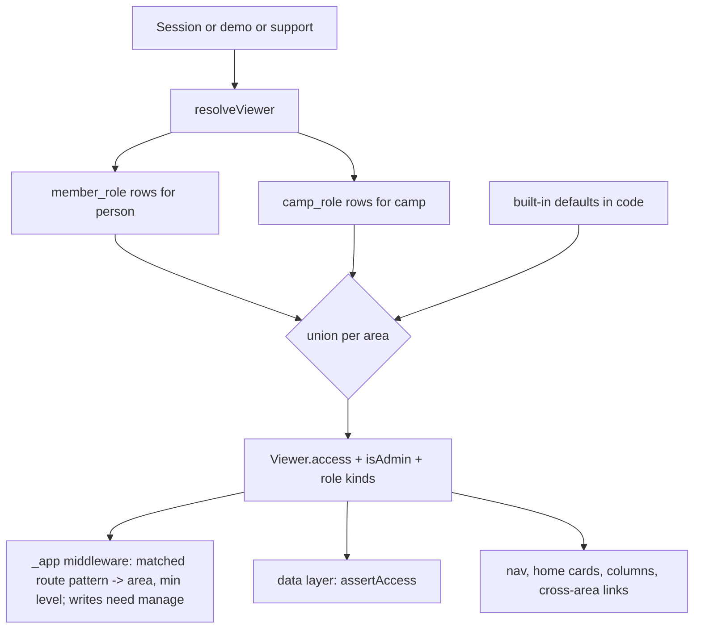
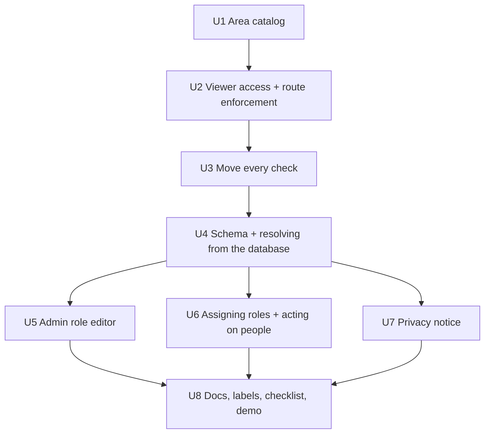

# feat: Granular permissions with editable built-in roles and custom roles

## Overview

Today a camp has three fixed roles: Lead, Treasurer and Admin. Each one is a yes/no flag on the viewer (`isLead`, `isTreasurer`, `isAdmin`). The flags are checked in about 35 files. A few more decisions are made directly in SQL, by reading `member_role.role`.

Issue #93 asks for something more flexible that stays simple:

- organizers can change what Lead and Treasurer allow;
- organizers can reset Lead and Treasurer to the defaults;
- organizers can create fully custom roles;
- all of this without "a massive list of checkboxes".

This plan replaces the role flags with a small catalog of **areas**, ten in all.

- Each area has a **level**: No access, View or Manage.
- A role is a name plus one level per area.
- Lead and Treasurer become editable presets. They start at today's permissions and can be reset.
- Admin stays fixed and can do everything.
- Only Admins create, edit and assign roles.

The work is ordered so the first two units change no behavior. They move every check onto the new area model while the roles are still the three fixed ones. Custom roles are added after that, on a foundation the tests have already proved.

## Problem Frame

Camps run differently. These are examples of what organizers will want. Each one must be possible to build with the area catalog, and a test proves it:

- **Dues viewer.** Leads who can see who has paid dues but can't record payments.
- **Tickets coordinator.** Someone who handles only Stewards Sale requests.
- **Registrar.** Someone who handles inquiries and invites, but never sees private notes or anyone's unshared contact details.

Today the only choices are "Lead (nearly everything)" or "nothing". So organizers either give too much access, which is a privacy problem because Leads see everyone's contact details and notes, or keep the work to themselves.

The issue sets these constraints:

- the system is powerful enough to be worth having;
- it's simple enough that organizers will actually set it up;
- the built-in Lead and Treasurer stay, with their current permissions as defaults;
- organizers can change those built-in roles and reset them;
- fully custom roles are possible.

## Requirements Trace

**Roles**
- R1. Built-in **Lead** and **Treasurer** roles exist in every camp. By default they allow exactly what they allow today.
- R2. An Admin can change what Lead and Treasurer allow, and can **reset** either one to the defaults.
- R3. An Admin can create, rename, edit and archive **custom roles**.
- R4. Editing a role is a short list of areas, each with a level and a line explaining what that level means. It's never a long checkbox list. The role also shows a plain-English summary of what it allows.
- R5. **Admin** stays fixed (user decision, 2026-10-06):
  - it always has every permission;
  - it can't be edited;
  - the Admin pages stay Admin-only.
- R6. Only Admins give or remove roles, built-in or custom (user decision, 2026-10-06).
- R7. A person can hold several roles. What they can do is the union: for each area, the highest level any of their roles gives.

**Enforcement and audit**
- R8. Every permission is enforced on the server, for pages, actions, exports and emails. Hiding navigation is a convenience, never the control.
- R9. Changes take effect on the person's next request. Every change to a role definition or an assignment is audited.

**Privacy**
- R10. Members can always see who can see what. The R51 privacy notice is generated from the camp's actual roles and stays reachable from the profile. It isn't shown to members again when access changes (user decision, 2026-10-06).

**Changes to existing rules**
- R11 (amended, user decision, 2026-10-06). The guard against removing the last active **Admin** stays. The guards on the last Lead and last Treasurer go away. Once those roles can be edited, the guards would protect a name rather than an ability, and an Admin can always do everything. This changes requirements R11 and R10 (leaving a camp).

## Scope Boundaries

- **No per-record or per-group scoping.** For example, "sees only the people in their build crew" is not supported. A role's levels apply camp-wide (see Alternatives).
- **No deny rules or per-person overrides.** Access is granted only through roles, and roles only add access.
- **The Admin pages can't be delegated in v1.** These are settings, features, wording, emails, seasons, positions, exports, logs, support and roles.
- **The member baseline isn't configurable.** Everything a member does today stays as it is: their own RSVP, profile, ticket request, SAP pass, Yearbook, directory and guides.
- **No role-based email routing.** Inquiry notifications already go to a configurable address list (`inquiry_notify`). That stays as it is.
- **Operator side unchanged.** The operator console and support access don't change. The support viewer keeps Admin-level, read-only access.

## Context & Research

### Relevant Code and Patterns

**Roles today**
- `app/lib/access.server.ts`:
  - `resolveViewer` loads `member_role` rows on every request. It sets `isLead`, `isTreasurer` and `isAdmin`; an Admin counts as Lead and Treasurer.
  - `requireLead`, `requireTreasurer` and `requireAdmin` are the route guards.
  - The demo and support viewers are built here too.
- `app/lib/roles.server.ts`:
  - `grantRole` and `revokeRole`, guarded by `assertCanManage`;
  - `lockActiveHolders`, used by the last-holder guards;
  - `deactivatePerson` and `reactivatePerson`;
  - `assertCanManagePersonLogin`.
- `app/lib/login-management.ts` requires `isLead`. On top of that, a Lead can't manage the login of a Treasurer or Admin unless they hold that role themselves. The plan generalizes this into a "within your access" check.

**Route guards and enforcement**
- `app/routes/_app.lead.tsx`: its layout middleware calls `requireLead` for every Lead page. Several Lead loaders and actions have no check of their own and rely on that guard alone:
  - the tickets lock;
  - the queue loader and its actions;
  - `/people/:id/rsvp`;
  - roster nudges;
  - inquiry updates, notes and invites;
  - the people import and its template.
- `/dues` sits outside the Lead layout and calls `requireTreasurer` itself.
- `app/routes/_app.tsx` middleware:
  - checks the feature with `featureForPath(new URL(request.url).pathname)`. This runs on the raw request URL, so client navigations (`<path>.data`) aren't normalized. The pilot-agreement check in the same middleware strips `.data` by hand for this reason.
  - builds the navigation and phone menu from the role flags.
- `app/routes/_app._index.tsx`: the Lead home and the member home, with sections gated by role.
- `app/lib/features.ts` (`FEATURES`, `featureForPath`): a typed catalog in a plain module. The area catalog uses the same shape, but keyed by route rather than by path prefix (see Key Technical Decisions).

**Role checks in SQL and other code the compiler won't catch**
- `app/lib/data/inquiries.server.ts`: the assignee list uses `mr.role = 'lead'`.
- `app/lib/invites.server.ts`: the bulk-invite candidate filter is SQL that uses `actor.isTreasurer`.
- `app/lib/data/export.server.ts`: the roles column uses `initcap(mr.role)`.
- `app/routes/sign-in.confirm.tsx` and `app/lib/notify.server.ts`: the role label in sign-in notifications.
- `app/lib/data/positions.server.ts`: the holder's `isLead` flag, used for the "Make Lead" button on the Admin positions page.
- `app/lib/data/reminders.server.ts`: a synthetic system viewer with `isLead: true, isTreasurer: true`.
- `app/lib/photos.server.ts`: a structural type that includes `isLead: false`.
- `app/lib/data/feedback.server.ts`: feedback labels, in priority order admin > treasurer > lead > member.

**Platform SQL that reads Admins**
- These read `member_role.role = 'admin'` directly, and must keep working unchanged:
  - `platform/app/lib/console.server.ts`;
  - `platform/app/jobs/support-grants.server.ts`;
  - `platform/app/lib/data-rights.server.ts`;
  - `app/lib/support-mail.server.ts`.

**Code that creates role rows**
- These insert `member_role` rows:
  - `platform/app/lib/camps.server.ts`;
  - `app/lib/bootstrap.server.ts`;
  - `scripts/lib/demo-data.ts`;
  - `scripts/migrate-yb.ts`.
- With the platform SQL above, this is why the `role` text column stays for the built-in roles.

**Schema**
- `app/db/schema.ts`, `memberRole`:
  - the check constraint `role in ('lead','treasurer','admin')`;
  - the active-role unique index on `(person_id, role)` that `grantRole`'s bare `onConflictDoNothing()` relies on;
  - the `campFk` composite foreign keys.

**Person page and data that's private today**
- The person page action (`app/routes/_app.lead.people.$id.tsx`) always writes phone and home location from the form. A hidden field would be wiped on save.
- The person page shows "2026 note (Leads only)".
- The people CSV export (`peopleCsv`) has these note columns: `note_2026`, `inquiry_notes` and `ticket_note`. Only its dues and mailing columns are filtered by role today.

**Tests and conventions**
- `tests/authz/`:
  - `access-matrix.test.ts`, `lead-routes.test.ts` and `roles.test.ts`;
  - `routes.test.ts`, which lists the public routes;
  - `cross-camp.registry.ts`, where every route must be registered.
- Conventions from recent work (#63, #78, #82):
  - shared constants go in plain modules, never `.server` ones;
  - new shared files are added to `tsconfig.platform.json` and `tsconfig.scripts.json` when needed;
  - every new route goes in the cross-camp registry;
  - audit goes through `audit()`, with labels in `app/lib/history-labels.ts`.

### Institutional Learnings

There is no `docs/solutions/` folder. These are this project's lessons:
- Components can't import `.server` modules. The catalog and its summaries go in a plain module.
- Demo and suspended camps get read-only transactions (`campReadOnly`). Resolving access must never write anything (the #84 bug).
- Writing JSON through the plain postgres.js client needs `::text::jsonb`. Drizzle jsonb columns are fine.
- React Router middleware sees the raw request. Use the matched route or the normalized URL, never `request.url`, for authorization.

### External References

How current SaaS products handle custom roles, and what this plan takes from each:

- **Access levels per area instead of checkboxes per action.**
  - Notion (Full access / Can edit / Can view), HubSpot and Atlassian group permissions by resource and offer a few levels.
  - Sources: [Designing permissions for a SaaS app (UX Collective)](https://uxdesign.cc/design-permissions-for-a-saas-app-db6c1825f20e), [How to design permissions for SaaS products (Department of Product)](https://departmentofproduct.com/blog/how-to-design-permissions-for-saas-products).
- **Built-in roles as editable presets, plus "start from an existing role".**
  - GitHub's custom roles inherit a base role.
  - Here, creating a role starts from Lead, Treasurer, a ready-made starting point, or blank.
  - Source: [GitHub, custom organization roles](https://docs.github.com/en/enterprise-cloud@latest/organizations/managing-peoples-access-to-your-organization-with-roles/managing-custom-organization-roles).
- **Stable permission keys in code, separate from what a role is called.**
  - Clerk checks `org:<feature>:<action>`, never role names.
  - Here, the code checks `can(viewer, "dues", "view")`.
  - Source: [Clerk, roles and permissions](https://clerk.com/docs/guides/organizations/control-access/roles-and-permissions).
- **No acting on someone with more access than you.** Kubernetes RBAC and GitHub prevent this kind of privilege escalation. Here it applies to deactivating people, reactivating them and managing their logins.
- **Approaches rejected as overkill:**
  - relationship-based access (Zanzibar, OpenFGA, SpiceDB);
  - policy engines (Cedar, Oso);
  - hosted authorization services (WorkOS FGA, Permit.io).

  Each adds a service or a language that self-hosters (open-source plan, D7) would have to run, for per-record scoping this product doesn't need.

## Key Technical Decisions

**The model**

- **Areas × levels.**
  - There are ten areas, and each offers some of `none`, `view` and `manage`. `manage` includes `view`.
  - The editor is a set of segmented controls with no checkboxes.
  - Each area has a short line explaining what each of its levels means.
  - This is the user's choice. It covers the three examples in the Problem Frame.
- **Code checks areas, never role names.**
  - One helper family does every check: `can`, `assertAccess` and `requireAccess`.
  - `isLead` and `isTreasurer` are removed from `Viewer`. `isAdmin` stays, because the Admin pages are a fixed set (R5).
  - `Viewer` also keeps a server-only list of the kinds of role the person holds (`lead`, `treasurer`, `admin`, `custom`). It's used only for labels such as feedback and sign-in notifications, never for access.
- **The workspace means People: View or higher.** The workspace is the Lead home layout, the orientation tour, the Lead handbook and the setup checklist.
  - For the three built-in roles this matches today's `isLead` exactly.
  - A custom role without People access gets the member home, plus a "Your tools" card that links to each area page it can open, plus its own navigation links.
- **Access is the union.** Several roles combine by taking the highest level per area. There are no deny rules and no hierarchy between roles.
- **Private details & notes** (user decision, 2026-10-06). This area covers:
  - the phone, email, home location and mailing address of members who haven't shared them, wherever they're shown: the People list, the person page, the roster and its panel, the directory, the people an inquiry matches, and exports;
  - the yearly Lead note on a person (`note_2026`), wherever it's shown;
  - the note columns in person and roster exports (`note_2026`, `inquiry_notes` and `ticket_note`).

  Inquiry notes on the inquiry page belong to Inquiries, and ticket notes on the tickets page belong to Tickets. People: Manage without this area is allowed:
  - those fields are hidden;
  - a save writes only the fields the actor was allowed to see, enforced on the server;
  - changing someone's email and the CSV import (whose preview shows matched people's details) also need this area at View.

**Enforcement**

- **Each route declares its area and minimum level.** The `AREAS` catalog maps **route patterns** (as in `app/routes.ts`, for example `/people/:id`), not path prefixes, to an area and a minimum level for reading. React Router gives middleware the matched route's pattern (`pattern`, without its leading slash), which `routePath()` turns into the catalog's form.
  - The `_app` middleware finds the area from the matched route. So case variants, percent-encoding, trailing slashes and `.data` requests all resolve the same way.
  - Member routes such as `/tickets/request`, `/saps/pass/:id/pdf`, `/volunteer` and `/yearbook` belong to no area and keep their own checks.
  - The Lead layout **fails closed**: a matched route under it with no area is refused.
  - The `featureForPath` check moves to the matched route too, which fixes its existing `.data` gap.
- **Reads need the minimum level, which defaults to View. Writes need Manage.**
  - Any request that isn't a GET or HEAD to an area route needs `manage`, unless the route explicitly says less.
  - Data-layer `assertAccess` checks stay as a second layer.
  - These routes need Manage even to read: `/queue`, `/people/new`, `/people/invite`, `/people/import*`, `/people/export` and `/roster/nudge`.
  - The roster export needs Roster: View, with its columns filtered by Dues and by Private details & notes.
- **Actions that cross areas.**
  - An action needs `manage` on every area whose records it writes, and `view` on every area it reads from. For example, inviting from an inquiry creates a person and sends an invite, so it needs Inquiries: Manage and People: Manage.
  - A link or redirect into another area appears only if the viewer can open it. Otherwise the page shows plain text, or the action stays on the page with a notice.
  - `/people/:id/rsvp` (RSVP on someone's behalf) belongs to Roster & RSVPs.

**Storage**

- **Built-in defaults live in code. A camp stores only what it changed.**
  - A `camp_role` row with `builtin = 'lead'` or `'treasurer'` exists only once that role has been customized.
  - A saved row lists every area explicitly. "Reset to defaults" deletes the row.
- **New areas added in a later release** (user decision, 2026-10-06):
  - un-customized built-ins get the new area's default automatically;
  - customized built-ins and custom roles get `none`. The Roles page shows a "New area: review" badge on those roles until an Admin saves them. A missing key in a saved row is what marks an area as new, so no version column is needed.
  - Splitting, merging or renaming an existing area after release is a data migration. It writes explicit grants derived from the old area into existing rows, with an audit row per camp. It never relies on the defaults.
- **`member_role.role` keeps its text values for the built-ins.** Custom roles use `'custom'` plus a `custom_role_id`.
  - The platform SQL that reads `role = 'admin'`, and the four places that insert roles, stay unchanged.
  - There are two partial unique indexes. One is on `(person_id, role)` where the role is active and isn't `'custom'`, so built-ins stay unique as `grantRole` relies on. The other is on `(person_id, custom_role_id)` where the role is active and is `'custom'`.
- **Custom roles are archived, never deleted.**
  - Archiving revokes every active assignment, each with its own audit row.
  - Name uniqueness covers active roles only.
  - Archived roles appear read-only in a collapsed list. They can't be restored in v1.
- **Effective access is worked out in the app on every request.** `resolveViewer` already reads roles on every request. It also reads the camp's `camp_role` rows (a few at most). Changes apply on the next request, and no cache needs clearing.

**Authorization rules**

- **Only Admins assign roles (R6).** For existing camps, this changes two things:
  - Leads lose "Make Lead";
  - Treasurers lose "Make Treasurer".

  The person page tells non-Admins "Only Admins change roles". The Admin positions page already grants Lead and is Admin-only, so it's unchanged.
- **Acting on people.** Deactivating, reactivating, managing a login, and changing the email of someone with a pending invite all need **People: Manage**. In addition, for someone who isn't an Admin:
  - the target's effective access must be within their own. Only areas whose feature is on are compared.
  - someone who holds Admin can be acted on only by an Admin.

  This is one TypeScript function. Bulk invite and CSV import post-filter their SQL candidates with it, rather than writing the rule again in SQL. It runs after locking the person row, and it reads the camp's `camp_role` rows inside the same transaction.
- **Last-holder guards: Admin only (R11 amended).**
  - Removing, deactivating or letting leave the last active Admin is refused, as today.
  - The last-Lead and last-Treasurer guards go away. This covers `revokeRole`, `deactivatePerson` and `leave-camp.server.ts`.

**Privacy transparency** (user decision, 2026-10-06)

- The R51 privacy notice is generated from the camp's roles. For each sensitive area (Private details & notes, Dues), it lists which roles can see it.
- It's always reachable from the profile at `/privacy-notice`. It isn't shown to members again when access changes.
- The directory's "As a Lead you see everyone's contact details" becomes "You can see everyone's contact details", based on access.
- The legal privacy page becomes role-neutral and goes to the lawyer's review, which is already pending.
- This ships **with** the Roles page (Phase B). Otherwise members would read an untrue notice as soon as an Admin edits a role.

## Open Questions

### Resolved During Planning

- How permissions are set: areas with levels (user).
- Who assigns roles: only Admins (user).
- Whether Admin can be edited: no, it stays fixed (user).
- Lead notes and contact details: they share one area, Private details & notes, and People: Manage without it is allowed (user).
- Telling members about changes: the privacy notice is always reachable and never shown again (user).
- Last-holder guards: only the Admin one stays (user).
- New areas: customized roles get `none` plus a review badge (user).
- Does a Treasurer alone get the workspace? No, as today.
- What happens to a removed custom role? It's archived and its assignments are revoked.
- Where are the defaults? In code, with overrides per camp.
- How are areas enforced? By the matched route's pattern, with a minimum level for reads and Manage for writes.

### Deferred to Implementation

- **The final area labels and order.** After Phase A, show the draft table and the three example roles to two or three pilot organizers before U4 builds the list into the database. Roster versus People and the labels are the open points.
- **The level of each check site.** The mapping table is the guide. Read each site's code to confirm.
- **Concurrent edits to one role.** The last save wins, and both saves are audited. The editor's warning when a save lowers access reduces the risk. A version check is added only if testing shows confusion.
- **The cap on custom roles.** 20 is proposed. Confirm it against how the editor and the person page feel.

## High-Level Technical Design

> *This illustrates the intended approach and is directional guidance for review, not implementation specification. The implementing agent should treat it as context, not code to reproduce.*

### Draft area catalog and built-in defaults

| Area | Levels | Covers (and minimum levels) | Lead default | Treasurer default |
|---|---|---|---|---|
| People | none / view / manage | The `/people` list and profiles (view). Editing, inviting, deactivating, logins, `/people/new`, `/people/invite`, the import, the people export and `/queue` (manage). | manage | none |
| Private details & notes | none / view | See Key Technical Decisions. | view | none |
| Roster & RSVPs | none / view / manage | `/roster`, the roster panel and the roster export (view). RSVP on someone's behalf (`/people/:id/rsvp`), nudges (`/roster/nudge`) and camp-year edits (manage). | manage | none |
| Tickets | none / view / manage | The Lead `/tickets` page (view). Locking requests and editing (manage). Not the member's own `/tickets/request`. | manage | none |
| Dues | none / view / manage | `/dues`, plus dues columns and history everywhere (view). Recording payments and tiers (manage). | none | manage |
| SAPs | none / view / manage | The Lead `/saps` board and any pass PDF (view). Approving and assigning (manage). A holder's own pass stays theirs. Shown when SAPs are on. Setup stays under Admin. | manage | none |
| Volunteer roles | none / view / manage | `/volunteers`. Shown when volunteer roles are on. Setup stays under Admin. | manage | none |
| Inquiries | none / view / manage | `/inquiries`, plus inquiry notes and assignment. Shown when the join feature is on. | manage | none |
| Announcements & dates | none / manage | `/announcements`, `/dates`, and posting on the home page | manage | none |
| Guides | none / manage | `/guide-editor` (drafts and editing). Published guides stay visible to members. | manage | none |

Admin is every area at its highest level, plus the fixed Admin pages. The workspace is People ≥ view.

Ready-made starting points (constants, not stored):
- **Tickets coordinator:** Tickets: manage.
- **Registrar:** People: manage, Inquiries: manage, nothing else.
- **Dues viewer:** Dues: view.

### How access is resolved

### How today's checks map to areas

| Today | Where (examples) | Becomes |
|---|---|---|
| `requireLead` in the Lead layout | `app/routes/_app.lead.tsx` | The matched route's area and minimum level, in the `_app` middleware. Fails closed. |
| `requireTreasurer` | `app/routes/_app.dues.tsx` | Dues ≥ view to read. Dues: manage to write. |
| `isLead` → `lead_only` on writes | invites, roles, csv-import, history, key-dates, announcements, guides, volunteer, sap, checklist | `assertAccess(<area>, "manage")` |
| Writes guarded only by the layout | tickets lock, queue, `/people/:id/rsvp`, nudges, inquiry writes | Writes need Manage (middleware), plus a new data-layer `assertAccess` |
| `isTreasurer` on reads | season-roster, overview, export, person-summary, roster routes, person page | Dues ≥ view |
| `isLead` to see private contact details and notes | directory, people list, person page, roster panel, export note and mailing columns | Private details & notes ≥ view |
| Photo not in the Yearbook | `photos.server.ts` | People ≥ view |
| A SAP pass | `sap.server.ts` (`passFor`) | Holder, or SAPs ≥ view |
| Lead home, orientation, Lead handbook, checklist | `_app.tsx`, `_app._index.tsx`, `guides*.tsx`, `checklist.server.ts`, `_app.orientation.tsx` | The workspace (People ≥ view) |
| Home sections | `_app._index.tsx` | Announcement and date posting: Announcements: manage. Lock reminder: Tickets ≥ view. Dues card: Dues ≥ view. Other Lead cards: their area. |
| Role filter on logins and invites | `login-management.ts`, `invites.server.ts`, `roles.server.ts` | People: Manage, plus the "within your access" check (one TypeScript function) |
| Inquiry assignees (`mr.role = 'lead'`) | `inquiries.server.ts` | People with Inquiries: manage, or Admins, worked out in the app |
| `isAdmin` anywhere | Admin pages and Admin-only actions | Unchanged |

## Implementation Units

- [x] **Unit 1: Area catalog and access maths**

**Goal:** One plain module defines the areas, their levels and level help, which features hide them, the routes they own, the Lead and Treasurer defaults, and the starting points. It also holds the pure functions every later unit uses.

**Requirements:** R1, R4, R7

**Dependencies:** None

**Files:**
- Create: `app/lib/permissions.ts`
- Modify: `tsconfig.platform.json`, `tsconfig.scripts.json` (if platform code or tests import it)
- Test: `tests/roles/permissions.test.ts`

**Approach:**
- `AREAS` is a typed list, like `FEATURES`. Each entry has:
  - `key`, `label` and a one-line `description`;
  - the allowed `levels`, with `levelHelp` for each level, written from the "Covers" column;
  - an optional `feature`;
  - `routes`: a map from route pattern to its minimum read level, plus any route that allows writes below Manage.
- Built-in defaults for Lead and Treasurer, and the starting points.
- Pure functions:
  - parse stored grants, dropping unknown areas and invalid levels;
  - resolve a role's grants. An un-customized built-in gets its defaults. A saved row's missing area gets `none` and is marked "new" (customized built-ins and custom roles alike);
  - union several roles;
  - compare levels;
  - test whether one access set is within another, comparing only areas whose feature is on;
  - find the area for a route pattern;
  - write the summary.
- Summary rules:
  - areas at manage first, then areas at view;
  - "can't" clauses only for sensitive areas at none (Private details & notes, Dues);
  - areas whose feature is off are left out;
  - one sentence;
  - a role with no access reads "No extra access beyond members".
- Admin's access is a constant: every area at its highest level.

**Patterns to follow:**
- `app/lib/features.ts`

**Test scenarios:**
- Happy path: Lead's defaults and Treasurer's defaults combine into Lead's access plus Dues: manage.
- Happy path: each starting point can build its Problem Frame example:
  - Registrar: summary includes "can't see private details or notes";
  - Tickets coordinator: only Tickets;
  - Dues viewer: "Can view dues".
- Edge case: grants with an unknown area or the level `"owner"` are dropped, never thrown.
- Edge case: a saved Lead row missing an area resolves it to `none` and marks it new. An un-customized Lead gets the default.
- Edge case: `view` on an area that offers only none and manage becomes `none`, never more.
- Edge case: within-access checks:
  - Lead is within Lead+Treasurer, but Lead+Treasurer is not within Lead;
  - an empty role is within anything;
  - with SAPs off, a role missing only SAPs counts as within Lead.
- Happy path: the pattern `/people/:id/rsvp` maps to Roster. `/dues` maps to Dues. `/tickets/request` and `/profile` map to no area.

**Verification:**
- The pure functions are covered.
- Every Lead-layout route pattern and `/dues` appears in `AREAS` (the full two-way check is in U2).

- [x] **Unit 2: Viewer access, guards and route enforcement (no behavior change)**

**Goal:** `Viewer` carries effective `access`, worked out from today's fixed roles through the built-in defaults. Enforcement moves from the role guards to matched route patterns, failing closed.

**Requirements:** R1, R7, R8

**Dependencies:** Unit 1

**Files:**
- Modify: `app/lib/access.server.ts`, `app/routes/_app.tsx`, `app/routes/_app.lead.tsx`, `app/routes/_app.dues.tsx`
- Test:
  - `tests/authz/permissions-matrix.test.ts` (new)
  - `tests/authz/area-routes.test.ts` (new)
  - the existing `tests/authz/*`

**Execution note:** Characterization first. Before changing any guard, write `permissions-matrix.test.ts` against the real Worker, and commit it green on the current code. It covers:
- viewers: member, Lead, Treasurer, Lead+Treasurer and Admin;
- requests: GET on every Lead-layout route and on `/dues`, plus one POST per area;
- the same GETs and POSTs as `.data` requests, upper-case paths and percent-encoded paths. A Treasurer alone on `/people.data`, `/ROSTER` and `/r%6Fster` gets 403;
- a member's GET on `/tickets/request` and on their own SAP pass returns 200.

**Approach:**
- `resolveViewer` works out `access` and the role kinds from the role rows, using the U1 defaults. No database change yet.
  - The demo viewer gets the built-in defaults for its chosen role.
  - The support viewer gets Admin access and stays read-only.
- Add the helpers `can`, `assertAccess`, `requireAccess` and `workspace`.
- In the `_app` middleware, take the matched route's pattern and look up its area:
  - a GET or HEAD needs the route's minimum level;
  - anything else needs `manage`, unless the route allows less.
  - The feature check moves to the matched route too.
- `_app.lead.tsx` fails closed: if the matched route has no area, the request is refused.
- Keep `isLead` and `isTreasurer` as deprecated getters derived from `access`, so U3 can move call sites in batches.

**Patterns to follow:**
- The middleware in `_app.tsx`
- `tests/authz/lead-routes.test.ts`

**Test scenarios:**
- Characterization: every outcome in the matrix is identical before and after the change, including the `.data`, upper-case and encoded variants.
- Integration (view-only test viewers): for each area, a test-only viewer with only that area at view can:
  - GET the area's routes with a minimum level of view;
  - not GET the routes that need manage (`/queue`, `/people/import`, `/people/export`, `/roster/nudge`);
  - not POST to any of the area's routes (403).
- Happy path: the support viewer GETs a Lead page and gets 200. Its POSTs are still refused.
- Happy path: the demo "lead" sees the Lead navigation, with no Dues link.
- Error path: a Treasurer alone POSTing to a roster action gets 403 `forbidden`, with no role named.
- Integration: `area-routes.test.ts` walks `app/routes.ts` both ways:
  - every route under the Lead layout, and `/dues`, maps to an area;
  - every other `_app` route maps to none, or the test fails and names the route.

**Verification:**
- The full suite and the matrix pass, before and after the change.

- [x] **Unit 3: Move every role check onto areas**

**Goal:** Every `isLead` and `isTreasurer` use, and every role check written in SQL, becomes an area check. The deprecated getters are removed.

**Requirements:** R1, R8

**Dependencies:** Unit 2

**Files:**
- Modify (data layer):
  - `app/lib/invites.server.ts`, `app/lib/roles.server.ts`, `app/lib/login-management.ts`
  - `app/lib/photos.server.ts`, `app/lib/data/reminders.server.ts`
  - `app/lib/data/inquiries.server.ts`, `app/lib/data/export.server.ts`, `app/lib/data/feedback.server.ts`
  - every check site in `app/lib/data/`
  - `app/lib/errors.ts`
- Modify (routes):
  - `app/routes/_app._index.tsx`, `app/routes/_app.tsx`
  - `app/routes/_app.lead.people.$id.tsx`, the roster, tickets, queue and inquiry routes
  - `app/routes/_app.yearbook.tsx`, `app/routes/_app.volunteer.tsx`
  - `app/routes/guides._index.tsx`, `app/routes/guides.$slug.tsx`, `app/routes/_app.orientation.tsx`
  - `app/routes/sign-in.confirm.tsx`
- Test:
  - `tests/authz/permissions-matrix.test.ts` (unchanged)
  - the existing tests under `tests/lead/`, `tests/dues/`, `tests/directory/`, `tests/people/`, `tests/home/`, `tests/orientation/` and `tests/feedback/`

**Approach:**
- **Order of work.** Go area by area: each area's reads, writes, navigation link and home cards together.
- **Writes without a check.** Writes that today rely only on the layout guard get a data-layer `assertAccess`: the tickets lock, queue actions, the RSVP on someone's behalf, nudges, inquiry updates, notes and invites.
- **Loaders and links.** Loaders send the client only the levels it needs, never role names. Cross-area links (roster → person page, inquiry → person page) render only if `can()` allows them. A redirect into an area the viewer can't open stays on the current page with a notice.
- **Private details & notes.**
  - The person page, the People list, the roster panel, the matched people on an inquiry, and exports hide unshared contact fields and the yearly note without this area.
  - The person page save writes only the fields the actor was allowed to see. The server works this out from the actor's access, not from what the form sent.
  - Changing someone's email and the CSV import need this area.
  - Field labels such as "2026 note (Leads only)" become role-neutral.
- **Navigation.**
  - Each Lead link appears when its area is at view or higher.
  - The secondary navigation bar shows for any area at view or higher.
  - The orientation tour already skips steps whose anchor isn't visible.
  - A custom role without the workspace gets the "Your tools" card on the member home.
- **Role checks in SQL** (see Context):
  - inquiry assignees become people with Inquiries: manage, or Admins, worked out in the app;
  - the export's roles column shows role names (custom roles by name);
  - the bulk-invite filter moves to the app, through the "within your access" function, which still preserves today's behavior here.
- **Other viewers and types.**
  - The reminders system viewer gets an explicit full-access constant. It never takes access from a camp's roles.
  - The `photos.server.ts` type takes an access map.
  - Feedback and sign-in labels come from the role kinds, keeping today's priority order.
- **Error reasons.** `lead_only` and `treasurer_only` become `forbidden` (and their messages in `errors.ts`). The area is logged only on the server.
- **Finish** by deleting the deprecated getters.

**Done in Phase A, and moved to Phase B:** the people export already applies Private details & notes. Hiding those fields on the person page, the People list, the roster panel and inquiries (with saves that leave hidden fields alone), cross-area links that check `can()`, the "Your tools" card and the role-neutral field labels move to Unit 6. With today's three roles none of them can show a difference, so they're built and tested there, with real custom roles.

**Patterns to follow:**
- The column filtering in `export.server.ts`

**Test scenarios:**
- Characterization: the matrix is unchanged.
- Happy path: a Lead+Treasurer sees dues columns on the roster and in its CSV. A Lead alone doesn't.
- Happy path: the directory shows unshared contact details to a Lead, and not to a Treasurer alone.
- Integration: a roster export by a Lead with mailing addresses on includes the mailing columns. With the feature off, they're absent.
- Error path: every former `lead_only` write, and every write that relied on the layout alone, returns 403 when POSTed by a member.
- Integration: the inquiry assignee list is the same as today for the built-in roles.

**Verification:**
- `isLead` and `isTreasurer` no longer exist on `Viewer`.
- A grep of `app/lib` and `app/routes` for `mr.role`, `role = '`, `role in (` and `memberRole.role` finds only:
  - the Admin reads listed in Context;
  - role management in `roles.server.ts`;
  - the positions holder flag.
- The suite and the matrix pass.

- [x] **Unit 4: Schema for custom and customized roles; access read from the database**

**Goal:** Camps can store customized built-in roles and custom roles, and `resolveViewer` reads them.

**Requirements:** R1, R2, R3, R7, R9

**Dependencies:** Unit 3, and the check with pilot organizers (see Phased Delivery)

**Files:**
- Create: `drizzle/0029_custom_roles.sql` (with its drizzle meta)
- Modify: `app/db/schema.ts`, `app/lib/access.server.ts`, `app/lib/roles.server.ts`
- Test:
  - `tests/roles/custom-roles.test.ts` (new)
  - `tests/tenancy/`
  - `tests/authz/cross-camp.test.ts`

**Approach:**
- `camp_role` table:
  - `id` and `camp_id`;
  - `builtin` (null, `lead` or `treasurer`), unique per camp when set;
  - `name` and `description` (custom roles only). Names are unique per camp ignoring case, among active roles only, through a partial index where `archived_at` is null. Member, Lead, Treasurer and Admin are reserved. Names have a length limit;
  - `grants` (jsonb);
  - timestamps and `archived_at`.
  - Row-level security on `camp_id`. The database grants come from the existing camp-table rules.
- `member_role`:
  - add `custom_role_id`, a `campFk` to `camp_role`;
  - widen the check to allow `'custom'`;
  - add a check that `role = 'custom'` if and only if `custom_role_id` is set;
  - replace `member_role_active_ux` with the two partial unique indexes (Key Technical Decisions).
- `resolveViewer` joins `camp_role` once. It resolves each held role and takes the union. An archived custom role grants nothing.
- No change to `feedback_role_ck`. People whose only role is custom report as `member`, as today.

**Patterns to follow:**
- The `campFk` and `check` constraints in `schema.ts`
- `drizzle/0027_mailing_address.sql` and `drizzle/0028_community_joined.sql`

**Test scenarios:**
- Happy path: a Lead override with Dues: view. On the next request, a Lead can GET `/dues` and is refused a dues POST.
- Happy path: a custom Tickets coordinator.
  - They see Home, Tickets and the "Your tools" card.
  - `/roster` returns 403.
  - A member GET on `/tickets/request` still returns 200.
- Happy path: deleting the Lead override brings today's Lead access back on the next request.
- Edge case: Lead plus a custom role with Dues: view gives Lead's access plus dues view.
- Edge case: an archived custom role with a stale active assignment gives no access.
- Error path: the database rejects these:
  - a custom role row without `custom_role_id`, and the reverse;
  - a second active `lead` row for the same person.
- Integration: granting Lead twice leaves one active row, and revoking it works.
- Integration (tenancy): camp B's `custom_role_id` can't be assigned in camp A.
- Integration: the existing platform queries still find Admins.

**Verification:**
- Migrations apply on a fresh database and on a copy of the current schema.
- `db:grants` passes.
- The isolation probe covers `camp_role`.

- [x] **Unit 5: Admin → Roles page (editor, reset, custom roles)**

**Goal:** Admins see every role with its summary and holders, edit areas with level controls, reset the built-ins, and create or archive custom roles.

**Requirements:** R2, R3, R4, R5, R9

**Dependencies:** Unit 4. Ships together with Unit 7.

**Files:**
- Create:
  - `app/routes/_app.admin.roles._index.tsx`, `app/routes/_app.admin.roles.new.tsx`, `app/routes/_app.admin.roles.$id.tsx`
  - `app/lib/data/roles.server.ts`
  - `app/components/AreaLevelPicker.tsx` (shared, exported from `app/components/ui.tsx` or alongside it)
- Modify:
  - `app/routes.ts`, `app/routes/_app.admin.tsx` (the tab)
  - `app/lib/history-labels.ts`
  - `tests/authz/cross-camp.registry.ts`
- Test:
  - `tests/admin/roles-page.test.ts` (new)
  - `tests/roles/custom-roles.test.ts` (extended)

**Approach:**
- **The list page.**
  - A short intro on how levels combine.
  - A "Member" row describing what everyone has.
  - Lead and Treasurer, each with:
    - its summary;
    - its holders, with a count and names;
    - a "Customized" badge when overridden;
    - a "New area: review" badge when the role is missing a new area.
  - Admin, read-only: "Everything, including the Admin pages".
  - Custom roles, alphabetically, each with its summary and holders.
  - A collapsed list of archived roles.
- **The editor.**
  - The holder count and names appear at the top.
  - Each area is a `<fieldset>` whose `<legend>` is the area's name. Its levels are radio buttons styled as a segmented control, with no JavaScript needed.
  - The help line for the selected level appears under each row. The server renders it, and it updates when the selection changes.
  - Layout:
    - below the `sm` breakpoint the segments sit under the label; from `sm` up they sit beside it;
    - segments are at least 44px tall and share the row's width evenly, so two-level and three-level rows line up;
    - the selected segment is shown with fill and weight, not color alone, and has a visible focus ring.
  - Areas whose feature is off are hidden, but their stored level is kept.
  - A live summary appears under the rows. The server writes it too.
- **Saving.**
  - A save that lowers any level for a role someone holds shows an inline confirmation naming who loses what.
  - A successful save redirects to the list with a notice.
  - A validation error keeps what was entered.
  - Built-ins have "Reset to defaults", with a confirmation.
- **Creating a role (`/admin/roles/new`).**
  - Choose a starting point (Lead, Treasurer, Tickets coordinator, Registrar, Dues viewer or blank), a name and an optional description. The rows are pre-filled from the starting point.
  - The cap is 20 active custom roles.
  - A role with no access is allowed, with a note.
- **Archiving.**
  - A danger button at the bottom of a custom role's editor.
  - The confirmation lists the holders.
  - The archive transaction locks the `camp_role` row, then revokes all active assignments.
- **Audit.**
  - `role_defined`, `role_updated` (before and after), `role_reset` and `role_archived`;
  - one `role_revoked` per holder on archive.
- Admin-only. Demo and support viewers see it read-only, with the controls disabled and a read-only notice.

**Patterns to follow:**
- `app/routes/_app.admin.features.tsx`
- `app/routes/_app.admin.emails.$kind.tsx` (edit with reset to default)
- The `audit()` calls in `camp-settings.server.ts`

**Test scenarios:**
- Happy path: an Admin changes Lead's Dues to view.
  - The confirmation names nobody, because nothing went down.
  - The audit row has before and after.
  - A Lead's next request has dues view.
- Happy path: lowering Lead's People to view shows the confirmation naming the Leads. Confirming saves it.
- Happy path: reset removes the override and the "Customized" badge.
- Happy path: creating from the Registrar starting point builds the Problem Frame example. The holder can invite from an inquiry, but sees no unshared contact details or yearly notes on any page or export.
- Edge case: these names are refused:
  - "lead", in any case;
  - a duplicate active name.

  Reusing the name of an archived role is allowed.
- Edge case: a 21st custom role is refused.
- Edge case: turning SAPs off hides that row, and the stored level survives a save.
- Edge case: a customized role missing a newly added area shows the review badge until it's saved.
- Error path:
  - a Lead POSTing to `/admin/roles` gets 403;
  - demo and support POSTs are refused;
  - an unknown area or level in a POST is ignored or normalized.
- Integration: archiving a role held by two people revokes both, with two audit rows, and both lose its access on their next request.

**Verification:**
- The page works at 360px and with the keyboard.
- The routes are in the cross-camp registry.
- The Activity log shows readable labels for the new actions.

- [x] **Unit 6: Assigning roles, and acting on people**

**Goal:** Admins give and remove any role from a person's page. Non-Admins see the person's roles but can't change them. Acting on people follows People: Manage plus the "within your access" check, and only the last-Admin guard remains.

**Requirements:** R6, R7, R11

**Dependencies:** Unit 4. Custom roles also need Unit 5.

**Files:**
- Modify:
  - `app/routes/_app.lead.people.$id.tsx`
  - `app/lib/roles.server.ts` (`grantRole`, `revokeRole`, `deactivatePerson`, `reactivatePerson`)
  - `app/lib/login-management.ts`, `app/lib/invites.server.ts`
  - `app/lib/leave-camp.server.ts`
- Test:
  - `tests/authz/roles.test.ts`
  - `tests/people/invites.test.ts`, `tests/people/leave-camp.test.ts`
  - `tests/roles/assign.test.ts` (new)

**Approach:**
- **Granting and revoking.**
  - Granting or revoking any role needs `isAdmin`.
  - Granting a custom role locks its `camp_role` row. If the role is archived, it refuses with 409 `role_archived`.
  - Last-holder guards: Admin only.
- **The person page.** Roles get their own card, apart from Access and Deactivate:
  - the roles the person holds are listed, each with a Remove button for Admins;
  - Admins also get one "Add a role" select (built-ins first, then custom roles alphabetically, leaving out roles already held) with an Add button;
  - granting Admin asks for confirmation;
  - after a change, the page shows a notice ("Gave Alex the Tickets coordinator role") and the refreshed effective summary ("Can manage tickets; can view dues");
  - non-Admins see the role names, the summary, and "Only Admins change roles".
- **Moved from Unit 3:** Private details & notes on the person page, the People list, the roster panel and inquiries; person-page saves that write only the fields the actor may see; cross-area links and redirects that check `can()`; the "Your tools" card for roles without the workspace; role-neutral labels such as "2026 note (Leads only)".
- **Acting on people.** Deactivating, reactivating, managing logins, and changing a pending invite's email need People: Manage. They also need the "within your access" check, or a target holding Admin requires an Admin actor. The check locks the person row first, as today.

**Patterns to follow:**
- `lockPersonForLoginManagement`
- `lockActiveHolders`

**Test scenarios:**
- Happy path: an Admin gives someone a custom role.
  - The audit row `role_granted` has the role's id and name.
  - The person has its access on their next request.
- Intended change: a Lead's page has no role buttons, and a Lead POSTing a grant of Lead returns 403. A Treasurer POSTing a grant of Treasurer returns 403.
- Happy path:
  - a Lead deactivates a member, as today;
  - a Lead deactivating a Lead+Treasurer gets 403, as today;
  - a Lead+Treasurer deactivating them is allowed.
- Error path: a Treasurer alone, without People: Manage, deactivating a member gets 403.
- Edge case: for a custom role with Dues: manage and People: manage:
  - it can deactivate a Treasurer;
  - it can't deactivate a Lead;
  - it can't reactivate a deactivated Admin or a deactivated Lead.
- Edge case: removing the last Lead now succeeds. Removing the last Admin returns 409 `last_admin`.
- Edge case: granting an archived custom role, for example from a stale page, returns 409.
- Integration: leaving the camp as the last Treasurer is now allowed. Leaving as the last Admin is still blocked, with today's message.
- Integration: bulk invite leaves out an unlinked person whose custom role has more access than the actor.

**Verification:**
- The existing role, invite and leave-camp tests pass.
- Assertions that change on purpose (Leads making Leads, last-Lead and last-Treasurer guards) are updated, with a comment pointing to R6 or R11.

- [x] **Unit 7: The generated privacy notice**

**Goal:** Members can always see who can see their private details and dues, based on the camp's actual roles.

**Requirements:** R10

**Dependencies:** Unit 4. Ships together with Unit 5.

**Files:**
- Modify:
  - `app/routes/_app.privacy-notice.tsx` and the first-sign-in notice
  - `app/routes/_app.profile.tsx` (a permanent link)
  - `app/routes/_app.yearbook.tsx` (the contact-details line)
  - `content/legal/privacy.md` (role-neutral wording, flagged for the lawyer's review)
- Test: `tests/home/` (privacy notice), `tests/directory/directory.test.ts`

**Approach:**
- The notice lists, for each sensitive area (Private details & notes, Dues), the camp's roles that can see it, by name. Admins are always listed.
- It's reachable from the profile at any time. It's shown once at first sign-in, as today, and not again after changes.
- The directory line follows the viewer's access.

**Test scenarios:**
- Happy path: with Lead customized to Private details & notes: none, the notice no longer lists Lead under private details.
- Happy path: a custom role with Dues: view appears under dues.
- Happy path: the profile links to the notice, and it renders after the first-sign-in acknowledgement.
- Happy path: the directory line shows for a viewer with Private details & notes ≥ view only.

**Verification:**
- The legal change is listed in the lawyer-review item.

- [x] **Unit 8: Docs, labels, setup checklist and demo**

**Done:** the Admin guide's Roles section and the Lead handbook's roles line shipped with Phase B, since Leads lose "Make Lead" then. The checklist item and the demo role shipped in Phase C. The item ticks itself off when an Admin first saves, creates, resets or archives a role, or clicks **These look right** on Admin → Roles (`camp_settings.roles_reviewed_at`).

**Goal:** The docs describe the new model, Admins are prompted to review roles, and the operator labels still work.

**Requirements:** R9

**Dependencies:** Units 5, 6 and 7

**Files:**
- Modify:
  - `content/admin-guide.md` (Roles section)
  - `content/starter-guides/lead-handbook.md`
  - `app/lib/data/checklist.server.ts` (new item)
  - `scripts/lib/demo-data.ts` (optional)
- Test:
  - `tests/admin/admin-guide.test.ts`
  - `tests/home/` (checklist)
  - `tests/demo/` (if the demo is seeded)

**Approach:**
- **The Admin guide** covers:
  - the built-in roles and resetting them;
  - custom roles and starting points;
  - "Only Admins give roles";
  - how levels combine;
  - the Private details & notes area;
  - the last-Admin guard.
- **The Lead handbook** drops "Make Lead".
- **The setup checklist** gets a new, dismissible Admin item: "Review what your Leads can see", linking to `/admin/roles`. It ticks itself off once any role is saved or the item is dismissed.
- **Optional:** the demo seeds a Tickets coordinator role with a holder.

**Test scenarios:**
- Integration: every link in the Admin guide resolves, including `/admin/roles`.
- Happy path: the checklist item appears for Admins, and ticks itself off after a role is saved.

**Verification:**
- The docs read correctly on Admin → Guide.

## System-Wide Impact

- **Interaction graph:**
  - Every `_app` request: `resolveViewer` (now also reading `camp_role`), then the `_app` middleware (matched route → area and level, plus the feature check), then data-layer checks.
  - Platform jobs and the console read only `role = 'admin'`, which is unchanged.
- **Error propagation:** a refused request gets 403 `forbidden`. The area is logged only on the server, so the response never reveals the camp's role structure.
- **State lifecycle risks:**
  - Archiving locks the role, then revokes in one transaction.
  - Reset deletes one row.
  - Changes apply on the next request, with no cache. Open pages are checked again on every action.
- **API surface parity:**
  - Exports follow the page rules: dues, mailing, private and note columns, plus a minimum level per export.
  - `.data` requests are matched exactly like page requests.
  - The support, demo and reminder viewers each get explicit access.
- **Integration coverage:**
  - the permissions matrix, with request variants and view-only test viewers;
  - the two-way route-to-area test;
  - cross-camp role assignment;
  - access changing on the next request.
- **Unchanged invariants:**
  - Row-level security stays per camp only.
  - The Admin pages and `requireAdmin` are unchanged.
  - The member baseline is unchanged.
  - The platform SQL that reads Admins is unchanged.
  - Camp creation still grants admin, lead and treasurer.

## Risks & Dependencies

| Risk | Mitigation |
|------|------------|
| A missed check during the move, leaving something open or broken | <ul><li>The matrix comes first, with `.data`, case and encoding variants.</li><li>The two-way route-to-area test.</li><li>The Lead layout fails closed.</li><li>Writes need Manage by default.</li><li>Removing the flags makes the compiler find their uses, and the SQL grep is part of verification.</li></ul> |
| View being enough to make changes once custom roles exist | <ul><li>The middleware requires Manage for writes.</li><li>The view-only test viewers per area run in Phase A, before any camp can set View.</li></ul> |
| An organizer over-restricts Lead mid-season | <ul><li>The editor names who loses what before saving.</li><li>Reset is one click.</li><li>Admins keep everything.</li><li>Every change is audited.</li></ul> |
| Leads and Treasurers lose their "Make…" buttons (R6) | Release note, the Admin guide and the Lead handbook, plus "Only Admins change roles" on the person page. |
| Camps with one rarely active Admin can't add Leads quickly | Accepted (R6). Watch it during the pilot. |
| The privacy notice becomes untrue | It's generated from the camp's roles (U7) and ships with the editor. The legal page becomes role-neutral and goes to the lawyer's review. |
| Hidden fields wiped on save | Saves write only the fields the actor was allowed to see, enforced on the server, with a test (U3, U5). |
| Catalog changes after release silently change access | New areas get `none` on customized roles, with a review badge. Splits and merges are data migrations with audit rows. |
| Extra work in `resolveViewer` | One indexed join over a few rows, inside the query that already runs. |

## Alternative Approaches Considered

- **Start from a role, then adjust (GitHub style):** harder to see what a role allows, and it needs two models. The user chose areas with levels.
- **A checkbox for every action:** ruled out by the issue.
- **Relationship-based access (Zanzibar, OpenFGA, SpiceDB):** it's needed only for per-record scoping, which is out of scope, and it adds a service.
- **A policy engine or a hosted authorization service:** more than the product needs, plus a new language or vendor that conflicts with the open-source plan.
- **Path-prefix area matching, like `featureForPath`:** it fails open on `.data`, case and encoding variants, and it collides with member routes. Rejected in favor of matched route patterns.
- **Built-in roles as seeded rows in every camp:** four creation and seeding paths would have to create them, and changes to the defaults wouldn't reach un-customized camps.

## Phased Delivery

- **Phase A (U1–U3): a pure refactor with no visible change.** It ships to production on its own. The matrix proves the status codes are unchanged, and the feature tests prove the page data is unchanged.
- **Between the phases:** show the draft area table and the three example roles to two or three pilot organizers. Settle the labels and the list before U4 builds them into the database.
- **Phase B (U4–U7): schema, editor, assignment and the generated privacy notice.** They ship together. Visible changes for existing camps:
  - the new Admin → Roles tab;
  - Leads and Treasurers can no longer assign roles;
  - the last Lead or Treasurer can be removed;
  - the privacy notice lists roles by name and is reachable from the profile.
- **Phase C (U8): docs, the checklist item and the optional demo.** It ships before the release is announced to camps.

## Documentation / Operational Notes

- Admin guide and Lead handbook (U8).
- The legal privacy wording goes to the pending lawyer-review item (U7).
- Release note for camps:
  - what custom roles are;
  - only Admins assign roles now;
  - the last Lead and Treasurer guards are gone;
  - where to find the privacy notice.
- No production data change is needed. Existing `member_role` rows stay valid, and the index rebuild preserves them.
- Open-source plan: permissions are core and shipped to everyone (D10). No new config or secrets.

## Sources & References

- Issue: #93 "Granular permissions"
- Requirements: `docs/brainstorms/2026-09-28-multi-camp-platform-requirements.md` (R10 leaving the camp, R11 roles and guards, R51 privacy notice). This plan amends R11 and R10.
- Related code:
  - `app/lib/access.server.ts`, `app/lib/roles.server.ts`, `app/lib/login-management.ts`
  - `app/lib/invites.server.ts`, `app/lib/features.ts`
  - `app/routes/_app.tsx`, `app/routes/_app.lead.tsx`, `app/routes/_app.lead.people.$id.tsx`
- External:
  - [GitHub, custom organization roles](https://docs.github.com/en/enterprise-cloud@latest/organizations/managing-peoples-access-to-your-organization-with-roles/managing-custom-organization-roles)
  - [GitHub changelog: repository permissions in custom organization roles](https://github.blog/changelog/2024-08-29-add-repository-permissions-to-custom-organization-roles/)
  - [Clerk, roles and permissions](https://clerk.com/docs/guides/organizations/control-access/roles-and-permissions)
  - [UX Collective, designing permissions for a SaaS app](https://uxdesign.cc/design-permissions-for-a-saas-app-db6c1825f20e)
  - [Department of Product, how to design permissions for SaaS products](https://departmentofproduct.com/blog/how-to-design-permissions-for-saas-products)
